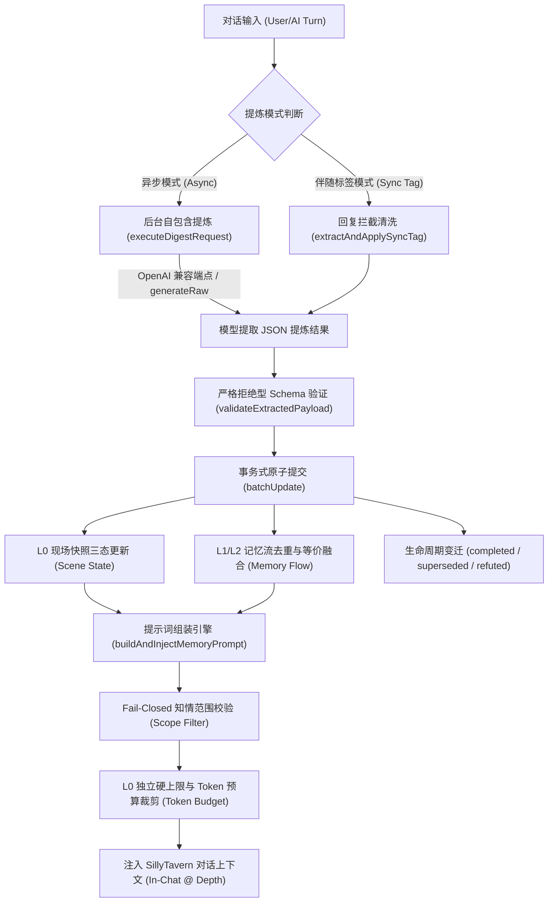

# SillyTavern 持续记忆插件 (ST-Persistent-Memory)

[](https://github.com/dayuseless/ST-Persistent-Memory)
[](https://github.com/SillyTavern/SillyTavern)
[](LICENSE)

> **定位**：SillyTavern Persistent Memory 是一套专为长文本角色扮演 (RP) 设计的持续性情境与记忆扩展系统。通过维护**现场即时快照 (L0 Scene State)**、**事实分级认知流 (L1/L2 Active Memories)** 与**多角色在场权限状态机**，确保 AI 在有限上下文窗口内始终牢记当下发生了什么、角色真正知晓什么，显著增强长程对话的情境连贯性，有效抑制跨轮失忆与身份逻辑穿帮。

---

## 🌟 核心特性与亮点

### 1. 现场快照 (L0 Scene State)
- **拒绝大而全的空洞摘要**：区别于传统“剧情总结”，L0 聚焦当前物理现场：**角色在哪里、处于何时/何种天气、在做什么、心理张力如何、现场遗留什么未决悬念、谁在场**。
- **独立硬预算上限保护**：L0 享受专属启发式 Token 硬上限（默认 ~150 tok），即使剧情再复杂也绝不撑爆上下文。
- **精准清空语义**：散伙离场或动作结束时自动清空，绝不留存旧动作幽灵。

### 2. 事实分级与防脑补纪律 (Fact Hierarchy)
- **事实与推测严格解耦**：
  - `fact`（客观物理事实）：已发生的可验证经历。
  - `statement`（言行约定）：角色亲口说过的话，不推定未来必然兑现。
  - `inference`（主观推断）：对心境、动机、怀疑的当下判断，随情节演化流转。
  - `todo`（即时待办）：未竟之约或即时行动目标。
- **防幻觉纪律**：空白代表角色确实未知，严禁模型为了情节顺畅而脑补未经证实的过去或动机。

### 3. 知情范围隔离与接收者权限路由 (Presence & Recipient Routing)
- **多角色权限分流**：
  - 🌐 `world`（公共世界常识）：全员通用。
  - 👥 `shared`（现场经历共知）：基于当前生成主体 (POV) 严格验证其是否在 `known_by` 知情列表中；若现场存在其他不知情者，自动附加保密约束标记。
  - 👤 `character`（角色私密经历）：基于生成目标主体严格路由，仅允许该角色本人生成时注入，离场或无关角色生成时自动静默休眠，不占额外 Token，严格防止群聊无关角色获悉私密记忆。
- **Fail-Closed 闭环保护**：生成主体无法确定时保守拒绝注入私密/共享记忆；缺失归属或知情者的非法条目直接拒绝入库。

### 4. 双模式提炼架构 (Dual Extraction Modes)
- ⚡ **异步后台独立提炼 (Async Mode)**：
  - 支持**通用 OpenAI 兼容接口**（包含 OpenAI 官方、DeepSeek、Claude 代理中转、通义千问、硅基流动、本地 Ollama / LM Studio / vLLM 等）。
  - 独立专属端点发起单轮自包含提取请求，**彻底隔绝主会话上下文与思维链丢失问题 (彻底解决 DeepSeek `400 Bad Request: reasoning_content must be passed` 报错)**。
  - 具备 **45 秒 AbortController 超时保护**，避免网络挂死锁定提炼通道。
  - **一键同步酒馆主 API**：点击按钮即可自动提取酒馆主界面配置的 Endpoint URL、Key 与模型名称，免去重复配置烦恼。
- 🏷️ **伴随标签模式 (Sync Tag Mode)**：
  - 在主回复末尾附加隐藏状态标签 `<!--PERSISTENT_MEMORY: ... -->`，由前端无感截获入库并从消息正文中剥离。
  - **零额外 API 调用与请求消耗**，适合 API 额度紧张或不支持多并发连接的环境；异常标签自动保留并提供 HUD 错误排查面板。

### 5. 密集向量语义检索与混合召回 (Semantic Retrieval & Hybrid Engine)
- 🧠 **双路混合召回 (Hybrid Retrieval)**：结合精确关键词词法匹配与密集向量余弦相似度（Dense Cosine Similarity），完美解决同义词或口语转述无法命中的难题（如记忆为“暴雨造成山洪”，对话提及“漫山遍野的泥浆浊流呼啸而下”，零关键词重合仍能精准召回）。
- ⚡ **零外部依赖本地嵌入 (Local Dense Vectorizer)**：内置专为浏览器与 Node.js 离线环境设计的多尺度字符 N-gram 与 FNV-1a 符号投射 256 维稠密特征向量引擎，毫秒级响应、确定性强、完全不耗费 API 额度与网络流量。
- 🌐 **通用 OpenAI 兼容外部向量接口**：支持接入外部专用 Embedding 模型（如 `text-embedding-3-small`、`bge-m3`、`nomic-embed-text`），具备超时保护与平滑降级机制。
- 🛡️ **语义加权绝不穿透知情权限**：任何高相似度得分都无法击穿角色私密经历与知情范围边界，未授权 POV 永远无法借由语义高分探测他人秘密。

### 6. 世界书关联条目与动态情境差量 (World Book / Lorebook Integration)
- 📖 **世界书动态差量补丁 (Dynamic Lorebook Delta)**：传统世界书多为静态设定（如“王城地下藏有秘宝”），持续记忆支持为记忆条目绑定世界书关联（`lorebook_ref`），将现实推进的差量动态追加在世界书设定之上，提示词注入时自动标注 `[世界书关联: 条目名]`。
- 🔒 **单会话安全提取 (Session-Scoped Extraction)**：自动读取当前对话绑定的 World Info、角色主世界书以及角色内置嵌合世界书（`character_book`），在提炼时将活跃条目安全提供给提炼模型，严格限制于当前单会话，杜绝跨会话或全局污染。
- 🚀 **双路检索相关性加成 (Dynamic Retrieval Boost)**：当对话提及世界书条目时，混合检索引擎自动为关联记忆赋予检索加权加成（默认 +0.35），优先将关联动态记忆精准召回至上下文。
- 🛡️ **严格 ACL 权限铁律与 Fail-Closed 闭环**：关联了世界书的私密或共享记忆，依然严格执行知情范围与生成 POV 过滤；当生成主体无法确认时执行 Fail-Closed 绝不注入，严防通过世界书泄露隐私。

### 7. 三重 UI 入口与清爽现代交互
- 📱 **屏幕快捷悬浮球**：右下角极简白底脑形气泡，支持触控拖拽、双端独立坐标记忆。
- 🧩 **顶部扩展快捷菜单**：深度融入酒馆顶部工具栏扩展下拉菜单（拼图/魔棒），随时一键唤起。
- ⚙️ **原生扩展设置抽屉 & 侧边 HUD 控制台**：
  - 记忆流管理：支持常驻置顶 (Pinned)、动态触发 (Triggered)、归档 (Archived) 一键切换。
  - 四维类型轮转：事实、约定、推断、待办一键点击更迭。
  - 即时现场快照修改器：随手手填或纠偏现场地点与角色。
  - 状态与生命周期显式流转：已履约 (`completed`)、已迭代 (`superseded`)、已证伪 (`refuted`) 实时徽标展示。

---

## 📥 安装方法

### 方式一：在 SillyTavern 扩展中心一键安装（推荐）

1. 打开 SillyTavern，点击顶部工具栏的 **扩展管理** 图标（拼图/积木块）。
2. 打开 **“安装扩展 (Install Extension)”** 选项卡。
3. 在 Git 仓库 URL 输入框中粘贴以下地址并点击安装：
   ```text
   https://github.com/dayuseless/ST-Persistent-Memory
   ```
4. 页面提示安装成功后，按 **`Ctrl + F5`** 刷新网页即可。

### 方式二：手动离线包安装

1. 从 [Releases 页面](https://github.com/dayuseless/ST-Persistent-Memory/releases) 下载 `ST-Persistent-Memory-v0.1.29.zip`。
2. 解压到 SillyTavern 的扩展目录中：
   ```text
   SillyTavern/public/scripts/extensions/third-party/ST-Persistent-Memory/
   ```
   *(多用户版本可放置于 `SillyTavern/data/default-user/extensions/ST-Persistent-Memory/`)*
3. 重启 SillyTavern 服务端并刷新浏览器即可。

---

## 🚀 快速上手指南

### 步骤 1：开启插件与入口

刷新酒馆后，你会在屏幕右下角看到一个白色的脑形悬浮球。你也可以点击顶部扩展菜单（拼图图标）找到 **“持续记忆”**。
点击即可滑出 HUD 侧边控制台。

### 步骤 2：配置提炼 API（极简推荐：一键同步）

1. 在控制台中切换到 **“设置与 API”** 选项卡（或在右侧酒馆扩展面板的折叠抽屉中）。
2. 勾选 **“启用独立提炼 API (自定义兼容 OpenAI)”**。
3. 点击 **`同步酒馆主 API`** 按钮：
   - 插件会自动读取你已经在酒馆主设置里填好的 Base URL、API Key 与 Model ID。
4. 点击 **`测试 API 连通性`**，看到绿色连通提示即表示配置成功！
5. 点击底部 **`保存并生效全部配置`**。

> 💡 **进阶提示**：你也可以将提炼端点指向成本更低的轻量模型（例如提炼用 `gpt-4o-mini` 或 `deepseek-chat`，而主聊用大模型），实现降本增效。

### 步骤 3：正常聊天，记忆自动运转

- 随着对话推进，插件会按照设定的频率（默认每 3 轮）在后台静默发起提炼，自动沉淀事实并维护现场快照。
- 你可以随时点击控制台顶部的 **“闪电 (⚡)”** 按钮手动触发一次即时提炼。
- 在“记忆流”列表中，你可以随时点击状态徽标将某条记忆设为“常驻置顶”或“归档”，也可以手动删除不准确的条目。

---

## 🏗️ 架构与数据流



---

## 🛠️ 控制台调试指令

在浏览器开发者工具控制台 (F12 Console) 中，提供了全局调试钩子：

```javascript
// 查看当前会话的快照与记忆全量数据
window.__persistentMemory.getState();

// 立即组装并测试提示词注入块
window.__persistentMemory.injectNow();

// 立即强制执行一次后台提炼
window.__persistentMemory.digestNow();
```

---

## 📝 版本历史

### v0.1.17 (全量历史回溯分块提炼：中途启用支持、楼层回退自愈与递进演化状态机)

- **全量与未消化历史回溯提炼管道 (Backlog / Full History Digestion)**：针对长程会话中途启用插件的用户，提供全新的分块滑动窗口回溯提炼引擎（`triggerBacklogDigest`）。将全量历史按时序划分为小步长批次（默认 8 条消息/批，2 条重叠保护语义连续），依次递进演化现场快照与长期认知，彻底解决中途启用用户“前几十轮历史无法被记忆”的空白痛点。
- **对话轮次回退自愈校准 (Floor Rewind Self-Healing)**：修复用户撤回消息、重载旧分支或删除末尾轮次时导致的提炼“假死”隐患。当检测到当前实际轮次小于历史记录的 `last_digest_floor` 时，自动感知并校准提炼基准楼层，确保后续对话能无缝自动恢复提炼。
- **中途启用智能引导与交互横幅 (Smart Mid-Chat Onboarding)**：当检测到会话已有较长历史（$\ge 6$ 条消息）但记忆库为空时，HUD 顶部自动展示友好的智能引导横幅，支持一键点击启动全量回溯；控制台顶部新增“回溯提炼”快捷按钮，自由选择“从头全量提炼”或“增量补全未消化历史”。
- **实时进度反馈与随时安全中止 (Live Progress & Abort Guard)**：回溯执行期间，HUD 实时呈现带旋转动效的百分比进度条、批次计数与已沉淀记忆数；提供一键“中止”按钮与会话切换自动熔断拦截，绝不发生跨会话污染或挂死。
- **测试矩阵扩展至 41 项 (T1-T41 全绿)**：新增针对对话轮次回退自愈校准 (T40) 与全量历史分块回溯多批次递进提炼 (T41) 的自动化测试覆盖。

### v0.1.29 (准出权限收敛：统一 POV 访问控制、保密提示与输入输出双向 ACL 对称)

- **准出端权限路由统一收口至 ACL 服务 (Egress Access Control / POV Routing Gate)**：
  - 在 `src/acl.js` 中新增核心准出判定函数 `canRecipientAccessMemory(memory, recipient, inSceneCharacters, options)`，彻底收敛原本内嵌在提示词注入引擎 (`src/injector.js`) 中的分散权限判定逻辑。
  - **角色私密经历严格私有隔离**：仅允许归属角色自身生成时（`mem.character === recipient`）作为 POV 接收；跨主体生成坚决拒绝。
  - **现场共享机密与不知情者保密预警**：生成主体必须位于 `known_by` 知情列表中；当现场存在其他不知情者（Outsiders）时，自动计算并附加保密提示（`[保密提示: 现场存在不知情者 X，当前角色切勿透露此秘密]`），防止大模型穿帮失言。
  - **物理在场核验 (In-Scene Presence)**：受限记忆强制核验生成主体当下是否在物理现场名单中，离场角色记忆自动静默休眠，杜绝跨空域千里传音。
  - **Fail-Closed 闭环**：当生成主体缺失或无法确定时，角色私密与现场共享记忆一律严格拒绝注入，仅放行全域公共常识（`world`）。
- **访问控制层双向对称性闭环 (Bidirectional ACL Symmetry)**：
  - 数据准入（Ingress）由 `validateMemoryAcl` 严密把关，数据准出（Egress）由 `canRecipientAccessMemory` 严密把关，形成输入/输出全链路 100% 由 `src/acl.js` 裁决的对称式权限闭环，彻底根除注入端规则越权逃逸风险。
- **自动化测试矩阵扩展至 80 项 (T1-T80 全绿)**：
  - 新增针对准出端 POV 访问控制单元测试 (T78)、注入引擎协同路由与保密加固测试 (T79)、双向对称性契约验证 (T80) 的全自动化回归测试。

### v0.1.28 (架构解耦：统一 ACL 访问控制层、数据准入流水线与权限变更审计)

- **权限规则与业务操作解耦 (Unified ACL & Ingestion Gate)**：
  - 新增独立安全核心模块 `src/acl.js`，将原本分散在提炼 (`extractor.js`)、导入 (`state.js`)、手工录入 (`ui.js`) 中的权限校验逻辑彻底抽象收敛。
  - 各业务入口不再各自为战，统一交由 ACL 判定层（`validateMemoryAcl` / `normalizeAndValidateMemory`）执行权威决策，杜绝权限边界漂移与特权旁路。
- **数据结构与数据来源解耦 (Provenance != Credibility)**：
  - 严格确立核心架构纪律——“数据来源不等于数据可信度”。外部数据无论源自 AI 自动提炼、历史回溯、备份文件导入、长程宏观归并还是人工手动录入，全链路经由统一数据准入流水线：格式规范化 ➔ 结构合法性校验 ➔ 权威参与者 ACL 校验 ➔ 越权提权防线 ➔ 纯净记忆落盘。
  - 严格落实 Fail-Closed 原则，未通过准入校验的数据坚决拦截，受限私密与共享记忆绝不静默降级为 `world` 公共记忆。
- **越权提权防线与继承性保障 (Escalation Guard & Inheritance)**：
  - 抽象并统一 `checkAclEscalation` 判定函数，针对语义高度吻合（相似度 $\ge 0.70$）的新增条目，严禁将既有私密记忆提权为公共记忆 (`character` ➔ `world`)、严禁向共享记忆擅自追加知情者 (`known_by`)、严禁借相似条目将角色私知所有权转移给其他角色，强制继承既有条目 ACL。
- **关键权限流转审计留痕 (Permission Mutation Audit Trail)**：
  - 在系统全局状态中建立统一的 `acl_audit_log` 环形队列（硬上限 30 条），自动记录世界书升格 (`promote_world_info`)、越权提权拦截 (`scope_escalation_blocked`) 与备份导入越权拦截 (`import_acl_rejected`)，实现关键权限变更的全生命周期透明追溯与留痕。
- **自动化测试矩阵扩展至 77 项 (T1-T77 全绿)**：
  - 新增针对统一 ACL 判定层单元测试 (T72)、统一数据准入规范化流水线测试 (T73)、数据来源与可信度解耦跨端一致性测试 (T74)、越权提权防线与继承性测试 (T75)、统一安全审计日志环形缓冲区测试 (T76) 以及状态机持久化契约验证 (T77) 的全量自动化测试覆盖。

### v0.1.27 (安全审计加固：数据导入全链路参与者校验、世界书升格权限提示与版本统一)

- **备份导入全链路参与者白名单校验 (Import ACL Boundary Hardening, P1 修复)**：
  - **对齐提炼入口最高防护级别**：彻底消除数据导入（`importMemoryData`）与模型提炼入口的权限边界差异。在导入记忆数据（无论是 `merge` 增量合并还是 `replace` 全量覆盖模式）时，全面调用权威参与者白名单 `getContextParticipants()`。
  - **跨会话越权记忆坚决拦截**：单聊模式下坚决拦截非当前参战角色的私密记忆（`character`）及包含非参战角色的共享记忆（`shared`），严禁未参战角色的隐私记忆渗透入库；受限记忆绝不静默降级为 `world` 公共记忆，执行严格的 Fail-Closed 拦截。
  - **导入结果透明审计**：`importMemoryData` 结果中明确返回 `aclRejected` 计数，UI 层弹出即时 Toastr 安全预警，向用户清晰披露拦截条数与原因。
- **世界书升格权限范围提示与溯源追溯 (Lorebook Promotion Escalation Guard & Traceability, P2 修复)**：
  - **显式权限扩散预警与二次确认**：当用户尝试将【角色私密 (`character`)】或【现场机密 (`shared`)】记忆升格为独立世界书词条时，升格弹窗顶部自动弹出醒目的琥珀色权限变更预警，提醒用户世界书条目将向绑定该书的所有会话与角色开放常驻；必须主动勾选「安全确认：确认授权可见范围扩大」复选框方可确认升格，杜绝误触导致的知情权外泄。
  - **全生命周期溯源追溯凭据**：在记忆的 `lorebook_ref` 中完整持久化 `promoted_from_scope`、`original_character` 与 `original_known_by`，同时在世界书词条 `comment` 注释中明确附加原始归属标记（如 `[持续记忆·私密(角色A)]`、`[持续记忆·机密(知情:角色A,玩家)]`），便于后续审计与多会话溯源。
  - **极端边界与只读卡片资源防御**：强化对世界书非数字 UID 的过滤与自增分配，并在遇到只读角色卡内置世界书 (`character_embedded`) 或空正文时予以安全拦截并友好提示。
- **全工程版本标识严格统一 (P3 修复)**：
  - 彻底修正 `index.js` 第一行滞后的 `v0.1.18` 版本头，将 `manifest.json`、`src/config.js`、`index.js` 以及所有核心模块（`src/state.js`, `src/extractor.js`, `src/injector.js`, `src/semantic.js`, `src/ui.js`）头部注释严格统一为 `v0.1.27`。
- **自动化测试矩阵扩展至 71 项 (T1-T71 全绿)**：
  - 新增针对单聊备份导入拦截未参战角色私密记忆 (T65)、共享记忆非当前参战者越权渗入拦截 (T66)、replace 与 merge 模式 ACL 约束等价性 (T67)、世界书升格受限记忆权限预警与强制确认 (T68)、世界书升格条目全生命周期溯源追溯 (T69)、世界书升格边界极端容错 (T70) 以及全工程各模块版本标识统一一致性扫描 (T71) 的全量自动化测试。

### v0.1.26 (安全审计加固：权威白名单权限收敛、历史回溯中止与并发竞态修复)

- **权威可信参与者白名单边界加固 (Authoritative Participant Boundary, P1-01 修复)**：
  - **单聊/群聊模式严格过滤**：彻底修复原先将 SillyTavern 全局角色库 (`context.characters`) 全部纳入白名单的跨会话权限扩大漏洞。单聊模式下严格限定参与者为玩家 (`name1`) 与当前单聊角色 (`name2` / `characters[characterId]`)；群聊模式下通过 `groupId` 索引实际群组定义中的 `members` 成员解析合法群角色，未参战角色严禁进入白名单。
  - **现场叙事角色与授权凭证彻底解耦**：彻底剥离将 `state.scene.in_scene_characters` 纳入白名单的旧逻辑，彻底消除模型在现场描述中生成临时 NPC 或幻觉角色后下一轮自动获得知情权 (`known_by`) 的循环提权漏洞。现场角色仅作为叙事状态呈现，绝不可作为 memory ACL 授权依据。
- **历史回溯中止与任务生命周期竞态加固 (Backlog Abort & Concurrency Hardening, P1-02 修复)**：
  - **修复中止信号丢失**：重构 `abortBacklogDigest`，消除立即置空 `backlogAbortController` 导致循环中 `signal.aborted` 计算为 `undefined` 的致命失效漏洞。
  - **局部任务生命周期与任务 ID 隔离**：引入递增 `backlogTaskIdCounter` 与局部 `task` 上下文，彻底解决旧任务 A 被中止后用户快速发起新任务 B 时，旧任务 `finally` 误清除新任务控制器的并发状态错乱缺陷。
  - **AbortSignal 级联与全链路检查点**：在底层 `executeDigestRequest`、`withTimeout` 及 fetch 路径全程透传 `signal`；在网络请求发出前、请求返回后、批次落盘前建立多级中止拦截点，确保中止后毫秒级退出且绝不向数据库写入任何脏数据。
- **历史回溯总输入 Token 预算硬约束 (Backlog Input Token Budget, P2-02 修复)**：
  - 在全量历史回溯中引入与日常提炼一致的单批次总对话字符上限 (`MAX_TOTAL_CONVERSATION_CHARS = 3500`) 与单条 1000 字符安全压缩，采用逆序优先保留最新完整轮次策略，彻底杜绝超长历史消息撑爆上下文与超额 API 费用。
- **模块源码版本头与规范统一 (P3 修复)**：
  - 全面纠正并统一各核心模块源码文件头版本注释（`src/state.js`, `src/extractor.js`, `src/injector.js`, `src/ui.js` 统一升格至 `v0.1.26`）。
- **测试矩阵扩展至 64 项 (T1-T64 全绿)**：新增针对单聊/群聊排除无关库角色 (T60)、现场叙事角色解耦与循环提权拦截 (T61)、历史回溯请求期间可靠中止防脏数据落盘 (T62)、任务 A 中止后立即启动任务 B 的生命周期隔离 (T63)、历史回溯总字符预算硬约束与压缩 (T64) 的全自动化回归测试。

### v0.1.25 (P2核心推进：记忆一键升格世界书新词条与智能增量提炼节律)

- **记忆一键升格为世界书独立新词条 (Promote Memory to Lorebook Entry)**：
  - 在记忆卡片底部新增 **“👑 升格词条”** 专属按钮（未关联已有世界书条目时展示），支持将重大剧情里程碑（如击破魔王、获得神器、缔结神圣契约等动态事实）一键升格为独立、永久常驻的世界书新词条。
  - 自动分配连续无冲突的数字 UID（现有条目最大 UID + 1），规范装配酒馆标准条目结构（Comment、Keys、Content、Selective=true 等），安全调用 ST 原生 `saveWorldInfo` 接口落盘。
  - 升格成功后自动反向将 `lorebook_ref`（包含书名、词条名、UID）绑定至该条记忆并标记已入册，同时默认将该记忆流转至 `completed`（办结）终态，避免在动态记忆与世界书之间重复双重注入。
  - 内置角色卡只读内嵌世界书（Embedded Book）安全拦截，杜绝非法写入只读卡片资源。
- **智能信息增量感知与自适应提炼节律 (Adaptive Extraction Cadence)**：
  - 智能感知近期增量对话内容量，杜绝日常短句寒暄（如“好的”、“嗯”、“晚安”）频繁触发后台提炼造成的 Token 浪费与 API 费用开销。
  - 在未达实质剧情推进字数门槛（默认 60 字符，可自由配置 20-500 字）时智能顺延提炼，不浪费任何 LLM API 请求。
  - 设置最大推迟轮数硬上限保底（默认 `2 * frequency` 轮），确保即使持续短对话也不会永远停滞提炼；手动触发提炼（Force Digest）无条件绕过门槛直接执行。
  - 在插件设置面板与原生扩展抽屉提供完整的开关与字符门槛配置控件。
- **测试矩阵扩展至 59 项 (T1-T59 全绿)**：新增针对记忆升格世界书新词条与双向绑定 (T58)、智能信息增量感知与自适应提炼节律全场景验证 (T59) 的自动化测试覆盖。

### v0.1.24 (P1核心增强：现场快照时光机、思考型推理模型适配与自定义注入模板)

- **现场快照时光机与一键回滚 (Snapshot History & Rollback)**：
  - 内部自动维护最近 10 次快照变更历史栈，具备连续变更去重保护与原因追踪（记录模型提炼、手动保存等来源）。
  - HUD 现场快照面板增加 **“↩ 撤销回滚”** 专属按钮与当前历史版本计数，支持一键秒级还原至上一快照。
  - 提供可折叠的 **“快照时光机”** 历史版本列表，实时预览历史版本地点、动作、轮次与时间戳，支持一键将现场恢复至任意历史快照，彻底根治模型脑补与幻觉导致的情境偏移。
- **思考型推理模型 (`<think>`) 深度适配与防截断自愈 (Reasoning Model Adaptation)**：
  - 新增深度思考链清洗器 `stripThinkingTags`，原生适配 DeepSeek-R1、QwQ、Claude 等前沿思考推理模型，自动彻底清洗各类 `<think>`、`<thought>`、`[Thinking Process: ...]` 等思维链标签。
  - 智能未闭合思考标签自愈：若模型因 Token 限制或截断未输出 `</think>` 但输出了合法 JSON，清洗器精准定位 JSON 起始，绝不吞没有效数据。
  - 优化提炼 System Prompt，指引具备思维链的模型保持内部推导紧凑，确保 100% 聚焦输出合法标准 JSON。
- **自定义提示词注入格式模板 (Custom Injection Templates)**：
  - 在设置面板与原生扩展抽屉新增 **提示词注入格式模板选择器**，支持 4 种模板无缝切换：
    - 🇨🇳 **标准中文 Standard**（默认，经典中文 RP 首选）
    - 🏷️ **结构化 XML**（`<persistent_memory><scene_state>...</scene_state><active_memories>...</active_memories></persistent_memory>`，推荐 Claude 3.5 Sonnet / GPT-4o，标签遵守度极佳）
    - 🇬🇧 **英文原生 English**（`[Current Scene State]`, `Location:`, `Statement/Promise:`, 原生英文前缀，绝不带偏英文角色卡语言）
    - ⚡ **极简紧凑 Compact**（去掉多余装饰行与空隙，极致节省 Token 开销）
- **测试矩阵扩展至 57 项 (T1-T57 全绿)**：新增针对现场快照时光机入栈与回滚 (T55)、思考型模型标签清洗与未闭合自愈 (T56)、自定义注入格式模板渲染与预算自洽 (T57) 的全自动化测试覆盖。

### v0.1.23 (P0交互增强：实时搜索、批量管理、主流API预设与动态预算弹性扩容)

- **HUD 记忆流实时搜索框 (Real-time Memory Stream Search)**：记忆卡片顶部新增高响应度搜索框，支持即时按正文内容、关键词、角色过滤记忆卡片，带有一键清空按钮，即使存在上百条记忆也能秒级定位目标条目。
- **批量管理工具栏 (Batch Management Toolbar)**：
  - 记忆卡片支持多选复选框，选中卡片高亮显式呈现。
  - 顶部工具栏提供全选/反选与实时选中计数，支持一键**批量常驻（Pinned）**、**批量激活（Triggered）**、**批量归档（Archived）**与**批量删除（带二次确认拦截）**。
- **内置主流 API 模型预设 (API Provider Presets)**：在 HUD 和酒馆原生设置抽屉中内置 5 大主流供应商一键填充预设：
  - **DeepSeek 官方**（`api.deepseek.com` / `deepseek-chat`）
  - **硅基流动 SiliconFlow**（`api.siliconflow.cn/v1` / `deepseek-ai/DeepSeek-V3`）
  - **本地 Ollama**（`http://127.0.0.1:11434/v1` / `qwen2.5:7b`）
  - **OpenAI 官方**（`api.openai.com/v1` / `gpt-4o-mini`）
  - **OpenRouter**（`openrouter.ai/api/v1` / `deepseek/deepseek-chat`）
- **动态预算弹性扩容与字数自适应 (Dynamic Budget Elastic Scaling)**：
  - **根治“调高摘要字数与 Token 预算后好像没用”的问题**：
  - **提示词动态弹性放宽**：取消原先对提炼模型硬编码的“≤40字”限制；当用户调高现场快照预算（$\ge 220$）或总预算（$\ge 800$）时，提炼提示词自动指导模型输出长达 80~250 字符的丰富细节。
  - **Schema 清洗边界弹性自适应**：取消原先对快照动作（150字）与记忆正文（100字）的机械硬截断，改为根据 `maxSceneTokens` 与 `maxTotalMemoryTokens` 动态按比例计算安全截断边界（动作最高允许 800 字符，记忆正文最高允许 400 字符）。
  - **注入器条数突破硬编码**：打破原先常驻 5 条、激活 5 条的硬上限，注入器随总预算弹性扩展（常驻最高 15 条，激活最高 30 条），并在设置面板中提供 `maxPinnedCount` 与 `maxTriggeredCount` 显式配置，允许总预算上限设置到 2500。
- **现场快照动作多行文本域 (Multi-line Scene Action Textarea)**：现场快照中的“正在进行”动作输入框升级为支持自适应拉伸的多行 `<textarea>`，方便输入与微调复杂细腻的动作描写。
- **测试矩阵扩展至 54 项 (T1-T54 全绿)**：新增针对动态字符截断边界放宽 (T53) 与总预算调高弹性扩容注入条数 (T54) 的全自动化测试断言。

### v0.1.16 (世界书深度协同：设定复合筛选、安全差量写回钩子与全流程防重矩阵)

- **按关联世界书条目复合筛选 (Lorebook & Lifecycle Filter)**：在 HUD 记忆流控制台顶部引入设定筛选选择器，支持按“全部设定”、“未关联设定”以及各个具体关联条目（如 `📖 断钢圣剑 (3)`）快速筛选聚合记忆。与既有的生命周期筛选（活跃/归档/全部）无缝组合，大幅提升长程复杂跑团中某项专属设定的演进回溯体验。
- **安全事实差量写回机制 (Write-Back Hook)**：记忆卡片新增“写入设定 / 已入册”快捷操作。支持将长程剧情中沉淀的动态客观事实（例如“圣剑在第三章折断”），一键安全写回至静态世界书文件的对应条目末尾，实现从“动态记忆差量”到“静态设定常驻”的安全沉淀闭环。
- **差异预览与用户二次确认 (Dry-Run Preview & Confirmation Modal)**：严格遵循用户知情权原则，写回操作前自动发起 Dry-Run 校验并弹出差异预览浮层，清晰展示目标世界书、条目 UID、条目名以及拟追加的带日期标记事实差量；提供“同步后将本记忆置为【履约/办结】”可选开关，杜绝静默隐式修改。
- **强幂等防重与安全边界防护**：内置严格幂等防重检查，当目标条目正文已包含该记忆内容时拒绝重复写入；对角色卡内置只读世界书（Embedded Character Book）提供只读拦截与安全提示；自动自愈更新条目的 `file_name` 与 `entry_uid` 绑定信息。
- **测试矩阵扩展至 39 项 (T1-T39 全绿)**：新增针对双维复合筛选规则 (T38) 与写回钩子完整流程（预览、提交、生命周期流转、幂等防重及只读拦截）(T39) 的自动化测试覆盖。

### v0.1.15 (世界书关联与协同：会话级设定提取、动态差量注入、双路加权与权限边界锁)

- **世界书条目动态关联架构 (World Book Linking & Delta)**：构建记忆条目与静态世界书 (Lorebook / World Info) 的动态关联链路（`lorebook_ref: { file_name, entry_uid, entry_name }`）。让 AI 在长程剧情推进中，将持续变化的事态演化作为静态世界书的“动态差量补丁”，生成提示词注入时自动标注 `[世界书关联: 条目名]`。
- **单会话安全提取与上下文协同 (Session-Scoped Lore Extraction)**：严格遵守单会话安全边界（第一阶段不跨会话），安全解析当前会话绑定的聊天世界书 (`chatMetadata.world_info`)、角色主世界书以及角色内置嵌合世界书 (`character_book`)，在提炼请求中以只读安全上下文形式呈现活跃世界书条目，引导模型精准关联而绝不触碰全局文件。
- **世界书输入防御与原型污染免疫 (Lorebook Ref Sanitization)**：引入 `sanitizeLorebookRef` 校验层，对来自外部导入、旧数据迁移或提炼模型自报的 `lorebook_ref` 执行严格类型过滤、100 字符安全限长与非法原型键剥离，杜绝对象注入与污染。
- **双路检索世界书激活加成 (Dynamic Retrieval Boost)**：当对话或近期上下文出现世界书条目关键词时，混合检索引擎自动为关联记忆叠加动态激活加权（默认 +0.35），并在向量表征中嵌入世界书标记，使相关动态经历优先召回。
- **权限边界绝对不穿透 (Fail-Closed ACL & POV Boundary Invariant)**：确立严密的权限铁律——世界书关联绝不能成为绕过知情权限的后门。`character` 私密与 `shared` 共享记忆即使关联了世界书，依然必须经过严格的生成 POV 身份核验；主体无法核实或未授权时严格保守拒绝注入 (Fail-Closed)。
- **UI 原位交互与控制面板**：卡片头部展示清爽青蓝色 `[📖 条目名]` 徽标，支持卡片原位行内快速修改世界书关联；控制台新增世界书协同控制卡片，支持实时调节激活加成滑块、查看当前绑定的活跃世界书名称与条目数。
- **测试矩阵扩展至 37 项 (T1-T37 全绿)**：新增针对会话级世界书安全解析 (T33)、输入校验与原型污染防护 (T34)、动态提示词注入与检索加成 (T35)、世界书关联私密记忆 POV 权限绝对拦截 (T36)、行内编辑与导入更新世界书关联 (T37) 的全方位自动化测试。

### v0.1.14 (语义检索基建：密集向量嵌入、混合检索融合与多源 Embedding 支持)

- **语义检索与向量基建 (Semantic Retrieval Infrastructure)**：实现词法匹配（精确关键词）与密集向量余弦相似度（Dense Cosine Similarity）的混合双路召回引擎。彻底解决同义词与概念转述无法激活的问题（如记忆中为“海啸爆发”，对话提到“巨浪疯狂席卷吞没村落”，无相同关键字仍可精准召回）。
- **内置零依赖轻量向量引擎 (Local Dense Vectorizer)**：专为浏览器与 Node.js 离线环境设计的多尺度字符 N-gram 与 FNV-1a 符号投射 256 维稠密特征向量，无需外部模型、零网络依赖、毫秒级响应且 100% 确定性。
- **通用 OpenAI 兼容 Embedding 接口支持**：支持配置独立的 Embedding Base URL、Key 与模型（如 `text-embedding-3-small`、`bge-m3`、`nomic-embed-text`），具备超时保护与网络异常时的本地平滑优雅降级。
- **全生命周期向量缓存与失效感知**：条目创建、修改正文或触发词、导入时自动感知失效并增量同步向量缓存；支持在控制台一键全库向量重建索引。
- **权限安全边界绝对免疫 (Semantic ACL Invariant)**：确立严密的权限不变量——任何高分语义匹配绝不可穿透角色私密（`character`）或共享（`shared`）边界，未授权 POV 永远无法借由语义高分探测他人秘密。
- **API Key 双重安全脱敏**：`embeddingApiKey` 与提炼 Key 一道享受完整的 `localStorage` 备份脱敏防护，杜绝明文密钥泄漏。
- **测试矩阵扩展至 32 项 (T1-T32 全绿)**：新增向量余弦数学与确定性 (T28)、无关键词同义语义激活 (T29)、高语义得分权限绝对免疫 (T30)、向量失效与重构 (T31) 及密钥脱敏 (T32) 的自动化测试覆盖。

### v0.1.13 (归并时序安全、跨会话竞态拦截与生命周期边界自洽)

- **归并执行时序反转安全 (Consolidation Sequencing Fix)**：修复归并入库与旧条目废弃的时序隐患。先将 `supersedes` 关联的旧条目置为 `superseded`，再执行新概括条目入库，彻底杜绝由于文本高相似度（$\ge 0.70$）误触发同库合并导致新记忆被误吞并随同旧条目连带归档失踪的逻辑缺陷。
- **长程归并跨会话隔离拦截 (Cross-Session Async Guard)**：在异步归并请求完成返回后，严格比对 `finishChatId === startChatId`，若检测到用户在模型生成等待期间切换了聊天会话，立即安全丢弃该归并提交，防止归并结果污染新会话或破坏旧会话生命周期。
- **检索休眠记忆隔离防护 (Hibernated Memory Isolation)**：修正归并候选集收集规则，严格限定候选记忆为 `status === triggered`，防止用户主动设置为 `archived`（检索休眠）但事实仍然有效的核心条目被误纳入归并并被意外废弃。
- **终态回收与休眠检索严格解耦 (Terminal Lifecycle Purge Fix)**：`purgeArchivedMemories` 垃圾回收严格依据生命周期终态（`completed` / `superseded` / `refuted`）执行过滤，保护所有 `lifecycle === 'active'` 的条目（即使其处于 `status === 'archived'` 检索休眠状态），确保事实真实性与检索激活状态的严格正交解耦。
- **外部数据导入知情范围归一化 (Import Scope Normalization)**：导入 `character` 私密记忆时强制规整知情者名单为当前单一角色，杜绝从外部备份恢复时出现权限范围模糊或知情者脏数据。
- **测试矩阵扩展至 27 项 (T1-T27 全绿)**：新增归并时序反转与相似隔离 (T26) 及异步切换会话安全拦截 (T27) 的完整自动化测试断言。

### v0.1.12 (记忆周期演进：长程宏观归并、归档抽屉与终态垃圾回收)

- **长程记忆高阶归并 (Memory Consolidation Engine)**：支持将多条阶段性、细节性历史事件一键/自动浓缩为一条宏观概括事实，被涵盖的旧记忆自动流转为 `superseded`（已被迭代）退出日常上下文注入，极大降低长文本 Token 占用。
- **严格归并权限边界安全 (Consolidation ACL Invariants)**：强制基于知情范围与角色分组归并，严禁将私密记忆与公共常识混同，新归并事实强制继承源条目的权限边界，杜绝越权提权。
- **记忆视图三态过滤 (All / Active / Archived)**：记忆列表支持按“活跃”、“归档/终态”、“全部”一键切换查看，不再被长历史拉垮界面。
- **终态记忆垃圾回收 (Purge Terminal Memories)**：在归档视图提供一键彻底清理已履约 (`completed`)、已迭代 (`superseded`)、已证伪 (`refuted`) 终态历史的功能。
- **测试矩阵扩展至 25 项 (T1-T25 全绿)**：新增归并候选分组隔离 (T23)、跨组提权拦截与 Schema 校验 (T24)、终态垃圾回收 (T25) 的自动化测试覆盖。

### v0.1.11 (用户体验升级：卡片行内即时编辑与数据备份迁移)

- **卡片原位即时编辑 (Inline Text & Keywords Editing)**：记忆卡片顶部新增编辑按钮（铅笔图标 ✏️），支持就地快速修改记忆正文与触发词，具备 150 字符安全限制与即时保存/取消能力，改错字更无需删库重加。
- **记忆数据备份与跨会话迁移 (JSON Export & Import)**：在设置面板新增一键导出当前会话的现场快照与全部记忆库为标准 JSON 文件，并支持选择外部备份文件进行智能合并导入（自动跳过重复内容、重塑冲突 ID、校验清洗字段）。
- **测试矩阵扩展至 22 项 (T1-T22 全绿)**：新增针对行内编辑规范化校验 (T21) 与数据导出/去重合并 (T22) 的自动化测试覆盖。

### v0.1.10 (ACL权限边界校验、XSS免疫、容错迁移与20项验证矩阵)

- **P0-1 提炼知情者白名单核验 (ACL Boundary)**：模型提炼产出的 `known_by` 与私密归属 `character` 必须严格属于权威会话参与者名单（包含玩家、当前角色、全部群聊成员及现场角色）；严禁模型受注入影响擅自捏造局外已知者，杜绝越权信息渗透。
- **P0-2 存储型属性注入与 XSS 防御**：在 UI 卡片渲染与状态载入层双重严格落实 `type` 枚举白名单过滤，彻底消除利用畸形属性突破 `class="... pm-type-${curType}"` 引发的浏览器端脚本执行风险。
- **P1-1 历史数据迁移知情权保守化**：针对早期未设定知情范围的旧条目，遵循严格封闭原则归属为当前角色私密（`CHARACTER`），严禁自动升级扩大为两方共享秘密，杜绝历史记忆知情范围失控膨胀。
- **P1-2 损坏记忆数据自愈与容错**：在元数据载入迁移环节引入防御性类型与结构过滤，剔除 `null`、非对象及空白条目，免疫异常元数据导致的迁移中断或插件崩溃。
- **测试矩阵扩展至 20 项 (T1-T20 全绿)**：新增针对非参与者知情白名单核验 (T17)、恶意类型属性注入净化 (T18)、旧数据保守化范围约束 (T19) 与损坏元数据自愈容错 (T20) 的自动化断言。

### v0.1.9 (事务提交、知情权限与预算边界修复)

- **原子提交修复**：批量更新在成功路径直接执行内部持久化，保证聊天元数据与 `state_revision` 恰好提交一次；异常路径仍完整回滚。
- **ACL 收敛**：`known_by` 与 `scope` 均作为权限对象处理。相似记忆不得扩大共享知情者集合，也不得把角色私知转移给另一角色。
- **提炼数据最小化**：提炼请求优先按显式现场角色过滤私密和共享记忆；仅在现场未知时才按近期对话回退。
- **异步可靠性**：修复异常路径的状态引用；原生 `generateRaw` 与 `generateQuietPrompt` 也具备超时后的结果丢弃与锁释放保护。
- **注入边界**：`scene.time` 可独立输出，空角色数组表示有效空场景；总 Token 预算不足时自动改用紧凑同步协议，不再挤占可选记忆预算。
- **可观测性与测试**：同步标签错误可跨重载保留并有 4,000 字符上限；测试矩阵扩展至 16 项，覆盖事务成功提交、ACL 扩张、生产过滤器、低预算和超时。

### v0.1.8 (架构边界与安全加固)
- **P1-01 角色级接收者权限隔离 (POV-based Routing)**：重构知情范围过滤机制，基于当前实际生成对象 (POV) 进行记忆权限路由。私密记忆仅允许路由给该角色生成的提示词；共享记忆严格要求当前生成角色必须在 `known_by` 知情列表中；现场存在不知情角色时自动附加保密约束标记；生成主体无法确定时执行 Fail-Closed 仅注入公共常识。
- **P1-02 真正原子回滚事务**：重构 `batchUpdate`，在执行前创建内存状态完整深拷贝快照，执行过程中发生任何未捕获异常均完整回滚内存状态，杜绝局部脏数据落盘。
- **P1-03 提权注入防线 (Scope Escalation Guard)**：禁止模型通过输出 `world` 擅自扩大私有或共享条目的知情范围；相似已有条目禁止单方面提升权限；限制单条记忆最大长度 (150 字)。
- **P1-04 API Key 脱敏存储**：剥离 `localStorage` 备份中的明文 API Key，回写安全过滤，确保密钥仅在安全环境中受控持有。
- **P2-01 L0 时间维度补齐**：将 `scene.time`（时段/天气）纳入快照判定，修复仅有时间信息时快照被判定为空的缺陷。
- **P2-02 真实 Token 预算全开销扣除**：扩展 CJK 字符估算支持韩文音节与字母 (Hangul)；将伴随协议 (Sync Protocol) 与模板固定开销全量纳入总 Token 预算先期扣减。
- **P2-03 提炼请求超时保护**：异步提炼与连通性测试引入 `AbortController` 45 秒 / 15 秒硬超时保护，网络挂起时自动释放并发任务锁。
- **P2-04 会话切片输入预算上限**：提炼历史消息引入单条 1000 字符安全压缩与 3500 字符总上限，逆序保留最新完整轮次，杜绝机械腰斩与超额 API 费用。
- **P2-05 伴生标签异常留存**：伴生标签解析或验证失败不再静默丢弃，错误原因与原始片段存入状态并在 HUD 控制台呈现。
- **P2-06 旧版本记忆平滑迁移**：无知情范围旧单聊记忆自动对齐为参与者共享并输出统计报告，杜绝历史记忆静默休眠。

### v0.1.7
- **手动录入类型支持**：在 HUD 控制台手动新增条目面板中，新增记忆类型选择器（📌 客观事实 `fact` / 💬 言行约定 `statement` / 🧠 主观推断 `inference` / 📝 即时待办 `todo`），彻底打破原先手动添加只能默认为 `fact` 的限制。
- **卡片类型一键轮转**：记忆卡片顶部类型徽章支持直接点击切换（`fact` ➔ `statement` ➔ `inference` ➔ `todo`），随心订正条目分类。
- **色彩语义强化**：各类记忆拥有专属高对比度配色徽标（事实灰蓝、约定科技蓝、推断高贵紫、待办琥珀金），辨识度倍增。

### v0.1.6
- **核心修复**：排除了注入引擎内部重复声明的致命编译错误；启动生命周期重构为 UI 优先加载，彻底根治插件抽屉与悬浮窗偶发消失的问题。
- **全模型通用兼容**：独立提炼端点升级为通用 OpenAI 兼容格式，全面接入官方 OpenAI、DeepSeek、Claude 代理中转、通义千问、硅基流动、本地 Ollama / LM Studio / vLLM。
- **一键同步**：新增一键从酒馆原生连接设置中自动同步端点 URL、API Key 与模型的便捷功能。
- **三重 UI 入口**：新增顶部工具栏扩展下拉菜单（`#extensionsMenu`）一键直达入口。
- **深色/浅色自适应优化**：UI 界面采用高对比度现代工业风设计，数字读数更清晰。

### v0.1.5
- 引入事务式原子提交机制 (`batchUpdate`)，消除写入竞态。
- 增强防提示词注入隔离区与文学文本不可信边界。
- 修复知情者等价合并与私有角色记忆 Fail-Closed 拦截。

---

## 📄 开源许可证

本项目基于 [MIT License](LICENSE) 开源。欢迎提交 Issue 与 Pull Request！
