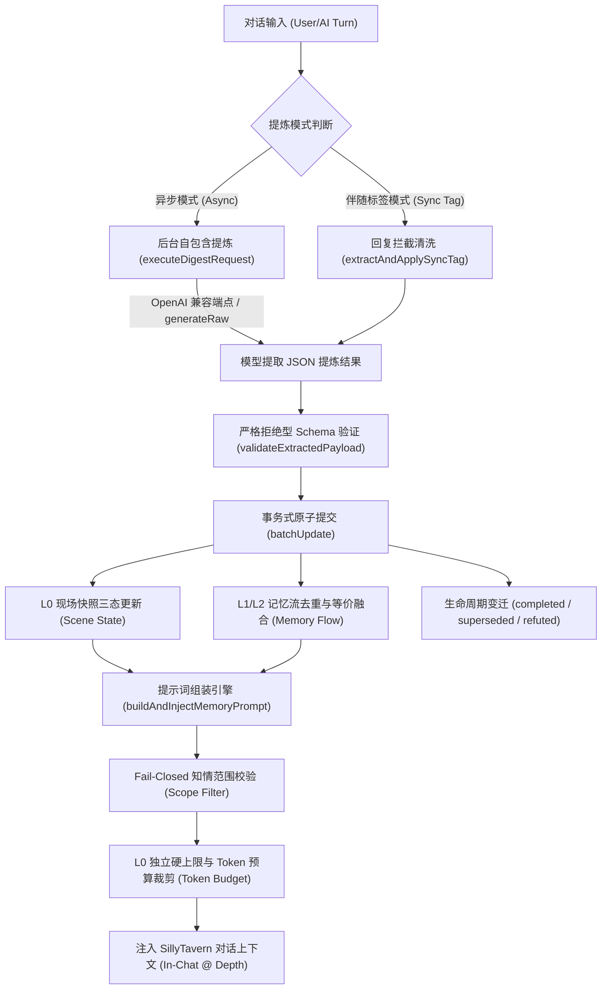

# SillyTavern 持续记忆插件 (ST-Persistent-Memory)

[](https://github.com/dayuseless/ST-Persistent-Memory)
[](https://github.com/SillyTavern/SillyTavern)
[](LICENSE)

> **定位**：SillyTavern Persistent Memory 是一套专为长文本角色扮演 (RP) 设计的持续性情境与记忆扩展系统。通过维护**现场即时快照 (L0 Scene State)**、**事实分级认知流 (L1/L2 Active Memories)** 与**多角色在场权限状态机**，确保 AI 在有限上下文窗口内始终牢记当下发生了什么、角色真正知晓什么，彻底告别失忆与逻辑穿帮。

---

## 🌟 核心特性与亮点

### 1. 现场快照 (L0 Scene State)
- **拒绝大而全的空洞摘要**：区别于传统“剧情总结”，L0 聚焦当前物理现场：**角色在哪里、在做什么、心理张力如何、现场遗留什么未决悬念、谁在场**。
- **独立硬预算上限保护**：L0 享受专属启发式 Token 硬上限（默认 ~150 tok），即使剧情再复杂也绝不撑爆上下文。
- **精准清空语义**：散伙离场或动作结束时自动清空，绝不留存旧动作幽灵。

### 2. 事实分级与防脑补纪律 (Fact Hierarchy)
- **事实与推测严格解耦**：
  - `fact`（客观物理事实）：已发生的可验证经历。
  - `statement`（言行约定）：角色亲口说过的话，不推定未来必然兑现。
  - `inference`（主观推断）：对心境、动机、怀疑的当下判断，随情节演化流转。
  - `todo`（即时待办）：未竟之约或即时行动目标。
- **防幻觉纪律**：空白代表角色确实未知，严禁模型为了情节顺畅而脑补未经证实的过去或动机。

### 3. 知情范围隔离与权限防穿透 (Presence Routing & Scope)
- **多角色权限分流**：
  - 🌐 `world`（公共世界常识）：全员通用。
  - 👥 `shared`（现场经历共知）：必须携带明确的 `known_by` 知情角色列表；不在场且不知情的角色无法获取。
  - 👤 `character`（角色私密经历）：只有该角色在场时才会激活注入，离场自动静默休眠，**0 Token 占用，彻底防止群聊偷窥私密记忆**。
- **Fail-Closed 闭环保护**：缺失归属或知情者的非法共享条目直接拦截入库，杜绝权限越权泄露。

### 4. 双模式提炼架构 (Dual Extraction Modes)
- ⚡ **异步后台独立提炼 (Async Mode)**：
  - 支持**通用 OpenAI 兼容接口**（包含 OpenAI 官方、DeepSeek、Claude 代理中转、通义千问、硅基流动、本地 Ollama / LM Studio / vLLM 等）。
  - 独立专属端点发起单轮自包含提取请求，**彻底隔绝主会话上下文与思维链丢失问题 (彻底解决 DeepSeek `400 Bad Request: reasoning_content must be passed` 报错)**。
  - **一键同步酒馆主 API**：点击按钮即可自动提取酒馆主界面配置的 Endpoint URL、Key 与模型名称，免去重复配置烦恼。
- 🏷️ **伴随标签模式 (Sync Tag Mode)**：
  - 在主回复末尾附加隐藏状态标签 `<!--PERSISTENT_MEMORY: ... -->`，由前端无感截获入库并从消息正文中剥离。
  - **零额外 API 调用与请求消耗**，适合 API 额度紧张或不支持多并发连接的环境。

### 5. 三重 UI 入口与清爽现代交互
- 📱 **屏幕快捷悬浮球**：右下角极简白底脑形气泡，支持触控拖拽、双端独立坐标记忆。
- 🧩 **顶部扩展快捷菜单**：深度融入酒馆顶部工具栏扩展下拉菜单（拼图/魔棒），随时一键唤起。
- ⚙️ **原生扩展设置抽屉 & 侧边 HUD 控制台**：
  - 记忆流管理：支持常驻置顶 (Pinned)、动态触发 (Triggered)、归档 (Archived) 一键切换。
  - 即时现场快照修改器：随手手填或纠偏现场地点与角色。
  - 状态与生命周期显式流转：已履约 (`completed`)、已迭代 (`superseded`)、已证伪 (`refuted`) 实时徽标展示。

---

## 📥 安装方法

### 方式一：在 SillyTavern 扩展中心一键安装（推荐）

1. 打开 SillyTavern，点击顶部工具栏的 **扩展管理** 图标（拼图/积木块）。
2. 打开 **“安装扩展 (Install Extension)”** 选项卡。
3. 在 Git 仓库 URL 输入框中粘贴以下地址并点击安装：
   ```text
   https://github.com/dayuseless/ST-Persistent-Memory
   ```
4. 页面提示安装成功后，按 **`Ctrl + F5`** 刷新网页即可。

### 方式二：手动离线包安装

1. 从 [Releases 页面](https://github.com/dayuseless/ST-Persistent-Memory/releases) 下载 `ST-Persistent-Memory-v0.1.6.zip`。
2. 解压到 SillyTavern 的扩展目录中：
   ```text
   SillyTavern/public/scripts/extensions/third-party/ST-Persistent-Memory/
   ```
   *(多用户版本可放置于 `SillyTavern/data/default-user/extensions/ST-Persistent-Memory/`)*
3. 重启 SillyTavern 服务端并刷新浏览器即可。

---

## 🚀 快速上手指南

### 步骤 1：开启插件与入口

刷新酒馆后，你会在屏幕右下角看到一个白色的脑形悬浮球。你也可以点击顶部扩展菜单（拼图图标）找到 **“持续记忆”**。
点击即可滑出 HUD 侧边控制台。

### 步骤 2：配置提炼 API（极简推荐：一键同步）

1. 在控制台中切换到 **“设置与 API”** 选项卡（或在右侧酒馆扩展面板的折叠抽屉中）。
2. 勾选 **“启用独立提炼 API (自定义兼容 OpenAI)”**。
3. 点击 **`同步酒馆主 API`** 按钮：
   - 插件会自动读取你已经在酒馆主设置里填好的 Base URL、API Key 与 Model ID。
4. 点击 **`测试 API 连通性`**，看到绿色连通提示即表示配置成功！
5. 点击底部 **`保存并生效全部配置`**。

> 💡 **进阶提示**：你也可以将提炼端点指向成本更低的轻量模型（例如提炼用 `gpt-4o-mini` 或 `deepseek-chat`，而主聊用大模型），实现降本增效。

### 步骤 3：正常聊天，记忆自动运转

- 随着对话推进，插件会按照设定的频率（默认每 3 轮）在后台静默发起提炼，自动沉淀事实并维护现场快照。
- 你可以随时点击控制台顶部的 **“闪电 (⚡)”** 按钮手动触发一次即时提炼。
- 在“记忆流”列表中，你可以随时点击状态徽标将某条记忆设为“常驻置顶”或“归档”，也可以手动删除不准确的条目。

---

## 🏗️ 架构与数据流



---

## 🛠️ 控制台调试指令

在浏览器开发者工具控制台 (F12 Console) 中，提供了全局调试钩子：

```javascript
// 查看当前会话的快照与记忆全量数据
window.__persistentMemory.getState();

// 立即组装并测试提示词注入块
window.__persistentMemory.injectNow();

// 立即强制执行一次后台提炼
window.__persistentMemory.digestNow();
```

---

## 📝 版本历史

### v0.1.7
- **手动录入类型支持**：在 HUD 控制台手动新增条目面板中，新增记忆类型选择器（📌 客观事实 `fact` / 💬 言行约定 `statement` / 🧠 主观推断 `inference` / 📝 即时待办 `todo`），彻底打破原先手动添加只能默认为 `fact` 的限制。
- **卡片类型一键轮转**：记忆卡片顶部类型徽章支持直接点击切换（`fact` ➔ `statement` ➔ `inference` ➔ `todo`），随心订正条目分类。
- **色彩语义强化**：各类记忆拥有专属高对比度配色徽标（事实灰蓝、约定科技蓝、推断高贵紫、待办琥珀金），辨识度倍增。

### v0.1.6
- **核心修复**：排除了注入引擎内部重复声明的致命编译错误；启动生命周期重构为 UI 优先加载，彻底根治插件抽屉与悬浮窗偶发消失的问题。
- **全模型通用兼容**：独立提炼端点升级为通用 OpenAI 兼容格式，全面接入官方 OpenAI、DeepSeek、Claude 代理中转、通义千问、硅基流动、本地 Ollama / LM Studio / vLLM。
- **一键同步**：新增一键从酒馆原生连接设置中自动同步端点 URL、API Key 与模型的便捷功能。
- **三重 UI 入口**：新增顶部工具栏扩展下拉菜单（`#extensionsMenu`）一键直达入口。
- **深色/浅色自适应优化**：UI 界面采用高对比度现代工业风设计，数字读数更清晰。

### v0.1.5
- 引入事务式原子提交机制 (`batchUpdate`)，消除写入竞态。
- 增强防提示词注入隔离区与文学文本不可信边界。
- 修复知情者等价合并与私有角色记忆 Fail-Closed 拦截。

---

## 📄 开源许可证

本项目基于 [MIT License](LICENSE) 开源。欢迎提交 Issue 与 Pull Request！
