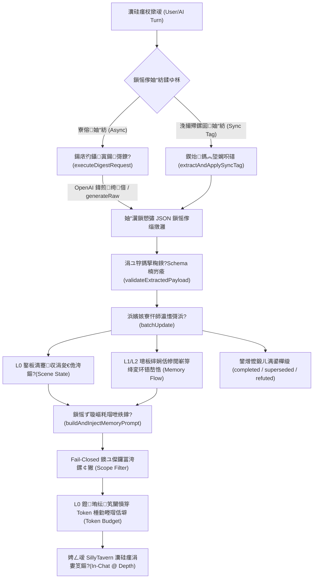

# SillyTavern 鎸佺画璁板繂鎻掍欢 (ST-Persistent-Memory)

[](https://github.com/dayuseless/ST-Persistent-Memory)
[](https://github.com/SillyTavern/SillyTavern)
[](LICENSE)

> **瀹氫綅**锛歋illyTavern Persistent Memory 鏄竴濂椾笓涓洪暱鏂囨湰瑙掕壊鎵紨 (RP) 璁捐鐨勬寔缁€ф儏澧冧笌璁板繂鎵╁睍绯荤粺銆傞€氳繃缁存姢**鐜板満鍗虫椂蹇収 (L0 Scene State)**銆?*浜嬪疄鍒嗙骇璁ょ煡娴?(L1/L2 Active Memories)** 涓?*澶氳鑹插湪鍦烘潈闄愮姸鎬佹満**锛岀‘淇?AI 鍦ㄦ湁闄愪笂涓嬫枃绐楀彛鍐呭缁堢墷璁板綋涓嬪彂鐢熶簡浠€涔堛€佽鑹茬湡姝ｇ煡鏅撲粈涔堬紝鏄捐憲澧炲己闀跨▼瀵硅瘽鐨勬儏澧冭繛璐€э紝鏈夋晥鎶戝埗璺ㄨ疆澶卞繂涓庤韩浠介€昏緫绌垮府銆?
---

## 馃専 鏍稿績鐗规€т笌浜偣

### 1. 鐜板満蹇収 (L0 Scene State)
- **鎷掔粷澶ц€屽叏鐨勭┖娲炴憳瑕?*锛氬尯鍒簬浼犵粺鈥滃墽鎯呮€荤粨鈥濓紝L0 鑱氱劍褰撳墠鐗╃悊鐜板満锛?*瑙掕壊鍦ㄥ摢閲屻€佸浜庝綍鏃?浣曠澶╂皵銆佸湪鍋氫粈涔堛€佸績鐞嗗紶鍔涘浣曘€佺幇鍦洪仐鐣欎粈涔堟湭鍐虫偓蹇点€佽皝鍦ㄥ満**銆?- **鐙珛纭绠椾笂闄愪繚鎶?*锛歀0 浜彈涓撳睘鍚彂寮?Token 纭笂闄愶紙榛樿 ~150 tok锛夛紝鍗充娇鍓ф儏鍐嶅鏉備篃缁濅笉鎾戠垎涓婁笅鏂囥€?- **绮惧噯娓呯┖璇箟**锛氭暎浼欑鍦烘垨鍔ㄤ綔缁撴潫鏃惰嚜鍔ㄦ竻绌猴紝缁濅笉鐣欏瓨鏃у姩浣滃菇鐏点€?
### 2. 浜嬪疄鍒嗙骇涓庨槻鑴戣ˉ绾緥 (Fact Hierarchy)
- **浜嬪疄涓庢帹娴嬩弗鏍艰В鑰?*锛?  - `fact`锛堝瑙傜墿鐞嗕簨瀹烇級锛氬凡鍙戠敓鐨勫彲楠岃瘉缁忓巻銆?  - `statement`锛堣█琛岀害瀹氾級锛氳鑹蹭翰鍙ｈ杩囩殑璇濓紝涓嶆帹瀹氭湭鏉ュ繀鐒跺厬鐜般€?  - `inference`锛堜富瑙傛帹鏂級锛氬蹇冨銆佸姩鏈恒€佹€€鐤戠殑褰撲笅鍒ゆ柇锛岄殢鎯呰妭婕斿寲娴佽浆銆?  - `todo`锛堝嵆鏃跺緟鍔烇級锛氭湭绔熶箣绾︽垨鍗虫椂琛屽姩鐩爣銆?- **闃插够瑙夌邯寰?*锛氱┖鐧戒唬琛ㄨ鑹茬‘瀹炴湭鐭ワ紝涓ョ妯″瀷涓轰簡鎯呰妭椤虹晠鑰岃剳琛ユ湭缁忚瘉瀹炵殑杩囧幓鎴栧姩鏈恒€?
### 3. 鐭ユ儏鑼冨洿闅旂涓庢帴鏀惰€呮潈闄愯矾鐢?(Presence & Recipient Routing)
- **澶氳鑹叉潈闄愬垎娴?*锛?  - 馃寪 `world`锛堝叕鍏变笘鐣屽父璇嗭級锛氬叏鍛橀€氱敤銆?  - 馃懃 `shared`锛堢幇鍦虹粡鍘嗗叡鐭ワ級锛氬熀浜庡綋鍓嶇敓鎴愪富浣?(POV) 涓ユ牸楠岃瘉鍏舵槸鍚﹀湪 `known_by` 鐭ユ儏鍒楄〃涓紱鑻ョ幇鍦哄瓨鍦ㄥ叾浠栦笉鐭ユ儏鑰咃紝鑷姩闄勫姞淇濆瘑绾︽潫鏍囪銆?  - 馃懁 `character`锛堣鑹茬瀵嗙粡鍘嗭級锛氬熀浜庣敓鎴愮洰鏍囦富浣撲弗鏍艰矾鐢憋紝浠呭厑璁歌瑙掕壊鏈汉鐢熸垚鏃舵敞鍏ワ紝绂诲満鎴栨棤鍏宠鑹茬敓鎴愭椂鑷姩闈欓粯浼戠湢锛屼笉鍗犻澶?Token锛屼弗鏍奸槻姝㈢兢鑱婃棤鍏宠鑹茶幏鎮夌瀵嗚蹇嗐€?- **Fail-Closed 闂幆淇濇姢**锛氱敓鎴愪富浣撴棤娉曠‘瀹氭椂淇濆畧鎷掔粷娉ㄥ叆绉佸瘑/鍏变韩璁板繂锛涚己澶卞綊灞炴垨鐭ユ儏鑰呯殑闈炴硶鏉＄洰鐩存帴鎷掔粷鍏ュ簱銆?
### 4. 鍙屾ā寮忔彁鐐兼灦鏋?(Dual Extraction Modes)
- 鈿?**寮傛鍚庡彴鐙珛鎻愮偧 (Async Mode)**锛?  - 鏀寔**閫氱敤 OpenAI 鍏煎鎺ュ彛**锛堝寘鍚?OpenAI 瀹樻柟銆丏eepSeek銆丆laude 浠ｇ悊涓浆銆侀€氫箟鍗冮棶銆佺鍩烘祦鍔ㄣ€佹湰鍦?Ollama / LM Studio / vLLM 绛夛級銆?  - 鐙珛涓撳睘绔偣鍙戣捣鍗曡疆鑷寘鍚彁鍙栬姹傦紝**褰诲簳闅旂粷涓讳細璇濅笂涓嬫枃涓庢€濈淮閾句涪澶遍棶棰?(褰诲簳瑙ｅ喅 DeepSeek `400 Bad Request: reasoning_content must be passed` 鎶ラ敊)**銆?  - 鍏峰 **45 绉?AbortController 瓒呮椂淇濇姢**锛岄伩鍏嶇綉缁滄寕姝婚攣瀹氭彁鐐奸€氶亾銆?  - **涓€閿悓姝ラ厭棣嗕富 API**锛氱偣鍑绘寜閽嵆鍙嚜鍔ㄦ彁鍙栭厭棣嗕富鐣岄潰閰嶇疆鐨?Endpoint URL銆並ey 涓庢ā鍨嬪悕绉帮紝鍏嶅幓閲嶅閰嶇疆鐑︽伡銆?- 馃彿锔?**浼撮殢鏍囩妯″紡 (Sync Tag Mode)**锛?  - 鍦ㄤ富鍥炲鏈熬闄勫姞闅愯棌鐘舵€佹爣绛?`<!--PERSISTENT_MEMORY: ... -->`锛岀敱鍓嶇鏃犳劅鎴幏鍏ュ簱骞朵粠娑堟伅姝ｆ枃涓墺绂汇€?  - **闆堕澶?API 璋冪敤涓庤姹傛秷鑰?*锛岄€傚悎 API 棰濆害绱у紶鎴栦笉鏀寔澶氬苟鍙戣繛鎺ョ殑鐜锛涘紓甯告爣绛捐嚜鍔ㄤ繚鐣欏苟鎻愪緵 HUD 閿欒鎺掓煡闈㈡澘銆?
### 5. 瀵嗛泦鍚戦噺璇箟妫€绱笌娣峰悎鍙洖 (Semantic Retrieval & Hybrid Engine)
- 馃 **鍙岃矾娣峰悎鍙洖 (Hybrid Retrieval)**锛氱粨鍚堢簿纭叧閿瘝璇嶆硶鍖归厤涓庡瘑闆嗗悜閲忎綑寮︾浉浼煎害锛圖ense Cosine Similarity锛夛紝瀹岀編瑙ｅ喅鍚屼箟璇嶆垨鍙ｈ杞堪鏃犳硶鍛戒腑鐨勯毦棰橈紙濡傝蹇嗕负鈥滄毚闆ㄩ€犳垚灞辨椽鈥濓紝瀵硅瘽鎻愬強鈥滄极灞遍亶閲庣殑娉ユ祮娴婃祦鍛煎暩鑰屼笅鈥濓紝闆跺叧閿瘝閲嶅悎浠嶈兘绮惧噯鍙洖锛夈€?- 鈿?**闆跺閮ㄤ緷璧栨湰鍦板祵鍏?(Local Dense Vectorizer)**锛氬唴缃笓涓烘祻瑙堝櫒涓?Node.js 绂荤嚎鐜璁捐鐨勫灏哄害瀛楃 N-gram 涓?FNV-1a 绗﹀彿鎶曞皠 256 缁寸瀵嗙壒寰佸悜閲忓紩鎿庯紝姣绾у搷搴斻€佺‘瀹氭€у己銆佸畬鍏ㄤ笉鑰楄垂 API 棰濆害涓庣綉缁滄祦閲忋€?- 馃寪 **閫氱敤 OpenAI 鍏煎澶栭儴鍚戦噺鎺ュ彛**锛氭敮鎸佹帴鍏ュ閮ㄤ笓鐢?Embedding 妯″瀷锛堝 `text-embedding-3-small`銆乣bge-m3`銆乣nomic-embed-text`锛夛紝鍏峰瓒呮椂淇濇姢涓庡钩婊戦檷绾ф満鍒躲€?- 馃洝锔?**璇箟鍔犳潈缁濅笉绌块€忕煡鎯呮潈闄?*锛氫换浣曢珮鐩镐技搴﹀緱鍒嗛兘鏃犳硶鍑荤┛瑙掕壊绉佸瘑缁忓巻涓庣煡鎯呰寖鍥磋竟鐣岋紝鏈巿鏉?POV 姘歌繙鏃犳硶鍊熺敱璇箟楂樺垎鎺㈡祴浠栦汉绉樺瘑銆?
### 6. 涓栫晫涔﹀叧鑱旀潯鐩笌鍔ㄦ€佹儏澧冨樊閲?(World Book / Lorebook Integration)
- 馃摉 **涓栫晫涔﹀姩鎬佸樊閲忚ˉ涓?(Dynamic Lorebook Delta)**锛氫紶缁熶笘鐣屼功澶氫负闈欐€佽瀹氾紙濡傗€滅帇鍩庡湴涓嬭棌鏈夌瀹濃€濓級锛屾寔缁蹇嗘敮鎸佷负璁板繂鏉＄洰缁戝畾涓栫晫涔﹀叧鑱旓紙`lorebook_ref`锛夛紝灏嗙幇瀹炴帹杩涚殑宸噺鍔ㄦ€佽拷鍔犲湪涓栫晫涔﹁瀹氫箣涓婏紝鎻愮ず璇嶆敞鍏ユ椂鑷姩鏍囨敞 `[涓栫晫涔﹀叧鑱? 鏉＄洰鍚峕`銆?- 馃敀 **鍗曚細璇濆畨鍏ㄦ彁鍙?(Session-Scoped Extraction)**锛氳嚜鍔ㄨ鍙栧綋鍓嶅璇濈粦瀹氱殑 World Info銆佽鑹蹭富涓栫晫涔︿互鍙婅鑹插唴缃祵鍚堜笘鐣屼功锛坄character_book`锛夛紝鍦ㄦ彁鐐兼椂灏嗘椿璺冩潯鐩畨鍏ㄦ彁渚涚粰鎻愮偧妯″瀷锛屼弗鏍奸檺鍒朵簬褰撳墠鍗曚細璇濓紝鏉滅粷璺ㄤ細璇濇垨鍏ㄥ眬姹℃煋銆?- 馃殌 **鍙岃矾妫€绱㈢浉鍏虫€у姞鎴?(Dynamic Retrieval Boost)**锛氬綋瀵硅瘽鎻愬強涓栫晫涔︽潯鐩椂锛屾贩鍚堟绱㈠紩鎿庤嚜鍔ㄤ负鍏宠仈璁板繂璧嬩簣妫€绱㈠姞鏉冨姞鎴愶紙榛樿 +0.35锛夛紝浼樺厛灏嗗叧鑱斿姩鎬佽蹇嗙簿鍑嗗彫鍥炶嚦涓婁笅鏂囥€?- 馃洝锔?**涓ユ牸 ACL 鏉冮檺閾佸緥涓?Fail-Closed 闂幆**锛氬叧鑱斾簡涓栫晫涔︾殑绉佸瘑鎴栧叡浜蹇嗭紝渚濈劧涓ユ牸鎵ц鐭ユ儏鑼冨洿涓庣敓鎴?POV 杩囨护锛涘綋鐢熸垚涓讳綋鏃犳硶纭鏃舵墽琛?Fail-Closed 缁濅笉娉ㄥ叆锛屼弗闃查€氳繃涓栫晫涔︽硠闇查殣绉併€?
### 7. 鍥涢噸浜や簰鍏ュ彛涓庡師鐢熸枩鏉犳寚浠?(Quadruple Access & Slash Commands)
- 鈱笍 **鑱婂ぉ妗嗗師鐢熸枩鏉犳寚浠?(`Slash Commands`)**锛氭墦瀛楁祦鐜╁鏃犻渶绂诲紑閿洏锛岀洿鎺ュ湪瀵硅瘽妗嗚緭鍏ュ揩鎹锋寚浠ゆ搷浣滆蹇嗭細
  - `/remember <鍐呭>`锛氱洿鎺ヨ鍏ヤ竴鏉¤蹇嗭紙鏀寔 `--pinned`, `--type fact|statement|inference|todo`, `--scope world|character|shared`, `--char <瑙掕壊>`锛夛紱
  - `/scene <鍦扮偣/鍓ф儏>`锛氫竴鍙ヨ瘽閲嶇疆鎴栫籂姝ｅ綋鍓嶇幇鍦猴紙鏀寔 `--location`, `--action`, `--time`锛夛紱
  - `/inspect`锛氫竴閿懠鍑哄嵆鏃舵敞鍏ラ€忚闀滐紱
  - `/digest`锛氱珛鍗冲湪鍚庡彴鍙戣捣涓€娆¤蹇嗘彁鐐硷紱
  - `/forget [--all] <鍏抽敭璇?ID>`锛氬揩閫熷皢鏌愭潯璁板繂璁句负宸茶瘉浼?(`refuted`) 骞跺綊妗ｏ紙甯?`--all` 鍙壒閲忚瘉浼墍鏈夊尮閰嶈蹇嗭級锛?  - `/preset <娴佹淳鍚峾list>`锛氫竴閿鐢?RP 鐜╂硶娴佹淳棰勮锛堝 `/preset romance`, `/preset 璺戝洟`, `/preset mystery`, `/preset drama`锛夈€?- 馃攳 **HUD 璁板繂搴撳疄鏃舵ā绯婃悳绱㈡爮 (`Instant Search`)**锛氬湪璁板繂娴佸垪琛ㄩ《閮ㄦ彁渚涘疄鏃舵悳绱㈡锛屾墦瀛楀嵆鍒绘寜姝ｆ枃銆佽鑹插悕銆佽Е鍙戣瘝涓庝笘鐣屼功鍏宠仈鍗虫椂杩囨护銆?- 馃寵 **娌夌潯浼戠湢涓庡垰鍞ら啋鐩磋瑙嗚鏍囪 (`Visual Lifecycle Indicators`)**锛?  - **娌夌潯浼戠湢鐘舵€?*锛氶暱鏈熼棽缃湭鎻愬強鐨勬潯鐩嚜鍔ㄥ憟鐜伴潤璋х传鏈堣嵂涓?(`pm-chip-dormant`) 涓庡崱鐗囧井鏆楁牱寮忥紝娓呮櫚鍛婄煡鐜╁璇ヨ蹇嗘鍦ㄤ紤鐪犺搫鍔匡紝绛夊緟鍓ф儏鍞ら啋锛?  - **鍒氬敜閱掗噾鍏夊姩鏁?*锛氬綋鍓ф儏楂樺尮閰嶅害鑷姩浠庢矇鐫′腑鍙洖璇ユ潯璁板繂鏃讹紝鍗＄墖鍛堢幇閲戦槼寰檿涓庡懠鍚稿窘鏍?(`pm-wake-badge`)锛岀洿瑙傛劅鐭モ€滆蹇嗚鐜板満鐐归啋鈥濈殑鐢熷姩杩囩▼锛?  - **鍥涚淮涓撳睘绛涢€夋爣绛?*锛氫竴閿垏鎹€愭椿璺冦€戙€併€愭矇鐫°€戙€併€愮粨椤广€戙€併€愬叏閮ㄣ€戯紝褰诲簳瑙ｈ€︿紤鐪犲緟鍞ら啋璁板繂涓庡凡缁堢粨鍘嗗彶浜嬪疄銆?- 馃摝 **澧炲己鍨嬫壒閲忕鐞嗗伐鍏锋爮 (`Enhanced Batch Actions`)**锛?  - 鏀寔鍏ㄩ€?鍙嶉€夊綋鍓嶇瓫閫夊垪琛紝涓€閿彂璧枫€愭壒閲忓父椹汇€戙€併€愭壒閲忔縺娲汇€戙€併€愭壒閲忎紤鐪犮€戙€併€愭壒閲忓姙缁撱€戙€併€愭壒閲忚瘉浼€戙€併€愭壒閲忓交搴曞垹闄ゃ€戯紱
  - 鑱婂ぉ妗嗗師鐢熸寚浠ゅ悓姝ユ敮鎸?`/forget --all <鍏抽敭璇?` 鐬棿鎵归噺娓呴櫎璋ｈ█涓庤繃鏈熸帹娴嬨€?- 馃幃 **鍥涘ぇ鐜╂硶娴佹淳涓€閿皟浼橀璁惧寘 (`Gameplay Presets`)**锛?  - 馃挅 **绾埍鏃ュ父 (`romance`)**锛氳仛鐒︿簩浜烘儏缁緛缁娿€佽█琛屾壙璇轰笌绉佽锛涢珮鍚戦噺璇箟鑱旀兂鏉冮噸 (75%)锛屽鏉炬矇鐫″敜閱掞紝绮惧阀 Token 棰勭畻銆?  - 馃洝锔?**瑗垮够璺戝洟 (`fantasy_ttrpg`)**锛氳仛鐒﹀瑙傜墿鐞嗕簨瀹炪€佷弗鑻涘湴鐞嗗満鏅笌涓栫晫涔﹁瀹氭繁搴﹁仈鍔紱楂橀绠?(650 tok)锛屽己鍔涢暱绋嬭嚜鍔ㄥ綊骞躲€?  - 馃幁 **缇ゅ儚淇綏鍦?(`ensemble_drama`)**锛氭瀬鑷寸煡鎯呰寖鍥翠笌 POV 鏉冮檺闅旂锛屼弗鏍煎湪鍦轰繚瀵嗙害鏉燂紝寮哄埗閲囩敤缁撴瀯鍖?XML 娉ㄥ叆妯℃澘锛屾潨缁濆瑙掕壊涓插懗璇诲績銆?  - 馃攳 **鎺ㄧ悊鎮枒 (`mystery_detective`)**锛氱嚎绱㈢墿璇佷竴瀛椾笉婕忥紝鍋滅敤妯＄硦褰掑苟浠ヤ繚鍏ㄥ師璇濊瘉鎹紱楂樿瘝娉曟潈閲?(60%)锛岄暱鏁堜笉浼戠湢 (40 杞?銆?  - **鍑嵁闆舵薄鏌?*锛氬垏鎹㈤璁句粎璋冩暣鎻愮偧棰戠巼銆乀oken 棰勭畻銆佽涔夋潈閲嶄笌妯℃澘锛?*100% 瀹屾暣淇濈暀鐢ㄦ埛绉佹湁 API 瀵嗛挜銆佺鐐逛笌妯″瀷**銆?- 馃敭 **鎮诞鐞冨姩鎬佸懠鍚镐笌瀹炴椂鐘舵€佹満 (`Live Bubble Status`)**锛?  - 鎻愮偧涓嚜鍔ㄨ繘鍏ユ煍鍜岃摑鍏夊懠鍚歌剦鍔ㄥ姩鏁堬紝鎴愬姛鎴栧紓甯镐即闅忚交閲忓井鏍囦笌鍏夋檿鍙嶉锛屾棤鎰熸帉鎻″悗鍙版彁鐐煎姩鎬併€?- 馃摫 **灞忓箷蹇嵎鎮诞鐞?*锛氬彸涓嬭鏋佺畝鐧藉簳鑴戝舰姘旀场锛屾敮鎸佽Е鎺ф嫋鎷姐€佸弻绔嫭绔嬪潗鏍囪蹇嗐€?- 馃З **椤堕儴鎵╁睍蹇嵎鑿滃崟**锛氭繁搴﹁瀺鍏ラ厭棣嗛《閮ㄥ伐鍏锋爮鎵╁睍涓嬫媺鑿滃崟锛堟嫾鍥?榄旀锛夛紝闅忔椂涓€閿敜璧枫€?- 鈿欙笍 **鍘熺敓鎵╁睍璁剧疆鎶藉眽 & 渚ц竟 HUD 鎺у埗鍙?*锛?  - 璁板繂娴佺鐞嗭細鏀寔甯搁┗缃《 (Pinned)銆佸姩鎬佽Е鍙?(Triggered)銆佸綊妗?(Archived) 涓€閿垏鎹€?  - 鍥涚淮绫诲瀷杞浆锛氫簨瀹炪€佺害瀹氥€佹帹鏂€佸緟鍔炰竴閿偣鍑绘洿杩€?  - 鍗虫椂鐜板満蹇収淇敼鍣細闅忔墜鎵嬪～鎴栫籂鍋忕幇鍦哄湴鐐逛笌瑙掕壊銆?  - 鐘舵€佷笌鐢熷懡鍛ㄦ湡鏄惧紡娴佽浆锛氬凡灞ョ害 (`completed`)銆佸凡杩唬 (`superseded`)銆佸凡璇佷吉 (`refuted`) 瀹炴椂寰芥爣灞曠ず銆?
### 8. 宸ヤ笟绾ф贩鍚堟绱?(CJK Bigram + RRF) 涓庡叏灞€寮€鏀?SDK (Global SDK)
- 馃敜 **绾墠绔?CJK Bigram 绂绘暎鍒嗚瘝涓庤瘝娉曞姞鏉冮噸鍚堝害鎵撳垎鍣?*锛?  - 鍐呯疆鏃犱緷璧栦腑鏃ラ煩浜屽厓鍒嗚瘝鍣?(`tokenizeCjkBigram`)锛岃嚜鍔ㄦ彁鍙栭珮浠峰€煎崟瀛椾笌浜屽厓澶嶅悎璇嶏紙濡傗€滈粦鍒€鍒哄鈥?-> `榛戝垁`銆乣鍒哄`銆乣棣栭`锛夛紝鑷姩鍓ラ櫎鏃犳剰涔夊崟瀛楀仠鐢ㄨ瘝涓庢爣鐐癸紱
  - 鍔犳潈閲嶅悎搴︽墦鍒?(`calculateBigramLexicalScore`) 璧嬩簣澶嶅悎璇?2.0 鍊嶅疄浣撴潈閲嶏紝鏄捐憲鎻愬崌涓枃涓撴湁鍚嶈瘝銆佸湴鍚嶄汉鍚嶄笌閬撳叿姝﹀櫒鍙洖绮惧害锛?*0 API 寮€閿€**銆?- 鈿栵笍 **宸ヤ笟绾?RRF (Reciprocal Rank Fusion) 鍊掓暟鎺掑悕铻嶅悎**锛?  - 寮曞叆鐜颁唬娣峰悎妫€绱簨瀹炴爣鍑?RRF 绠楁硶 ($Score(d) = \sum \frac{1}{60 + Rank(d)}$)锛屾棤缂濆綊骞剁瀵嗚涔変笌绂绘暎璇嶆硶鍙岄€氶亾鎺掑悕锛?  - 褰诲簳鎽嗚劚缁忛獙鍔犳潈瓒呭弬璋冨弬鍥版壈锛屾棤鏍囧害澶辩湡锛岃嚜甯﹁涔変綅娆′笌璇嶆硶浣嶆瀹屾暣褰掑洜瀹¤锛?*0 API 寮€閿€**銆?- 馃攲 **鍏ㄥ眬鍏嶇綉缁滃厤鐣岄潰寮€鏀?SDK (`window.STPersistentMemoryAPI`)**锛?  - 缁熶竴鍦?`window.STPersistentMemoryAPI` 涓?`globalThis.STPersistentMemoryAPI` 鎸傝浇闂ㄩ潰鍗曚緥锛?  - 鏀寔澶栭儴鐢熸€佽剼鏈紙濡?Tavern Helper銆丵uick Reply銆佽嚜鍔ㄥ寲娴侊級鏃犳劅璋冪敤锛?    - 鐘舵€佷笌閰嶇疆锛歚getState`, `getSettings`, `updateSettings`, `saveSettingsImmediately`锛?    - 璁板繂鍏ㄧ敓鍛藉懆鏈?CRUD锛歚addMemory`, `updateMemory`, `deleteMemory`, `setMemoryLifecycle`, `cycleMemoryStatus`, `cycleMemoryType`, `purgeArchivedMemories`锛?    - 婕斿寲琛€缂樿拷婧細`getMemoryLineage(id)`锛?    - 鐜板満蹇収鏃跺厜鏈猴細`getScene`, `updateScene`, `getSceneHistory`, `restoreSceneSnapshot`, `rollbackScene`锛?    - 鍗虫椂娉ㄥ叆閫忚闀滃揩鐓э細`getLiveSnapshot()`锛?    - 娴佹淳棰勮锛歚getPresets()`, `applyPreset(presetId)`锛?    - 鏈湴绠楁硶宸ュ叿鍖咃細`tokenizeCjkBigram`, `calculateBigramLexicalScore`, `reciprocalRankFusion`, `rankCandidatesWithRRF`銆?  - **100% 绾湰鍦拌繍琛屼繚闅?*锛氭潨缁濋潪蹇呰澶栭儴缃戠粶璋冪敤锛屼繚鎶ょ敤鎴烽殣绉佷笌 Token 棰濆害銆?
---

## 馃摜 瀹夎鏂规硶

### 鏂瑰紡涓€锛氬湪 SillyTavern 鎵╁睍涓績涓€閿畨瑁咃紙鎺ㄨ崘锛?
1. 鎵撳紑 SillyTavern锛岀偣鍑婚《閮ㄥ伐鍏锋爮鐨?**鎵╁睍绠＄悊** 鍥炬爣锛堟嫾鍥?绉湪鍧楋級銆?2. 鎵撳紑 **鈥滃畨瑁呮墿灞?(Install Extension)鈥?* 閫夐」鍗°€?3. 鍦?Git 浠撳簱 URL 杈撳叆妗嗕腑绮樿创浠ヤ笅鍦板潃骞剁偣鍑诲畨瑁咃細
   ```text
   https://github.com/dayuseless/ST-Persistent-Memory
   ```
4. 椤甸潰鎻愮ず瀹夎鎴愬姛鍚庯紝鎸?**`Ctrl + F5`** 鍒锋柊缃戦〉鍗冲彲銆?
### 鏂瑰紡浜岋細鎵嬪姩绂荤嚎鍖呭畨瑁?
1. 浠?[Releases 椤甸潰](https://github.com/dayuseless/ST-Persistent-Memory/releases) 涓嬭浇 `ST-Persistent-Memory-v0.1.46.zip`銆?2. 瑙ｅ帇鍒?SillyTavern 鐨勬墿灞曠洰褰曚腑锛?   ```text
   SillyTavern/public/scripts/extensions/third-party/ST-Persistent-Memory/
   ```
   *(澶氱敤鎴风増鏈彲鏀剧疆浜?`SillyTavern/data/default-user/extensions/ST-Persistent-Memory/`)*
3. 閲嶅惎 SillyTavern 鏈嶅姟绔苟鍒锋柊娴忚鍣ㄥ嵆鍙€?
---

## 馃殌 蹇€熶笂鎵嬫寚鍗?
### 姝ラ 1锛氬紑鍚彃浠朵笌鍏ュ彛

鍒锋柊閰掗鍚庯紝浣犱細鍦ㄥ睆骞曞彸涓嬭鐪嬪埌涓€涓櫧鑹茬殑鑴戝舰鎮诞鐞冦€備綘涔熷彲浠ョ偣鍑婚《閮ㄦ墿灞曡彍鍗曪紙鎷煎浘鍥炬爣锛夋壘鍒?**鈥滄寔缁蹇嗏€?*銆?鐐瑰嚮鍗冲彲婊戝嚭 HUD 渚ц竟鎺у埗鍙般€?
### 姝ラ 2锛氶厤缃彁鐐?API锛堟瀬绠€鎺ㄨ崘锛氫竴閿悓姝ワ級

1. 鍦ㄦ帶鍒跺彴涓垏鎹㈠埌 **鈥滆缃笌 API鈥?* 閫夐」鍗★紙鎴栧湪鍙充晶閰掗鎵╁睍闈㈡澘鐨勬姌鍙犳娊灞変腑锛夈€?2. 鍕鹃€?**鈥滃惎鐢ㄧ嫭绔嬫彁鐐?API (鑷畾涔夊吋瀹?OpenAI)鈥?*銆?3. 鐐瑰嚮 **`鍚屾閰掗涓?API`** 鎸夐挳锛?   - 鎻掍欢浼氳嚜鍔ㄨ鍙栦綘宸茬粡鍦ㄩ厭棣嗕富璁剧疆閲屽～濂界殑 Base URL銆丄PI Key 涓?Model ID銆?4. 鐐瑰嚮 **`娴嬭瘯 API 杩為€氭€**锛岀湅鍒扮豢鑹茶繛閫氭彁绀哄嵆琛ㄧず閰嶇疆鎴愬姛锛?5. 鐐瑰嚮搴曢儴 **`淇濆瓨骞剁敓鏁堝叏閮ㄩ厤缃甡**銆?
> 馃挕 **杩涢樁鎻愮ず**锛氫綘涔熷彲浠ュ皢鎻愮偧绔偣鎸囧悜鎴愭湰鏇翠綆鐨勮交閲忔ā鍨嬶紙渚嬪鎻愮偧鐢?`gpt-4o-mini` 鎴?`deepseek-chat`锛岃€屼富鑱婄敤澶фā鍨嬶級锛屽疄鐜伴檷鏈鏁堛€?
### 姝ラ 3锛氭甯歌亰澶╋紝璁板繂鑷姩杩愯浆

- 闅忕潃瀵硅瘽鎺ㄨ繘锛屾彃浠朵細鎸夌収璁惧畾鐨勯鐜囷紙榛樿姣?3 杞級鍦ㄥ悗鍙伴潤榛樺彂璧锋彁鐐硷紝鑷姩娌夋穩浜嬪疄骞剁淮鎶ょ幇鍦哄揩鐓с€?- 浣犲彲浠ラ殢鏃剁偣鍑绘帶鍒跺彴椤堕儴鐨?**鈥滈棯鐢?(鈿?鈥?* 鎸夐挳鎵嬪姩瑙﹀彂涓€娆″嵆鏃舵彁鐐笺€?- 鍦ㄢ€滆蹇嗘祦鈥濆垪琛ㄤ腑锛屼綘鍙互闅忔椂鐐瑰嚮鐘舵€佸窘鏍囧皢鏌愭潯璁板繂璁句负鈥滃父椹荤疆椤垛€濇垨鈥滃綊妗ｂ€濓紝涔熷彲浠ユ墜鍔ㄥ垹闄や笉鍑嗙‘鐨勬潯鐩€?
---

## 馃彈锔?鏋舵瀯涓庢暟鎹祦



---

## 馃洜锔?鎺у埗鍙拌皟璇曟寚浠?
鍦ㄦ祻瑙堝櫒寮€鍙戣€呭伐鍏锋帶鍒跺彴 (F12 Console) 涓紝鎻愪緵浜嗗叏灞€璋冭瘯閽╁瓙锛?
```javascript
// 鏌ョ湅褰撳墠浼氳瘽鐨勫揩鐓т笌璁板繂鍏ㄩ噺鏁版嵁
window.__persistentMemory.getState();

// 绔嬪嵆缁勮骞舵祴璇曟彁绀鸿瘝娉ㄥ叆鍧?window.__persistentMemory.injectNow();

// 绔嬪嵆寮哄埗鎵ц涓€娆″悗鍙版彁鐐?window.__persistentMemory.digestNow();
```

---

## 馃И 鑷姩鍖栨祴璇曚笌鐙珛澶嶇幇

鏈彃浠堕殢鍖呮彁渚涘畬鏁寸殑绂荤嚎绔埌绔祴璇曞伐绋嬶紙鍖呭惈鍏ㄩ儴 107 椤规祴璇曠敤渚嬩笌寰瀷杩愯鐜 Mock锛夈€備换浣曞璁′汉鍛樻垨寮€鍙戣€呭潎鍙湪涓嬭浇鎴栬В鍘嬫湰鎻掍欢鍚庣洿鎺ョ嫭绔嬭繍琛屾牳楠岋細

```bash
# 杩涘叆鎻掍欢鏍圭洰褰?cd ST-Persistent-Memory

# 杩愯鍏ㄩ噺 107 椤硅嚜鍔ㄥ寲鍥炲綊娴嬭瘯鐭╅樀
npm test
# 鎴栬€呬娇鐢?node 鍘熺敓鐩存帴鎵ц锛?node test/test-matrix.mjs
```

娴嬭瘯鐭╅樀瑕嗙洊鑼冨洿锛?- **T1 ~ T70**锛氭牳蹇冭蹇嗘ā鍨嬨€丳OV 鍑嗗嚭鏉冮檺璺敱銆丗ail-Closed 鍒ゅ畾銆佺姸鎬佹満浜嬪姟涓庡洖婊氾紱
- **T71**锛氬叏宸ョ▼ 21 涓簮鏂囦欢銆乵anifest銆乸ackage銆乧onfig 涓?index 鐗堟湰鏍囪瘑涓€鑷存€ф牳楠岋紱
- **T72 ~ T95**锛氱粺涓€ ACL 闂ㄧ銆丄PI 浼犺緭灞傘€侀暱绋嬪綊骞躲€佷笘鐣屼功鍗忓悓銆佸揩鐓ф椂鍏夋満涓庤法鐗堟湰骞虫粦杩佺Щ锛?- **T96 ~ T100**锛氭€濈淮閾炬竻娲椼€佹ā寮忔牎楠屻€佹彁绀鸿瘝缂栨帓銆佹彁鐐艰惤鐩樻祦姘寸嚎涓庣鍒扮瑙ｈ€︽€绘垚闆嗘垚楠屾敹锛?- **T101 ~ T102**锛歎I 缁勪欢鍖栬В鑰﹀绾︺€乆SS 杞箟闃插尽銆佸偦鐡滃紡榛樿鍏ㄦ墭绠′笌璇︾粏鍙傛暟妯℃€佹浜や簰锛?- **T103 ~ T107 (v0.1.44 鏍稿績鍔犲浐)**锛氬綊骞跺師瀛愭€т笌澶辫触鍥炴粴淇濇姢銆佸綊骞跺苟鍙戜慨璁㈠彿淇濇姢銆佸巻鍙插洖婧寜鎵规淇鍙蜂繚鎶ゃ€佺┖鐜板満 `[]` 涓ユ牸鐗╃悊鍦ㄥ満鏍搁獙闃插尽銆丼chema 鎷掔粷鍨嬬瓥鐣ワ紙闈炴硶绫诲瀷/闈炴硶鐢熷懡鍛ㄦ湡/闈炴硶鐘舵€佹嫆缁濆叆搴擄級銆?- **T108 ~ T117 (v0.1.44 鏍稿績婕旇繘)**锛?  - **T108**锛氭矇鐫¤蹇嗚仈鎯冲敜閱掗槇鍊煎脊鎬у绾︽祴璇?(鑷畾涔夐棬妲涚敓鏁堛€佽秴闃堝敜閱掍笌浣庡垎鍘嬪埗)锛?  - **T109**锛氬浼氳瘽 stateCache 瀛楀吀鍖栦笌鑷姩鎰熺煡闅旂濂戠害娴嬭瘯 (璺ㄤ細璇濆垏鎹㈣嚜鍔ㄦ寜 chatId 瀵诲潃锛屾潨缁濋檲鏃х姸鎬佹薄鏌?锛?  - **T110**锛氱兢鑱婃ā寮忔劅鐭?ST 鍘熺敓瑙掕壊绂佺敤/闈欓煶涓庡姩鎬佺鍦哄绾︽祴璇?(disabled_members 鑷姩杩囨护銆佸噯鍏ユ嫤鎴笌鍦ㄥ満淇濆瘑绾︽潫)锛?  - **T111**锛氬閮?Embedding 鎵归噺璁＄畻涓庨€熺巼鎺у埗濂戠害娴嬭瘯 (429 鎸囨暟閫€閬块噸璇曘€丷etry-After 閬靛惊銆佸垎鎵硅妭娴佷笌浼橀泤闄嶇骇)锛?  - **T112**锛氫笘鐣屼功闀跨▼浜嬪疄宸噺鏅鸿兘鍘嬬缉涓庡幓閲嶅綊骞跺绾︽祴璇?(璇彞绾у幓閲嶃€佸巻鍙茶ˉ涓佹钀借仛鍚堛€丏ry-Run 璇嗗埆涓庡啓鍥炶惤鐩?锛?  - **T113**锛氬嵆鏃舵敞鍏ラ€忚闀?(Live Inspector) 鏋舵瀯涓庡綊鍥犺瘖鏂绾︽祴璇?(鍚屾簮瀵煎嚭銆丏ry-Run 鏃犲壇浣滅敤蹇収娴嬬畻銆佸彫鍥炶瘎鍒嗚瘖鏂€佹嫤鎴綊鍥犲璁′笌妯℃€佷氦浜?锛?  - **T114**锛氬師鐢熸枩鏉犳寚浠?(Slash Commands) 涓?HUD 瀹炴椂鎼滅储杩囨护濂戠害娴嬭瘯 (Phase 1)锛?  - **T115**锛氬洓澶х帺娉曟祦娲鹃璁?(Gameplay Presets) 涓庢偓娴悆瀹炴椂鍙嶉鐘舵€佸绾︽祴璇?(Phase 2)锛?  - **T116**锛氭矇鐫′紤鐪犱笌鍒氬敜閱掔洿瑙傝瑙夋爣璁?(Visual Lifecycle) 鍙婂寮哄瀷鎵归噺鎿嶄綔濂戠害娴嬭瘯 (Phase 3)锛?  - **T117**锛氳蹇嗘紨鍖栬缂樿拷婧?(Evolution Lineage) 涓庡巻鍙插垏鐗囬噸鏀?(Historical Slice) 濂戠害娴嬭瘯 (Phase 4)銆?
---

## 馃摑 鐗堟湰鍘嗗彶

### v0.1.46 (运行可靠性收敛：T129 强制断言闭环、悬浮球持久化自愈、Unicode Ext B~I/Jamo 深度覆盖与 SDK 深度防御；130 项金标测试矩阵)

针对专业代码审计报告提出的可靠性与测试可信度建议，全面完成架构可靠性收敛与边界加固：
1. **P1 调试接口测试可信度强制闭环 (`test/test-matrix.mjs`, T129)**：
   - 彻底移除 T129 中对 `window.__persistentMemory` 的条件分支跳过 (`if (typeof window !== 'undefined' && ...)`)；
   - 强制断言接口已挂载且具备有效 `getState` 函数，并采用基于条目 ID 的精确快照比对，严禁以条件跳过隐蔽潜在失败，确保安全测试 100% 严格执行。
2. **P2 悬浮球坐标持久化自愈 (`src/ui/bubble.js`, T125)**：
   - `placeBall()` 在捕获死区脏数据（如 `x: 5, y: 10`）或屏幕边界溢出时，不仅在运行时纠偏定位，更**自动将纠偏后的安全坐标写回 localStorage 设备缓存**；
   - 彻底避免下次启动重复触发纠偏计算，实现真正的持久化自愈闭环。
3. **P2 Unicode CJK 扩展区 (Ext B~I) 与韩文 Jamo 序列深度测试覆盖 (`test/test-matrix.mjs`, T128)**：
   - 补齐从 Ext B（`𠮷` U+20BB7）到 Ext C（`\u{2A700}`）、Ext D（`\u{2B740}`）、Ext E（`\u{2B820}`）、Ext F（`\u{2CEB0}`）、Ext G（`\u{30000}`）、Ext H（`\u{31350}`）、Ext I（`\u{2EBF0}`）全扩展区间代表性罕见字的码点原子二元切词断言；
   - 增加韩文标准谚文字母初声/中声/终声组合序列（`\u1100\u1161\u11A8`）与兼容字母序列（`\u3131\u314F`）测试，证明码点级分词对东亚跨语言序列的完整支持且 0 孤立代理对碎片。
4. **SDK 深度安全防御与原型污染拒止 (`src/state.js`, `src/sdk.js`, T130)**：
   - 验证对恶意 `__proto__` 与 `constructor.prototype` 注入负载的绝对拒止，杜绝原型链污染；
   - 验证对外部传入数组（如 `trigger_keys`）与深层嵌套配置对象的双向深拷贝隔离；
   - 验证 `deleteMemory` 返回明确布尔状态，且 SDK 面对 `null`、`undefined`、畸形对象等异常入参时安全 Fail-Closed，绝不抛出未捕获异常。
5. **金标测试矩阵扩展至 130 项全绿通过**：
   - `node test/test-matrix.mjs` 实现 **130 / 130 PASS (0 FAIL)**，全工程 23 个核心模块与所有元数据统一收敛至 `0.1.46`。

### v0.1.45 (状态所有权隔离闭环、跨平台纯 Node PKZIP 打包、RRF 同榜去重与 Unicode CJK 码点级分词；129 项金标测试矩阵)

全面解决外部专业代码审计发现的 P0、P1 与 P2 级安全及算法边界问题：
1. **P0 状态所有权与写接口返回值彻底隔离 (`src/state.js`, `src/sdk.js`, `src/scene.js`, `index.js`)**：
   - `addMemory()` 与 `updateMemory()` 返回值强制执行深拷贝 (`safeClone`)，彻底断绝外部调用方在获取对象后原位直接修改 `scope`、`character`、`known_by` 实施绕过 ACL 的提权攻击；
   - 现场管理写方法 `rollbackScene()`、`restoreSceneSnapshot()` 与 `getSceneHistory()` 返回值全量隔离；
   - `window.__persistentMemory.getState()` 全局调试接口完全切换为快照深拷贝返回，严防控制台原位篡改内部 `stateCache`；
   - `updateSettings(patch)` 入参执行深拷贝，消除外部传入配置对象的引用泄漏。
2. **P1 跨平台纯 Node.js 标准 PKZIP 打包器 (`scripts/pack-zip.mjs`)**：
   - 彻底废除依赖宿主环境 `tar` 二进制的打包方案（彻底根除 Linux/GNU tar 产生假 zip、Windows 缺失 tar 工具等跨平台构建失败问题）；
   - 采用纯 Node.js 内置标准库 (`zlib.deflateRawSync`, `zlib.crc32`, `fs`, `crypto`) 实现标准 PKWARE PKZIP 规范，严格保证 100% 正斜杠 `/` POSIX 路径格式与 UNIX 文件属性；
   - 自动生成 SHA-256 校验和文件，支持全平台 `unzip -t` 与 Python `zipfile` 验证。
3. **P1 RRF (Reciprocal Rank Fusion) 同榜单去重与数学排名不变性 (`src/semantic.js`)**：
   - 单通道榜单遍历引入 `seenInList = new Set()`，同榜单重复 ID 条目严格只记录首次出现位次，严禁同榜重复叠加累计打分 ($1/61 + 1/62$)；
   - 非法/纯空白 ID 条目不挤占有效实体名次，确保排名的数学连续性；
   - `rankCandidatesWithRRF` 预处理候选池按 ID 严格去重，消除候选膨胀。
4. **P2 Unicode CJK 补充平面汉字 (Ext B~I)、韩文 Jamo 与日文长音符码点级 Bigram 分词 (`src/semantic.js`)**：
   - 正则表达式升级为 Unicode 属性转义 `[\p{Script=Han}\p{Script=Hiragana}\p{Script=Katakana}\p{Script=Hangul}\u30fc]+`，完整覆盖 CJK Ext-A 至 Ext-I 全区、韩文谚文音节/字母及日文长音符；
   - 采用码点级展开 (`Array.from(cjkSeg)`) 替代 UTF-16 字节切片，彻底消除包含 Ext-B 罕见字（如 "𠮷" U+20BB7）时的 UTF-16 孤立代理对碎片 (Broken Surrogates) 乱码；
   - 确保东亚多语言与罕见字混合句式的准确分词与词法加权。
5. **P2 零网络测试契约与测试用例语义严谨化 (`test/test-matrix.mjs`)**：
   - T118 明确更名为 "零网络调用契约 (Zero-Fetch & Zero-Network Contract)"，并在单测中同步拦截 `XMLHttpRequest` 与 `fetch`；
   - 订正 T120 单测注释中关于 ACL 提权拦截与字段不可篡改性的表述；
   - 新增 **T127、T128、T129** 专项覆盖上述所有 P0/P1/P2 修复，测试矩阵总数扩展至 **129 项 (129/129 PASS 全绿通过)**。

### v0.1.44 (鏁版嵁瀹屾暣鎬с€佹潈闄愪竴鑷存€т笌鍥涘ぇ浣撻獙闈╂柊锛?17椤归噾鏍囨祴璇曠煩闃点€佸嵆鏃堕€忚闀溿€佹祦娲鹃璁俱€佹紨鍖栬缂樹笌鏃跺厜鍒囩墖)

鏍规嵁鐙珛瀹夊叏瀹¤鎶ュ憡鍏ㄩ潰鍔犲浐鏍稿績寮曟搸锛屽苟钀藉疄 6 澶ч珮闃剁敓浜х骇鏈哄埗涓庡嵆鍙鐨勫彲瑙傛祴鎬ч€忚闀滐細
1. **P1 淇褰掑苟鍘熷瓙鎬т笌婧愯蹇嗕繚鎶?(`src/consolidator.js`)**锛?   - 褰诲簳淇 `addMemory()` 澶辫触鏃跺洜鏈姏鍑哄紓甯稿鑷存簮璁板繂琚疆涓?`superseded` 鑰屾柊璁板繂涓㈠け鐨勯闄╋紱
   - 寮曞叆鏄惧紡妫€鏌ワ紝涓€鏃︽柊璁板繂鍒涘缓澶辫触涓诲姩鎶涘嚭寮傚父瑙﹀彂 `batchUpdate` 瀹屾暣浜嬪姟鍥炴粴锛岀‘淇濆師濮嬭蹇?100% 瀹屽ソ鎭㈠涓?`active`锛?2. **P1 淇鐜板満绌哄悕鍗曟潈闄愭紡娲?(`src/acl.js`)**锛?   - 淇 `canRecipientAccessMemory()` 涓?`sceneChars.length > 0` 瀵艰嚧绌哄悕鍗?`[]` 璺宠繃鍦ㄥ満鐗╃悊鏍￠獙鐨勯棶棰橈紱
   - 鏄庣‘鍖哄垎鏈煡鐜板満 (`null`锛屼笉鏍￠獙) 涓庢槑纭┖鐜板満 (`[]`锛孎ail-Closed 鍧氬喅鎷掔粷鎵€鏈夊彈闄愮瀵嗕笌鍏变韩璁板繂)锛?3. **P1 缁熶竴寮傛浠诲姟鐘舵€佷慨璁㈠彿涓€鑷存€т繚鎶?(`src/consolidator.js` & `src/backlog.js`)**锛?   - 褰掑苟涓庡叏閲忓巻鍙插洖婧瘡涓壒娆″湪鍙戣捣澶фā鍨嬭姹傚墠鍗曠嫭鎹曡幏 `state_revision`锛?   - 鍝嶅簲杩斿洖鍚庢牎楠岀姸鎬佷慨璁㈠彿锛岃嫢妫€娴嬪埌绛夊緟鏈熼棿鐢ㄦ埛鎵嬪姩缂栬緫浜嗙幇鍦烘垨璁板繂锛岃嚜鍔ㄥ畨鍏ㄤ涪寮?璺宠繃鏈壒鎻愪氦锛屾潨缁濊鐩栫敤鎴风紪杈戯紱
4. **P2 缁熶竴 Schema 鎷掔粷绛栫暐 (`src/schema.js` & `src/acl.js`)**锛?   - 褰掑苟璁板繂鏄惧紡鎻愪緵闈炴硶绫诲瀷鏃剁洿鎺ヤ涪寮冿紝涓ョ闈欓粯闄嶇骇涓?`fact`锛?   - 鏃犳硶鍙栧緱鏉冨▉鍙備笌鑰呯櫧鍚嶅崟鏃讹紝Fail-Closed 鎷掔粷鍙楅檺鑼冨洿璁板繂褰掑苟锛?   - 鏁版嵁鍑嗗叆灞傛樉寮忔彁渚涢潪娉?`lifecycle` 鎴?`status` 鏃舵嫆缁濆叆搴擄紝涓ョ闈欓粯榛樿锛?5. **P2 鍘熺敓 API 涓寮哄寲 (`src/api.js`)**锛?   - 鍦ㄩ厭棣嗗師鐢熸帴鍙ｈ秴鏃舵垨澶栭儴 AbortSignal 瑙﹀彂鏃讹紝涓诲姩璋冪敤 `c?.stopGeneration?.()` / `c?.abortGeneration?.()` 缁堟搴曞眰鐢熸垚锛?6. **鍗虫椂娉ㄥ叆閫忚闀?(Live Injection & Memory Inspector / Live Debugger)**锛?   - 鍦?HUD 鏍囬鏍忋€乀oken 棰勭畻鏍忓強閰掗鍘熺敓鎵╁睍鎶藉眽鏂板閫忚闀滃叆鍙ｏ紱
   - 鍏峰涓夊ぇ璇婃柇闈㈡澘锛?*鐪熷疄娉ㄥ叆 Prompt 鍘熷鏂囨湰 (甯︿竴閿鍒?**銆?*婵€娲昏蹇嗕笌鍙洖璇勫垎缁嗗垯 (Token 娑堣€椼€佸緱鍒嗐€佺幇鍦轰繚瀵嗘彁绀?**銆?*鏈彫鍥炰笌鎷︽埅褰掑洜瀹¤ (ACL 鏉冮檺闅旂銆乀oken 棰勭畻涓嶈冻銆佺浉鍏冲害浣庝簬闂ㄦ銆佺敓鍛藉懆鏈熼潪娲昏穬銆佹矇鐫℃湭鍞ら啋)**锛?   - 鏀寔鏃犲壇浣滅敤 Dry-Run 瀹炴椂娴嬬畻涓庡揩鐓у埛鏂帮紱
7. **鑱婂ぉ妗嗗師鐢熷揩鎹锋枩鏉犳寚浠ら泦涓?HUD 瀹炴椂鎼滅储杩囨护 (Phase 1, T114)**锛?   - 娉ㄥ唽 6 澶у師鐢熸枩鏉犳寚浠わ細`/remember`锛堝揩閫熷褰曡蹇嗭紝鏀寔 `--pinned`, `--type`, `--scope`, `--char`锛夈€乣/scene`锛堝揩閫熸洿杩幇鍦猴級銆乣/inspect`锛堜竴閿脊鍑洪€忚闀滐級銆乣/digest`锛堝悗鍙板彂璧锋彁鐐硷級銆乣/forget`锛堣瘉浼綊妗ｆ煇鏉¤蹇嗭紝鏀寔 `--all` 鎵归噺璇佷吉锛夈€乣/preset`锛堜竴閿垏鎹㈢帺娉曟祦娲鹃璁撅級锛?   - HUD 渚ц竟鎺у埗鍙伴泦鎴愬疄鏃跺嵆鏃跺叧閿瘝鎼滅储涓庤繃婊わ紙鍗宠緭鍗虫樉锛屾棤闇€鍥炶溅锛夛紱
8. **鍥涘ぇ鐜╂硶娴佹淳棰勮涓庡姩鎬佹偓娴悆鐘舵€佹満 (Phase 2, T115)**锛?   - 娣卞害鍐呯疆 4 绉嶅紑绠卞嵆鐢ㄧ殑 RP 椋庢牸娴佹淳棰勮锛?*鍙屼汉绾埍/鏃ュ父寰敎 (romance)**銆?*瑗垮够璺戝洟/鎺㈤櫓鎴樻枟 (fantasy_ttrpg)**銆?*缇ゅ儚缇よ亰/瀹枟澶ф垙 (ensemble_drama)**銆?*鎮枒瑙ｈ皽/鍒戜睛鎺ㄧ悊 (mystery_detective)**锛?   - 棰勮鍒囨崲涓ュ畧鍑嵁闆舵薄鏌撳噯鍒欙紝100% 瀹屾暣淇濈暀鐢ㄦ埛宸叉湁 API Key銆佺鐐逛笌妯″瀷閰嶇疆锛?   - 鎮诞鐞冮泦鎴愭煍鍜岃摑鍏夊懠鍚歌剦鍐插姩鏁堜笌鎴愬姛/閿欒鐬椂杞婚噺鍙嶉鐘舵€佹満锛?9. **鐩磋浼戠湢/鍞ら啋寰界珷涓庡寮哄瀷澶氱淮鎵归噺鎿嶄綔 (Phase 3, T116)**锛?   - 鍗＄墖鐩磋鏍囪瘑銆屾矇鐫′紤鐪?(鏈堢墮寰界珷)銆嶄笌銆屽垰鍞ら啋 (閲戣壊鏈濋槼寰界珷涓庨噾杈规祦鍏?銆嶏紝鐢熷懡鍛ㄦ湡涓€鐩簡鐒讹紱
   - 璁板繂娴侀《鏍忔柊澧炲洓缁寸姸鎬佸垏鐗囩瓫閫夛紙娲昏穬銆佹矇鐫°€佺粨椤瑰巻鍙层€佸叏閮級锛?   - 澧炲己鍨嬫壒閲忓伐鍏锋爮锛氭敮鎸佹壒閲忕疆椤躲€佹壒閲忚Е鍙戙€佹壒閲忎紤鐪犮€佹壒閲忓姙缁?(`completed`)銆佹壒閲忚瘉浼?(`refuted`) 涓庢壒閲忓垹闄わ紱
10. **璁板繂婕斿寲琛€缂樿拷婧笌鍘嗗彶鍒囩墖閲嶆斁 (Phase 4, T117)**锛?   - **鍙屽悜琛€缂樿拷婧爲 (Visual Evolution Lineage)**锛氶暱绋嬪綊骞舵椂鑷姩璁板綍寰浜嬪疄涓庡畯瑙備簨瀹炵殑鍙屽悜琛€缂樺叧绯伙紙`consolidated_from` 涓?`superseded_by`锛夛紝鍗＄墖闆嗘垚銆岃缂樿拷婧€嶆寜閽笌妯℃€佽缂樺浘璋憋紝瀹忚浜嬪疄鍓嶈韩涓庡幓鍚戦殢鏃舵竻鏅板彲鏌ワ紱
   - **鍘嗗彶鏃跺厜鍒囩墖閲嶆斁 (Historical Slice Replay)**锛氱幇鍦哄揩鐓ф椂鍏夋満闈㈡澘鏂板銆屽垏鐗囥€嶅姛鑳斤紝鏀寔鏌ョ湅鍘嗗彶浠绘剰杞鐨?L0 鐜板満蹇収鍏ㄦ櫙浠ュ強璇ユ椂鍒诲瓨鍦ㄧ殑鐢熸晥璁板繂姹狅紝骞舵敮鎸佷竴閿仮澶嶇幇鍦鸿嚦鎸囧畾鍒囩墖锛?11. **宸ョ▼鍖栦笌鐙珛澶嶇幇娴嬭瘯濂椾欢**锛?   - 鏍圭洰褰曡ˉ榻愭爣鍑?`package.json`锛堟敮鎸?`npm test`锛夛紱
   - 娴嬭瘯鐭╅樀鎵╁厖鑷?**117 椤?*锛堟柊澧?**T103 ~ T117** 涓撻」瑕嗙洊涓婅堪鎵€鏈夊姞鍥轰笌婕旇繘鐐癸紝杈炬垚 **117/117 PASS** 鍏ㄧ豢閫氳繃锛夛紱
   - 绂荤嚎鍙戝竷 ZIP 鍖呭惈瀹屾暣娴嬭瘯濂椾欢锛屼緵鐙珛瀹¤浜哄憳寮€绠卞嵆楠屻€?
### v0.1.42 (UX 浣撻獙閲嶅ぇ鍗囩骇锛氬紩鍏モ€滃偦鐡滃紡榛樿鍏ㄦ墭绠♀€濅笌鈥滆缁嗗紡寮圭獥寰皟鈥濆弻妯″紡)

- **UI 鐣岄潰灞傜箒鐞愬害褰诲簳鍑€鍖?(鍌荤摐寮忓叏鎵樼榛樿鐢熸晥)**锛?  - 閽堝鏅€氱敤鎴风洿闈?20 浣欓」寰皟鍙傛暟璁ょ煡杩囪浇鐨勯棶棰橈紝閲嶆瀯璁剧疆浜や簰鏋舵瀯锛?    1. **鍌荤摐寮忓叏鎵樼 (榛樿涓昏鍥?**锛氬簳灞傚弬鏁帮紙鎻愮偧棰戠巼銆佸洖婧垏鐗囥€乀oken 棰勭畻銆佹敞鍏ヤ綅缃?娣卞害銆佹贩鍚堝悜閲忔潈閲嶃€侀暱绋嬪綊骞堕槇鍊笺€佽嚜鍔ㄦ矇鐫¤疆鏁帮級瀹屽叏閬靛惊瀹樻柟鎺ㄨ崘鏈€浣冲疄璺靛叏鑷姩杩愯浆锛屾棤闇€鐢ㄦ埛鎿嶅績锛?    2. **API 璁剧疆鐙珛淇濈暀**锛氳嚜瀹氫箟鍏煎 OpenAI API 绔偣銆並ey銆佹ā鍨嬨€侀璁捐兌鍥娿€佷竴閿悓姝ラ厭棣嗕富 API 渚濈劧鐩磋闄堝垪浜庝富瑙嗗浘锛岀‘淇濇柊鐢ㄦ埛浠呴渶閰嶇疆濂?API 鍗冲彲寮€绠卞嵆鐢紱
    3. **璇︾粏鍙傛暟寮圭獥闈㈡澘 (`showAdvancedSettingsModal`)**锛氭彁渚涢啋鐩殑銆愭墦寮€璇︾粏涓庨珮绾у弬鏁拌缃?(寮瑰嚭闈㈡澘)銆戝叆鍙ｏ紝鐐瑰嚮寮瑰嚭鍏ㄥ睆鍝嶅簲寮忔ā鎬佹锛屼緵杩涢樁鐢ㄦ埛绮剧粏璋冩帶鎵€鏈?6 澶у簳灞傛ā鍧楃殑寰皟鍙傛暟锛?    4. **涓€閿仮澶嶆帹鑽愰粯璁ゅ€?(`restoreRecommendedDefaults`)**锛氭敮鎸侀殢鏃朵竴閿皢鎵€鏈夊簳灞傚弬鏁伴噸缃负榛勯噾鎺ㄨ崘鍊硷紝涓旂粷瀵瑰畨鍏ㄤ繚鐣欑敤鎴风殑 API 瀵嗛挜涓庣鐐瑰嚟鎹€?- **娴嬭瘯鐭╅樀鎵╁睍鑷?102 椤?(102/102 鍏ㄧ豢閫氳繃)**锛?  - 鏂板 **T102: 鍌荤摐寮忓叏鎵樼杩愯涓庤缁嗗弬鏁版ā鎬佹浜や簰濂戠害娴嬭瘯**锛屽叏闈㈤獙璇佸弻妯″紡浜や簰濂戠害銆丄PI 鍑嵁瀹夊叏淇濈暀涓庡弬鏁伴噸缃€昏緫銆?
### v0.1.41 (UI 鐣岄潰灞傚叏缁勪欢鍖栨灦鏋勮В鑰︼細鎷嗗垎鍑?5 澶х嫭绔?UI 妯″潡)

- **UI 鐣岄潰灞傜粍浠跺寲瑙ｈ€﹂噸鏋?*锛?  - 灏嗗簽澶ц噧鑲跨殑 `src/ui.js`锛堣繎 2,900 琛岋級褰诲簳鎷嗚В涓烘ā鍧楀寲缁勪欢浣撶郴锛屼唬鐮佷綋绉噣鍑忚繎 1,000 琛岋細
    1. **`src/ui/common.js`**锛氳法缁勪欢缁熶竴 HTML 瀛楃杞箟 (`escapeHtml`)銆佸叏璇 Token 蹇€熶及绠?(`estimateTokens`)銆丄PI 棰勮涓庝竴閿垏鎹紱
    2. **`src/ui/cards.js`**锛氳蹇嗗崱鐗囩粨鏋勬覆鏌撳紩鎿?(`renderMemoryCard`)锛屼弗闃插瓨鍌ㄥ瀷 XSS锛岄泦鎴愮姸鎬佸窘鏍囥€佺煡鎯呰寖鍥翠笌琛屽唴鍘熶綅鍗虫椂缂栬緫锛?    3. **`src/ui/modal.js`**锛氫笘鐣屼功宸噺鍐欏洖 (`showSyncLoreModal`) 涓庤蹇嗗崌鏍兼柊璇嶆潯 (`showPromoteLoreModal`) 妯℃€佹锛岃惤瀹炴潈闄愭墿澶ф樉寮忎簩娆＄‘璁ら槻绾匡紱
    4. **`src/ui/bubble.js`**锛氬睆骞曞揩鎹锋偓娴寜閽笌鎷栨嫿鎸佷箙鍖?(`createFloatingButton` / `resetBubblePosition`)锛屽疄鐜板弻绔睆骞曞畨鍏ㄨ竟缂樼畻娉曪紱
    5. **`src/ui/drawer.js`**锛歋illyTavern 鍘熺敓鎵╁睍鎶藉眽涓庨《閮ㄨ彍鍗曞叆鍙ｉ泦鎴?(`createNativeExtensionDrawer` / `importSillyTavernApiConfig`)锛?  - `src/ui.js` 涓撴敞浜?HUD 鎺у埗鍙颁富闈㈡澘娓叉煋涓庝簨浠舵祦缁勮璋冨害锛屽苟淇濇寔 100% 鍚屾簮浠ｇ悊閲嶅鍑猴紝澶栭儴闆嗘垚闆舵敼鍔ㄣ€侀浂鐮村潖銆?- **娴嬭瘯鐭╅樀鎵╁睍鑷?101 椤?(101/101 鍏ㄧ豢閫氳繃)**锛?  - 鏂板 **T101: UI 缁勪欢鍖栬В鑰﹀绾︿笌娓叉煋涓€鑷存€ф祴璇?*锛屽叏闈㈣鐩?5 澶?UI 瀛愮粍浠剁殑鍚屾簮鎬с€丠TML 瀹夊叏杞箟銆佸崱鐗囨ā鏉挎覆鏌撲笌妯℃€佹鏋勯€犮€?
### v0.1.40 (娴嬭瘯鐭╅樀绐佺牬 100 椤瑰ぇ鍏筹細鍏ㄩ摼璺В鑰︽灦鏋勬€绘垚濂戠害閲戞爣楠屾敹)

- **杈炬垚 100 椤瑰叏鑷姩鍖栨祴璇曢噷绋嬬 (100/100 鍏ㄧ豢閫氳繃)**锛?  - 鏂板 **T100: 绔埌绔叏閾捐矾瑙ｈ€︽灦鏋勬€绘垚濂戠害闆嗘垚娴嬭瘯 (End-to-End Decoupled Architecture Integration Test)**锛?  - 瀹屾暣鎵撻€氬苟閲戞爣楠屾敹鑷?v0.1.34 浠ユ潵瀹屾垚鐨勫崄澶ф牳蹇冩ā鍧楅噸鏋勪笌瑙ｈ€︽€绘垚娴佹按绾匡細
    1. **娑堟伅鍒囩墖涓庨€嗗簭棰勭畻** (`src/extractor.js` / `src/backlog.js`)锛?    2. **鎻愮ず璇嶆ā鏉夸笌鍏冩寚浠ゆ嫾瑁?* (`src/prompt.js`)锛?    3. **缃戠粶浼犺緭涓庤秴鏃堕檷绾?* (`src/api.js`)锛?    4. **鎺ㄧ悊鎬濈淮閾炬竻娲椾笌瀹归敊淇** (`src/parser.js`)锛?    5. **鏁版嵁妯″紡鏍￠獙涓庡畨鍏ㄩ槻绾块棬绂?* (`src/schema.js`)锛?    6. **鎻愮偧钀界洏涓庝即闅忓崗璁祦姘寸嚎** (`src/apply.js`)锛?    7. **搴曞眰鍘熷瓙浜嬪姟涓庣姸鎬佹満淇** (`src/state.js`)锛?    8. **鍑嗗嚭绔?POV 鏉冮檺璺敱涓庡揩鐓ч绠楁敞鍏?* (`src/injector.js`)锛?    9. **鍙屾ā寮忓吋瀹?*锛氬悓涓€浼氳瘽鍐呭紓姝ュ悗鍙版彁鐐间笌浼撮殢鏍囩鏃犵紳浜ょ粐涓斾簰涓嶆薄鏌擄紱
  - 宸ョ▼鏋舵瀯鏁翠綋杈惧埌楂樺唴鑱氥€佷綆鑰﹀悎銆佸己绫诲瀷绾︽潫涓庣敓浜х骇椴佹鎬э紝姝ｅ紡璺ㄥ叆鍏ㄦ柊楂樺害銆?
### v0.1.39 (鎻愮偧钀界洏涓庝即闅忓崗璁祦姘寸嚎瑙ｈ€︼細鏋勫缓鐙珛 apply.js 妯″潡)

- **鎻愮偧钀界洏涓庝即闅忓崗璁祦姘寸嚎瑙ｈ€?(`src/apply.js`)**锛?  - 灏嗘暟鎹啓鍥炵姸鎬佸簱銆佷即闅忔爣绛炬彁鍙栧墺绂讳笌鍊欓€夎蹇嗚繃婊ら€昏緫浠?`src/extractor.js` 涓娊绂伙紝鐙珛灏佽涓?`src/apply.js` 妯″潡锛?  - 妯″潡缁熶竴鏀舵暃涓夊ぇ鏍稿績鑳藉姏锛?    1. `applyExtractedData`锛氬師瀛愭壒閲忎簨鍔?(`batchUpdate`) 鎻愪氦銆佺幇鍦哄揩鐓т笁鎬?PATCH 鏇存柊銆佹樉寮忕敓鍛藉懆鏈熸祦杞紙completed / superseded / refuted锛夈€佹柊璁板繂鍏ュ簱鍙婇槻閲嶈瀺鍚堬紱
    2. `extractAndApplySyncTag`锛氬悓姝ヤ即闅忔爣绛捐В鏋愩€佸畨鍏ㄥ墺绂绘鏂囥€丼chema 楠岃瘉銆佸叆搴撴彁浜ゃ€乣last_sync_error` 鐣欑棔涓?Toastr 鎻愮ず锛?    3. `filterMemoriesForDigest`锛氭彁鐐煎€欓€夋椿璺冭蹇嗗満鏅寲杩囨护锛堟寜褰撳墠鍦烘櫙鍦ㄥ満瑙掕壊鍒ゅ畾绉佸瘑涓庡叡浜蹇嗙煡鎯呰寖鍥达級锛?  - 鏍稿績鎻愮偧寮曟搸 `src/extractor.js` 褰诲簳鐦﹁韩涓鸿交閲忕函绮圭殑浠诲姟骞跺彂璋冨害鍣紙浠呬繚鐣欎細璇濇爣璇嗘彁鍙栥€佹秷鎭垎鐗囥€佽疆娆¤鏁般€佸苟鍙戦攣涓?`triggerAsyncDigest` 璋冨害娴佺▼锛屾簮鐮侀檷鑷?360 琛岋級锛?  - 鎻掍欢鍏ュ彛 `index.js` 涓庡叏閲忓洖婧閬?`src/backlog.js` 渚濊禆瑙ｈ€﹀垎鏄庯紝鑱岃矗娓呮櫚銆?- **100% 鍚屾簮閫忔槑鍚戝悗鍏煎**锛?  - `src/extractor.js` 瀹屾暣淇濈暀浠ｇ悊閲嶅鍑猴紙`export { filterMemoriesForDigest, applyExtractedData, extractAndApplySyncTag } from './apply.js'`锛夛紝澶栭儴璋冪敤涓庣幇鏈夐泦鎴愰浂鎰熺煡銆侀浂鐮存崯銆?- **娴嬭瘯鐭╅樀鎵╁厖鑷?99 椤?(99/99 鍏ㄧ豢閫氳繃)**锛?  - 鏂板 **T99**锛氭繁搴﹁鐩?`src/apply.js 鈫?src/extractor.js` 鍚屾簮閲嶅鍑哄叏绛夊绾︺€佺幇鍦哄揩鐓т笁鎬?PATCH 鏇存柊銆佹樉寮忕敓鍛藉懆鏈熸祦杞€佹柊璁板繂鍏ュ簱涓庡幓閲嶃€佷即闅忔爣绛惧畬鏁磋В鏋愪笌姝ｆ枃鍓ョ銆佺暩褰㈡爣绛?HUD 鐣欑棔鎺掗敊浠ュ強鎻愮偧鍊欓€夎蹇嗘潈闄愯繃婊ゃ€?
### v0.1.38 (鎻愮ず璇嶆ā鏉夸笌鍏冩寚浠ょ紪鎺掕В鑰︼細鏋勫缓鐙珛 prompt.js 妯″潡)

- **鎻愮ず璇嶆ā鏉夸笌鍏冩寚浠ょ紪鎺掓ā鍧楄В鑰?(`src/prompt.js`)**锛?  - 灏嗚繎 200 琛屽垎鏁ｅ湪 `src/extractor.js`銆乣src/backlog.js` 涓?`src/consolidator.js` 涓殑澶фā鍨嬫彁绀鸿瘝妯℃澘銆佸璇濆畨鍏ㄩ殧绂昏竟鐣屼笌寮曞璇嶅嚱鏁板交搴曟娊绂伙紝鐙珛灏佽涓?`src/prompt.js` 妯″潡锛?  - 妯″潡缁熶竴鏀舵暃浜斿ぇ鏍稿績鑳藉姏锛?    1. `buildDigestPrompt`锛氳繎鏅閲忓紓姝ユ彁鐐兼彁绀鸿瘝妯℃澘缁勮锛堣嚜鍖呭惈浜嬪疄鍒嗙骇銆侀槻骞昏绾緥銆佺粓鎬佺害鏉熶笌鏍煎紡鎸囧紩锛夛紱
    2. `buildBacklogDigestPrompt`锛氶暱绋嬪巻鍙插叏閲忓洖婧垎鎵规彁鐐兼彁绀鸿瘝缁勮锛堝姩鎬佹劅鐭ュ綋鍓嶆壒娆¤繘搴︿笌鍒囩墖鑼冨洿锛夛紱
    3. `buildConsolidationPrompt`锛氶珮闃惰蹇嗗畯瑙傚綊骞舵彁绀鸿瘝妯℃澘缁勮锛堣法鏉＄洰娴撶缉涓庡悓缁勬潈闄愬畧鍒欙級锛?    4. `getActionGuidance` / `getMemoryContentGuidance`锛氭牴鎹綋鍓嶇幇鍦哄揩鐓т笌鎬婚绠?Token 涓婇檺鍔ㄦ€佽嚜閫傚簲鐢熸垚鐢熷姩鍔ㄤ綔涓庤蹇嗛暱搴︾殑璇︾暐寮曞璇嶏紱
    5. `SYNC_TAG_REGEX`銆乣UNTRUSTED_TRACE_HEADER`銆乣UNTRUSTED_SECURITY_NOTICE`锛氱粺涓€浼撮殢鏍囩鍖归厤涓庣敤鎴疯緭鍏ヤ笉鍙俊鏂囧瀵硅瘽瀹夊叏闅旂鍖哄父閲忥紱
  - 鏍稿績鎻愮偧寮曟搸 `src/extractor.js` 闄嶈嚦 450 琛屼互鍐咃紝鍥炴函绠￠亾 `src/backlog.js` 鐦﹁韩 60 琛岋紝鍚勪笟鍔＄閬撲笓娉ㄤ簬浠诲姟鐢熷懡鍛ㄦ湡涓庤姹傝皟搴︺€?- **100% 鍚屾簮閫忔槑鍚戝悗鍏煎**锛?  - `src/extractor.js` 瀹屾暣淇濈暀浠ｇ悊閲嶅鍑猴紙`export { buildDigestPrompt, buildBacklogDigestPrompt, buildConsolidationPrompt, getActionGuidance, getMemoryContentGuidance, SYNC_TAG_REGEX, ... } from './prompt.js'`锛夛紝纭繚鏃㈡湁澶栭儴鎵╁睍涓庡崟鍏冩祴璇曢浂鐮村潖鏃犳劅杩佺Щ銆?- **娴嬭瘯鐭╅樀鎵╁厖鑷?98 椤?(98/98 鍏ㄧ豢閫氳繃)**锛?  - 鏂板 **T98**锛氬叏闈㈣鐩?`src/prompt.js` 鏍稿績妯℃澘缁勮銆乀oken 棰勭畻鍔ㄦ€佸姩浣滀笌璁板繂寮曞璇嶅脊鎬ф墿灞曘€佸畨鍏ㄩ殧绂诲尯鍖呰９銆佷即闅忔爣绛炬鍒欐彁鍙栦笌鍚屾簮閲嶅鍑轰竴鑷存€ф祴璇曘€?
### v0.1.37 (鏁版嵁妯″紡鏍￠獙涓庨槻绾垮噯鍏ョ綉鍏宠В鑰︼細鏋勫缓鐙珛 schema.js 妯″潡)

- **鏁版嵁妯″紡鏍￠獙涓庨槻绾垮噯鍏ョ綉鍏宠В鑰?(`src/schema.js`)**锛?  - 灏嗗ぇ妯″瀷鎻愮偧涓庡綊骞惰緭鍑虹殑 Schema 鏍￠獙銆佺粓鎬佹祦杞害鏉熴€佽Е鍙戣瘝杩囨护浠ュ強闃茬嚎鍑嗗叆绾€昏緫褰诲簳浠?`src/extractor.js` 涓?`src/consolidator.js` 涓娊绂伙紝鐙珛灏佽涓?`src/schema.js` 缃戝叧妯″潡锛?  - 妯″潡缁熶竴鏀舵暃鍥涘ぇ鏍稿績鑳藉姏锛?    1. `validateExtractedPayload`锛氭彁鐐艰緭鍑虹粨鏋勫畬鏁存€ф牎楠屼笌鎷掔粷鍨嬮棬绂佹嫤鎴紙鏀寔 scene/new_memories/lifecycle_updates銆乀oken 棰勭畻鍔ㄦ€侀暱搴﹀噣鍖栥€侀潪瀛楃涓查殣寮忚浆鎹㈤槻寰★級锛?    2. `validateConsolidatedPayload`锛氶暱绋嬪畯瑙傚綊骞朵骇鐗?Schema 涓?ACL 杈圭晫瀹堝崼锛堜弗鏍煎悓 scope/鍚岃鑹?鍚岀煡鎯呰€呮牎楠屻€侀槻骞界伒鏇夸唬銆乻upersedes 鏄犲皠鏈夋晥鎬ф牳楠岋級锛?    3. `MODEL_ALLOWED_LIFECYCLES`锛氭祦杞粓鎬佺害鏉熼泦鍚堬紙`completed`, `superseded`, `refuted`锛夛紝涓ョ澶фā鍨嬫搮鑷秺鏉冩縺娲诲凡缁撻」璁板繂锛?    4. `sanitizeTriggerKeys`锛氳Е鍙戣瘝鍚堟硶鎬у噣鍖栦笌鍋滅敤璇嶈繃婊わ紱
  - `src/extractor.js` 浣撶Н鍐嶇槮韬繎 180 琛岋紝鎻愮偧绠￠亾銆佸綊骞跺紩鎿庝笌鍏ㄩ噺鍥炴函绠￠亾褰㈡垚娓呮櫚鐨勪笁灞傛祦姘寸嚎锛坄parser.js 璇硶瑙ｆ瀽` -> `schema.js 妯″紡鏍￠獙` -> `extractor/consolidator/backlog 涓氬姟缂栨帓`锛夈€?- **100% 鍚屾簮閫忔槑鍚戝悗鍏煎**锛?  - `src/extractor.js` 涓?`src/consolidator.js` 瀹屾暣淇濈暀閲嶅鍑猴紙`export { validateExtractedPayload, validateConsolidatedPayload, sanitizeTriggerKeys, MODEL_ALLOWED_LIFECYCLES } from './schema.js'`锛夛紝鏃㈡湁澶栭儴璋冪敤涓庢棦鏈夋祴璇曟棤鎰熷钩婊戣縼绉汇€?- **娴嬭瘯鐭╅樀鎵╁厖鑷?97 椤?(97/97 鍏ㄧ豢閫氳繃)**锛?  - 鏂板 **T97**锛氬叏闈㈣鐩?`src/schema.js`銆乣src/extractor.js`銆乣src/consolidator.js` 鐨勫悓婧愰噸瀵煎嚭濂戠害銆佺己澶辨牳蹇冪粨鏋勬暣鍖呮嫆缁濄€侀潪瀛楃涓茬被鍨嬮槻寰°€佺煡鎯呮潈闄愬噯鍏ユ嫤鎴€侀暱绋嬪綊骞惰法鏉冮檺鎷煎噾鎷︽埅涓庤Е鍙戣瘝杩囨护鏋侀檺杈圭晫銆?
### v0.1.36 (鏂囨湰娓呮礂涓庡閿?JSON 瑙ｆ瀽瑙ｈ€︼細鏋勫缓鐙珛 parser.js 妯″潡)

- **鏂囨湰娓呮礂涓庡閿?JSON 瑙ｆ瀽瑙ｈ€?(`src/parser.js`)**锛?  - 灏嗚繎 250 琛岀函鏂囨湰澶勭悊涓庡閿?JSON 瑙ｆ瀽绾嚱鏁颁粠 `src/extractor.js` 涓娊绂伙紝鐙珛灏佽涓?`src/parser.js` 妯″潡锛?  - 妯″潡涓撴敞浜?*鎬濊€冨瀷澶фā鍨嬫帹鐞嗘爣绛惧墺绂?(DeepSeek-R1 / QwQ / Claude thinking)**銆?*Markdown 浠ｇ爜鍧楁彁鍙?*銆?*鏂熬鏍堜慨澶?(repairTruncatedJson)**銆?*椤跺眰瀹夊叏瑙ｅ寘 (unwrapJsonPayload)** 涓?*鑹€ч潤榛樼姸鎬佸垽瀹?(isQuietDigestPayload)**锛?  - 鎻愮偧寮曟搸 `src/extractor.js` 浠ｇ爜浣撶Н缂╁噺绾?200 琛岋紝涓撴敞浜庢牳蹇冭姹傜紪鎺掋€佸璇濈獥鍙ｆ埅鍙栦笌鏁版嵁鍑嗗叆娴佹按绾匡紱
  - `src/backlog.js` 涓?`src/consolidator.js` 鐩存帴鏀逛粠 `src/parser.js` 寮曠敤鏍稿績瑙ｆ瀽绾嚱鏁帮紝妯″潡闂翠緷璧栨洿娓呮櫚瑙ｈ€︺€?- **100% 鍚屾簮閫忔槑鍚戝悗鍏煎**锛?  - `src/extractor.js` 瀹屾暣淇濈暀浠ｇ悊閲嶅鍑?(`export { stripThinkingTags, repairTruncatedJson, unwrapJsonPayload, isQuietDigestPayload, cleanAndParseJson } from './parser.js'`)锛岀‘淇濇棦鏈夋墿灞曚笌绗笁鏂硅皟鐢ㄩ浂鐮村潖銆佹棤鎰熷钩婊戣縼绉汇€?- **娴嬭瘯鐭╅樀鎵╁厖鑷?96 椤?(96/96 鍏ㄧ豢閫氳繃)**锛?  - 鏂板 **T96**锛氬叏闈㈣鐩?`src/parser.js` 涓?`src/extractor.js` 鐨勫悓婧愰噸瀵煎嚭濂戠害銆佹€濈淮閾炬竻娲楋紙鍚棴鍚?鏈棴鍚堟爣绛句笌浠ｇ爜鍧椾繚鐣欙級銆佹埅鏂?JSON 閫嗗簭鏍堜慨琛ャ€佸父瑙侀《灞傚寘瑁瑰璞¤В鍖呭強鑹€ч潤榛樺垽瀹氥€?
### v0.1.35 (鐜板満蹇収涓庤蹇?Token 涓婇檺鍗虫椂鎸佷箙鍖栦慨澶嶃€佸師鐢熸娊灞夊弻鍚戣仈鍔ㄤ笌闃插洖婊氬姞鍥?

- **鐜板満蹇収涓庤蹇?Token 棰勭畻鍗虫椂钀界洏淇 (Instant Persistence)**锛?  - 褰诲簳淇 `maxSceneTokens` (鐜板満蹇収涓婇檺) 涓?`maxTotalMemoryTokens` (璁板繂鎬?Token 棰勭畻) 淇敼鍚庡洜闃叉姈鍙栨秷瀵艰嚧鐨勨€滀慨鏀逛繚瀛樹箣鍚庤繕鏄師鏍封€濈殑鐥涚偣闂锛?  - `saveSettingsImmediately()` 寮曞叆鐪熷疄瀹夸富鍗虫椂鎸佷箙鍖栭摼璺紝鐩磋皟 `/script.js` 瀹夸富淇濆瓨绔偣锛屽憡鍒?2000ms 闃叉姈寤惰繜锛?  - 閽堝鏁板瓧杈撳叆妗嗗悓鏃剁洃鍚?`input` 涓?`change` 浜嬩欢锛岀‘淇濇棤璁烘槸鎸変笂涓嬪井璋冦€佺洿鎺ヨ緭鍏ャ€佸垏鎹?Tab 杩樻槸绔嬪嵆鍒锋柊锛岄厤缃慨鏀瑰缁堢墷鍥鸿惤鐩樼敓鏁堛€?- **SillyTavern 鍘熺敓鎵╁睍鎶藉眽鍙屽悜鑱斿姩 (Native Drawer Token Controls)**锛?  - 鍦ㄩ厭棣嗗師鐢熸娊灞夌洿鎺ユ彁渚涒€滅幇鍦哄揩鐓т笂闄?(Tok)鈥濅笌鈥滆蹇嗘€?Token 棰勭畻鈥濆揩鎹疯皟鑺傚叆鍙ｏ紝鍘熺敓鎶藉眽淇濆瓨涓?HUD 鎺у埗鍙伴厤缃疄鐜板弻鍚戞棤缂濊仈鍔ㄥ悓姝ワ紱
  - 淇鍘熺敓鎶藉眽淇濆瓨鏃剁己灏?Token 棰勭畻瀛楁瀵艰嚧閰嶇疆琚粯璁ゅ€艰鐩栫殑绔炴€侀殣鎮ｃ€?- **鐜板満蹇収 (Scene Tab) 涓婇檺閰嶇疆鍏ュ彛澧炶涓庡崗鍚屼繚瀛?*锛?  - 鍦?HUD 鎺у埗鍙?Tab 2 (鐜板満蹇収) 椤堕儴鐩存帴澧炶鈥滃揩鐓?Token 棰勭畻涓婇檺 (Tok)鈥濊皟鑺傝緭鍏ユ锛?  - 鐐瑰嚮鈥滀繚瀛樺揩鐓у彉鏇粹€濇寜閽椂锛岃嚜鍔ㄥ崗鍚屼繚瀛樺綋鏈熺幇鍦哄揩鐓т笌蹇収棰勭畻涓婇檺锛屾敮鎸佸崟鐐逛竴閿敓鏁堛€?- **鏈湴瀛樺偍鍙岄噸瀹圭伨涓庨槻瑕嗙洊闃插尽 (Anti-Revert Guard)**锛?  - `getSettings()` 鏂板闃插洖婊氭仮澶嶆満鍒讹細褰撴娴嬪埌瀹夸富閲嶈浇鐨?`extensionSettings` 渚濈劧涓烘棫榛樿鍊艰€?`localStorage` 澶囦唤涓瓨鍦ㄧ敤鎴疯嚜瀹氫箟璁剧疆鏃讹紝鑷姩浠ョ敤鎴疯嚜瀹氫箟棰勭畻浼樺厛鎭㈠锛屽交搴曟潨缁濋噸鍚洖婊氥€?- **娴嬭瘯鐭╅樀鎵╁厖鑷?95 椤?(95/95 鍏ㄧ豢閫氳繃)**锛?  - 鏂板 **T95** 閽堝蹇収涓婇檺涓庢€?Token 棰勭畻鍗虫椂钀界洏銆乴ocalStorage 澶囦唤闃叉姢銆佸涓绘棫榛樿鍊奸槻鍥炴粴鎭㈠涓庣幇鍦哄揩鐓у崗鍚屼繚瀛樼殑鑷姩鍖栨祴璇曡鐩栥€?
### v0.1.34 (鏁版嵁杩佺Щ涓庡鍏ュ鍑鸿В鑰︼細璺ㄧ増鏈钩婊戝崌绾т笌澶囦唤鏈嶅姟妯″潡鍖?

- **鏁版嵁杩佺Щ涓庡鍏ュ鍑烘湇鍔＄嫭绔嬭В鑰?(`src/migration.js`)**锛?  - 鏂板涓撶敤鏁版嵁杩佺Щ涓庝究鎼烘湇鍔℃ā鍧?`src/migration.js`锛屽皢鍘熸湰鍐呭祵浜庣姸鎬佹牳蹇?(`src/state.js`) 涓殑鍘嗗彶 Schema 骞虫粦杩佺Щ锛坄migrateLegacyState`銆乣migrateMemoryItems`锛変互鍙婅法浼氳瘽澶囦唤瀵煎嚭锛坄exportMemoryDataPackage`锛変笌瀵煎叆鍚堝苟锛坄importMemoryDataPackage`锛夊交搴曡В鑰︼紙绮剧畝鐘舵€佸紩鎿庤繎 200 琛屼唬鐮侊級銆?  - **璺ㄧ増鏈?Schema 鍗囩骇鏈哄埗**锛氫弗鏍艰鑼冩棫鐗堟湰璁板繂绫诲瀷杩囨护銆佺煡鎯呰寖鍥翠繚瀹堝皝闂崌绾с€丩0 灞炴€ч槻寰′笌鐢熷懡鍛ㄦ湡瀵归綈锛屽厤鐤崯鍧忔暟鎹紩鍙戠殑绯荤粺涓柇銆?  - **鏁版嵁鍖呭畨鍏ㄥ鍏ュ噯鍏ユ祦姘寸嚎**锛氭暣鍚堢粺涓€鏁版嵁鍑嗗叆鍒ゅ畾灞?(`normalizeAndValidateMemory`)锛屽湪瀵煎叆闃舵鍗虫墽琛屼細璇濆弬涓庤€呯櫧鍚嶅崟鏍搁獙銆佽秺鏉冩彁鏉冩嫤鎴笌瀹夊叏瀹¤鏃ュ織鐣欑棔锛屽苟鎻愪緵 `merge` (鏅鸿兘鍘婚噸) 涓?`replace` (鍏ㄩ噺瀹夊叏瑕嗙洊) 绛栫暐銆?- **鍏ㄥ伐绋嬪悓婧愭€т笌閫忔槑鍚戝悗鍏煎**锛?  - `src/state.js` 涓撴敞浜庡唴瀛樼姸鎬佹満涓庝慨璁㈠彿鐗堟湰閫掑锛屽澶栭€忔槑閲嶅鍑?`exportMemoryData`銆乣importMemoryData`銆乣migrateLegacyState` 绛夊叏閮ㄦ柟娉曪紝UI 涓庡閮ㄦ秷璐规柟 100% 闆舵劅鐭ュ崗鍚屻€?- **鑷姩鍖栨祴璇曠煩闃垫墿灞曡嚦 94 椤?(T1-T94 鍏ㄧ豢)**锛?  - **T93**锛氭暟鎹縼绉讳笌瀵煎叆瀵煎嚭妯″潡瑙ｈ€﹀悓婧愰噸瀵煎嚭濂戠害娴嬭瘯锛堥獙璇?`src/migration.js 鈫?src/state.js` 瀵煎嚭涓€鑷存€т笌 `sanitizeMemoryId` 瀹夊叏鎬э級銆?  - **T94**锛氳法鐗堟湰鐘舵€佸钩婊戝崌绾т笌澶囦唤瀵煎叆瀵煎嚭鍚屾簮鎬х鍒扮娴嬭瘯銆?
### v0.1.33 (鍦烘櫙鐘舵€佺鐞嗚В鑰︼細鐙珛鐜板満鐘舵€佷笌蹇収鏃跺厜鏈烘ā鍧楀寲)

- **鍦烘櫙鐘舵€佺鐞嗕笌蹇収鏃跺厜鏈虹嫭绔嬭В鑰?(`src/scene.js`)**锛?  - 鏂板涓撶敤鍦烘櫙鏈嶅姟妯″潡 `src/scene.js`锛屽皢鍘熸湰鍐呭祵浜庣姸鎬佹寔涔呭寲鏍稿績 (`src/state.js`) 涓殑 L0 瀹炴椂鐗╃悊鐜板満蹇収锛坄location`, `time`, `action`, `tension`, `unresolved`, `in_scene_characters`锛夊強鏃跺厜鏈烘爤绠＄悊褰诲簳瑙ｈ€︺€?  - **涓夋€?PATCH 璇箟淇濋殰**锛氱粺涓€瑙勮寖鐜板満鏇存柊閫昏緫锛屾湭鎻愪緵瀛楁涓ユ牸缁ф壙鏃у€笺€乣null` 鎴?`""` 鏄惧紡娓呯┖銆侀潪绌哄瓧绗︿覆瑕嗙洊骞堕槻寰￠潪娉曞璞℃敞鍏ャ€佽鑹叉暟缁勫幓閲嶈鑼冦€?  - **鏃跺厜鏈烘爤娣变繚鎶や笌鑷剤**锛氫弗鏍奸檺鍒舵渶澶?10 娆″揩鐓у彉鏇村巻鍙诧紙FIFO 鍏堣繘鍏堝嚭鑷姩娣樻卑锛夛紝闃茬┖鍐呭涓庤繛缁浉鍚屽唴瀹规棤鏁堝叆鏍堛€?  - **涓€閿洖婊氫笌绱㈠紩鎭㈠**锛氭彁渚涗竴閿挙閿€骞跺洖婊氳嚦涓婁竴蹇収 (`rollbackScene`)锛屼互鍙婃寚瀹氬巻鍙茬储寮曟仮澶?(`restoreSceneSnapshot`)锛屾仮澶嶅墠鑷姩钀界洏褰撳墠鐜板満浣滀负鎾ら攢淇濇姢鐐广€?- **鍏ㄥ伐绋嬪悓婧愭€т笌閫忔槑鍚戝悗鍏煎**锛?  - `src/state.js` 瀵瑰閫忔槑閲嶅鍑哄叏閮ㄥ満鏅笌鏃跺厜鏈烘柟娉曪紝鎵€鏈夊閮ㄦ秷璐规柟锛坄src/extractor.js`, `src/ui.js`, `src/backlog.js`锛夐浂鐮村潖鎬ф棤鎰熻縼绉汇€?- **鑷姩鍖栨祴璇曠煩闃垫墿灞曡嚦 92 椤?(T1-T92 鍏ㄧ豢)**锛?  - **T90**锛氬満鏅姸鎬佺鐞嗚В鑰︿笌鍚屾簮閲嶅鍑轰竴鑷存€ф祴璇曪紙楠岃瘉 `src/scene.js 鈫?src/state.js` 鍚屾簮鎬у绾︿笌涓夋€?PATCH 璇箟锛夈€?  - **T91**锛氱幇鍦哄揩鐓ф椂鍏夋満鏍堜繚鎶や笌瀹归噺涓婇檺娣樻卑娴嬭瘯锛堥槻绌哄璞°€侀槻閲嶅鍏ユ爤銆?0娆″閲忎笂闄愶級銆?  - **T92**锛氱幇鍦哄洖婊?(`rollbackScene`) 涓庡揩鐓ф仮澶?(`restoreSceneSnapshot`) 濂戠害涓庡紓甯歌竟鐣屾祴璇曘€?
### v0.1.32 (涓栫晫涔︽湇鍔¤В鑰︼細鐙珛璁惧畾鍗忓悓妯″潡銆佷簨瀹炲樊閲忓啓鍥炰笌璇嶆潯鍗囨牸鍒嗙)

- **涓栫晫涔﹀崗鍚屼笌澶栭儴鐭ヨ瘑鍛堢幇鐙珛瑙ｈ€?(`src/lorebook.js`)**锛?  - 鏂板涓撶敤鏈嶅姟妯″潡 `src/lorebook.js`锛屽皢鍘熸湰娣锋潅鍦ㄧ姸鎬佹寔涔呭寲寮曟搸 (`src/state.js`) 涓殑涓栫晫涔︿氦浜掗€昏緫褰诲簳鍓ョ锛堢簿绠€鏍稿績鐘舵€佷唬鐮?400+ 琛岋級銆?  - **缁撴瀯闃插尽涓庡師鍨嬪厤鐤?(`sanitizeLorebookRef`)**锛氫弗鏍兼竻娲椾笘鐣屼功鍏宠仈缁撴瀯锛屽厤鐤師鍨嬫薄鏌?(`__proto__`) 涓庨潪娉曞瓧娈垫敞鍏ワ紝瑙勮寖鍖?80 瀛楃闄愰暱涓庢暟瀛?UID 瑙ｆ瀽锛屽畬鏁存彁鍙栧苟鏍￠獙鍗囨牸鐭ユ儏鑼冨洿涓庤鑹叉函婧愬厓鏁版嵁銆?  - **浼氳瘽绾т笘鐣屼功鍔ㄦ€佽В鏋?(`getActiveWorldBookInfo`)**锛氬畨鍏ㄨВ鏋愯亰澶╃粦瀹氫笓灞炰笘鐣屼功 (`chatMetadata.world_info`)銆佸綋鍓嶈鑹蹭富涓栫晫涔︿互鍙婅鑹插唴缃崱鐗囦笘鐣屼功 (`character_book`)锛屼弗鏍奸檺鍒跺湪褰撳墠鍗曚細璇濅綔鐢ㄥ煙鍐咃紝鏉滅粷璺ㄤ細璇濊秺鏉冦€?  - **浜嬪疄宸噺瀹夊叏鍐欏洖 (`syncMemoryDeltaToWorldInfo`)**锛氭彁渚?Write-Back Hook锛屾敮鎸?Dry-Run 宸紓棰勮銆佹寜鏉＄洰 UID / 鍚嶇О鍙屽悜鍖归厤銆佹椂闂存埑鏍煎紡鍖栬拷鍔犱笌寮哄箓绛夐槻閲嶆満鍒讹紝骞惰嚜鍔ㄥ埛鏂板師鐢熶笘鐣屼功缂栬緫鍣ㄣ€?  - **鍔ㄦ€佽蹇嗚瘝鏉″崌鏍?(`promoteMemoryToWorldInfo`)**锛氭敮鎸佸皢楂樹环鍊奸暱鏈熻蹇嗕竴閿崌鏍间负涓栫晫涔︾嫭绔嬫柊璇嶆潯锛岃嚜澧炲垎閰嶅畨鍏?UID锛屽湪璇嶆潯鏍囬鏄惧紡娉ㄥ叆鐭ユ儏鑼冨洿涓庣煡鎯呰€呭璁℃函婧愭爣璁帮紙`[鎸佺画璁板繂路绉佸瘑(瑙掕壊)]`锛夛紝骞跺啓鍏ョ粺涓€瀹夊叏瀹¤鏃ュ織銆?- **鐘舵€佹寔涔呭寲寮曟搸绾补鍖栦笌閫忔槑鍏煎**锛?  - `src/state.js` 涓撴敞浜庡唴瀛樼姸鎬佺紦瀛樸€乣state_revision` 鍗曡皟閫掑銆佸揩鐓ф椂鍏夋満涓庝細璇濇寔涔呭寲瀛樺偍锛屽悇灞傛潈璐ｉ珮搴﹀唴鑱氥€?  - `src/state.js` 瀵瑰閫忔槑閲嶅鍑轰笘鐣屼功鏈嶅姟鐨勬牳蹇冩柟娉曪紝UI 涓庢彁鐐煎紩鎿庣瓑娑堣垂鏂规棤鎰熷吋瀹广€?- **鑷姩鍖栨祴璇曠煩闃垫墿灞曡嚦 89 椤?(T1-T89 鍏ㄧ豢)**锛?  - **T87**锛氫笘鐣屼功鏁版嵁缁撴瀯瀹夊叏涓庤鑼冨寲鍗曞厓娴嬭瘯锛堝師鍨嬮摼姹℃煋闃插尽銆?0瀛楃鎴柇涓庣煡鎯呰€呮竻娲楋級銆?  - **T88**锛氬姩鎬佽蹇嗗樊閲忓啓鍥炰笌鍗囨牸杈圭晫鍗曞厓娴嬭瘯锛堜笉瀛樺湪璁板繂瀹归敊銆佹湭缁戝畾涓栫晫涔﹂槻寰′笌骞傜瓑鎬ч獙璇侊級銆?  - **T89**锛氫笘鐣屼功鐙珛鏈嶅姟瑙ｈ€︿笌璺ㄥ眰閲嶅鍑哄崗鍚屾祴璇曪紙楠岃瘉鎺ュ彛鍚屾簮鎬т笌鐘舵€佸眰绾补鎬э級銆?
### v0.1.31 (瀛愮郴缁熼鍩熻В鑰︼細闀跨▼褰掑苟寮曟搸涓庡叏閲忓巻鍙插洖婧閬撶嫭绔嬫ā鍧楀寲)

- **璁板繂楂橀樁褰掑苟寮曟搸鐙珛瑙ｈ€?(`src/consolidator.js`)**锛?  - 灏嗗師鏈贩鍚堝湪 `src/extractor.js` 涓殑闀跨▼璁板繂褰掑苟閫昏緫瀹屽叏鍓ョ涓虹嫭绔嬮鍩熸ā鍧?`src/consolidator.js`銆?  - **鏉冭矗鍒嗘槑**锛氬綊骞跺紩鎿庝笓娉ㄤ簬鏍规嵁鏉冮檺杈圭晫鏋勫缓鍊欓€夎蹇嗗垎缁?(`buildConsolidationCandidateGroups`)銆佽皟搴?LLM 杩涜楂橀樁浜嬪疄娴撶缉 (`triggerMemoryConsolidation`) 浠ュ強涓ユ牸鐨?Schema/ACL 鎷掔粷鏍￠獙 (`validateConsolidatedPayload`)銆?  - 瀵煎嚭 `isMemoryConsolidationRunning()` 鐘舵€佹煡璇㈡帴鍙ｏ紝鏂逛究澶栭儴涓?HUD 瀹炴椂鎰熺煡褰掑苟鐘舵€併€?- **鍏ㄩ噺涓庨暱绋嬪巻鍙插洖婧秷鍖栫閬撶嫭绔嬭В鑰?(`src/backlog.js`)**锛?  - 灏嗗叏閲忓巻鍙叉粦鍔ㄧ獥鍙ｅ垎鍧椼€佹壒娆￠€掕繘婕斿寲涓庨€嗗簭瀛楃棰勭畻鎺у埗浠?`src/extractor.js` 褰诲簳鍓ョ涓虹嫭绔嬬閬撴ā鍧?`src/backlog.js`銆?  - **楂樺彲闈犱换鍔¤皟搴?*锛氭敹鎷?`triggerBacklogDigest`銆乣abortBacklogDigest`銆乣isBacklogDigestRunning` 涓?`findMessageIndexByTurn`锛屽疄鐜颁弗鏍肩殑 `AbortController` 淇″彿浼犻€掍笌璺ㄤ細璇濆垏鎹㈣嚜鍔ㄧ啍鏂€?  - 娑堝寲瀹屾垚鍚庨摼寮忚Е鍙戞湭婵€娲昏蹇嗘矇鐫″贰妫€涓庨暱绋嬪畯瑙傚綊骞讹紝鍏ㄦ祦绋嬮棴鐜嚜娲姐€?- **鎻愮偧涓氬姟鏍稿績鏋佽嚧绮剧畝涓?100% 閫忔槑鍚戝悗鍏煎**锛?  - `src/extractor.js` 鐦﹁韩杩?650 琛屼唬鐮侊紝涓撴敞浜庡崟杞嵆鏃舵彁鐐笺€佹枃鏈В鏋愪笌鏁版嵁閫傞厤銆?  - 瀵瑰閫忔槑閲嶅鍑哄綊骞跺紩鎿庝笌鍥炴函绠￠亾鐨勫叏閮ㄥ叕鐢?API锛孶I 涓庡巻鍙茶皟鐢ㄦ柟闆舵劅杩佺Щ锛屾棤闇€淇敼浠讳綍澶栭儴渚濊禆銆?  - 鏄惧紡瀵煎嚭搴曞眰鏁版嵁搴旂敤鏈嶅姟 `applyExtractedData` 涓庤Е鍙戣瘝娓呮礂鏈嶅姟 `sanitizeTriggerKeys`锛屼究浜庡悇瀛愮郴缁熺粺涓€鍗忓悓銆?- **鑷姩鍖栨祴璇曠煩闃垫墿灞曡嚦 86 椤?(T1-T86 鍏ㄧ豢)**锛?  - **T84**锛氳蹇嗗綊骞跺紩鎿?(`src/consolidator.js`) 鍒嗙粍闅旂涓?Schema/ACL 涓ユ牸鏍￠獙鍗曞厓娴嬭瘯銆?  - **T85**锛氬巻鍙插洖婧閬?(`src/backlog.js`) 杞瀹氫綅涓庝腑姝㈡帶鍒跺櫒鍗曞厓娴嬭瘯銆?  - **T86**锛氭彁鐐煎紩鎿庡垎灞備笌瀛愮郴缁熻法妯″潡鍗忓悓娴嬭瘯锛堥獙璇侀噸瀵煎嚭鐗╃悊鍚屾簮鎬т笌閫氱敤宸ュ叿鏂规硶锛夈€?
### v0.1.30 (缃戠粶浼犺緭灞傝В鑰︼細鐙珛 API 瀹㈡埛绔ā鍧椼€佸绾ц姹傞檷绾т笌涓鑱斿姩)

- **缃戠粶閫氫俊涓庢彁鐐煎紩鎿庡交搴曡В鑰?(API Transport Layer Decoupling)**锛?  - 鏂板涓撶敤缃戠粶閫氫俊妯″潡 `src/api.js`锛屽皢搴曞眰 HTTP fetch 璇锋眰銆佸師鐢熼厭棣?`generateRaw` 闄嶇骇閫傞厤銆乣AbortController` 瓒呮椂绠＄悊浠庡師鏈?1700+ 琛岀殑 `src/extractor.js` 涓交搴曞墺绂伙紙绮剧畝鎻愮偧鏍稿績 230+ 琛屼唬鐮侊級銆?  - **涓夌骇鐢熸垚璋冨害闄嶇骇**锛氫紭鍏堜娇鐢ㄧ嫭绔?OpenAI 鍏煎鑷畾涔夌鐐癸紙鑷寘鍚崟杞?Prompt锛屾牴娌讳富浼氳瘽鎬濈淮閾句涪澶变笌涓婁笅鏂囨薄鏌擄級锛涙棤鑷畾涔夌鐐规椂浼樺厛璋冪敤鍘熺敓 `generateRaw`锛涘厹搴曞洖閫€鑷?`generateQuietPrompt`銆?  - **鍏ㄩ摼璺富鍔ㄤ腑姝笌瓒呮椂鑱斿姩**锛氱粺涓€瀹炵幇 `withTimeout` 涓?`executeDigestRequest`锛屽疄鐜?45 绉掓彁鐐艰秴鏃朵笌 15 绉掓帰娴嬭秴鏃舵帶鍒讹紝骞跺湪鐢ㄦ埛鐐瑰嚮銆屼腑姝€嶆垨鍒囨崲浼氳瘽鏃跺疄鐜扮骇鑱旀绉掔骇鍙栨秷锛屽潥鍐抽樆鏂寕璧锋閿併€?  - **绔偣 URL 鏅鸿兘瑙勮寖鍖?*锛氭彁渚?`normalizeChatCompletionsUrl()`锛屾櫤鑳藉幓闄ゅ浣欐湯灏炬枩鏉犲苟鎸夐渶琛ュ叏 `/chat/completions`锛屾彁楂樿法鏈嶅姟鍏煎鎬с€?  - **杞婚噺鐙珛杩為€氭€ф帰閽?*锛歚testCustomApiConnection()` 鐙珛鏀剁撼锛屼娇鐢?8 tokens 鏋佺畝鎺㈤拡娴嬭瘯寰€杩斿欢杩燂紝寮傚父鍏ㄩ潰瀹夊叏闅旂锛岀粷涓嶅紩鍙戞湭鎹曡幏宕╂簝銆?- **鑷姩鍖栨祴璇曠煩闃垫墿灞曡嚦 83 椤?(T1-T83 鍏ㄧ豢)**锛?  - 鏂板閽堝 API 绔偣瑙勮寖鍖栦笌瓒呮椂鎺у埗鍣ㄦ祴璇?(T81)銆佹彁鐐肩綉缁滆姹傚垎绾ч檷绾ц皟搴︽祦姘寸嚎娴嬭瘯 (T82)銆佺嫭绔?API 杩為€氭€ф帰娴嬫帴鍙ｆ祴璇?(T83) 鐨勮嚜鍔ㄥ寲鍥炲綊娴嬭瘯銆?
### v0.1.29 (鍑嗗嚭鏉冮檺鏀舵暃锛氱粺涓€ POV 璁块棶鎺у埗銆佷繚瀵嗘彁绀轰笌杈撳叆杈撳嚭鍙屽悜 ACL 瀵圭О)

- **鍑嗗嚭绔潈闄愯矾鐢辩粺涓€鏀跺彛鑷?ACL 鏈嶅姟 (Egress Access Control / POV Routing Gate)**锛?  - 鍦?`src/acl.js` 涓柊澧炴牳蹇冨噯鍑哄垽瀹氬嚱鏁?`canRecipientAccessMemory(memory, recipient, inSceneCharacters, options)`锛屽交搴曟敹鏁涘師鏈唴宓屽湪鎻愮ず璇嶆敞鍏ュ紩鎿?(`src/injector.js`) 涓殑鍒嗘暎鏉冮檺鍒ゅ畾閫昏緫銆?  - **瑙掕壊绉佸瘑缁忓巻涓ユ牸绉佹湁闅旂**锛氫粎鍏佽褰掑睘瑙掕壊鑷韩鐢熸垚鏃讹紙`mem.character === recipient`锛変綔涓?POV 鎺ユ敹锛涜法涓讳綋鐢熸垚鍧氬喅鎷掔粷銆?  - **鐜板満鍏变韩鏈哄瘑涓庝笉鐭ユ儏鑰呬繚瀵嗛璀?*锛氱敓鎴愪富浣撳繀椤讳綅浜?`known_by` 鐭ユ儏鍒楄〃涓紱褰撶幇鍦哄瓨鍦ㄥ叾浠栦笉鐭ユ儏鑰咃紙Outsiders锛夋椂锛岃嚜鍔ㄨ绠楀苟闄勫姞淇濆瘑鎻愮ず锛坄[淇濆瘑鎻愮ず: 鐜板満瀛樺湪涓嶇煡鎯呰€?X锛屽綋鍓嶈鑹插垏鍕块€忛湶姝ょ瀵哴`锛夛紝闃叉澶фā鍨嬬┛甯け瑷€銆?  - **鐗╃悊鍦ㄥ満鏍搁獙 (In-Scene Presence)**锛氬彈闄愯蹇嗗己鍒舵牳楠岀敓鎴愪富浣撳綋涓嬫槸鍚﹀湪鐗╃悊鐜板満鍚嶅崟涓紝绂诲満瑙掕壊璁板繂鑷姩闈欓粯浼戠湢锛屾潨缁濊法绌哄煙鍗冮噷浼犻煶銆?  - **Fail-Closed 闂幆**锛氬綋鐢熸垚涓讳綋缂哄け鎴栨棤娉曠‘瀹氭椂锛岃鑹茬瀵嗕笌鐜板満鍏变韩璁板繂涓€寰嬩弗鏍兼嫆缁濇敞鍏ワ紝浠呮斁琛屽叏鍩熷叕鍏卞父璇嗭紙`world`锛夈€?- **璁块棶鎺у埗灞傚弻鍚戝绉版€ч棴鐜?(Bidirectional ACL Symmetry)**锛?  - 鏁版嵁鍑嗗叆锛圛ngress锛夌敱 `validateMemoryAcl` 涓ュ瘑鎶婂叧锛屾暟鎹噯鍑猴紙Egress锛夌敱 `canRecipientAccessMemory` 涓ュ瘑鎶婂叧锛屽舰鎴愯緭鍏?杈撳嚭鍏ㄩ摼璺?100% 鐢?`src/acl.js` 瑁佸喅鐨勫绉板紡鏉冮檺闂幆锛屽交搴曟牴闄ゆ敞鍏ョ瑙勫垯瓒婃潈閫冮€搁闄┿€?- **鑷姩鍖栨祴璇曠煩闃垫墿灞曡嚦 80 椤?(T1-T80 鍏ㄧ豢)**锛?  - 鏂板閽堝鍑嗗嚭绔?POV 璁块棶鎺у埗鍗曞厓娴嬭瘯 (T78)銆佹敞鍏ュ紩鎿庡崗鍚岃矾鐢变笌淇濆瘑鍔犲浐娴嬭瘯 (T79)銆佸弻鍚戝绉版€у绾﹂獙璇?(T80) 鐨勫叏鑷姩鍖栧洖褰掓祴璇曘€?
### v0.1.28 (鏋舵瀯瑙ｈ€︼細缁熶竴 ACL 璁块棶鎺у埗灞傘€佹暟鎹噯鍏ユ祦姘寸嚎涓庢潈闄愬彉鏇村璁?

- **鏉冮檺瑙勫垯涓庝笟鍔℃搷浣滆В鑰?(Unified ACL & Ingestion Gate)**锛?  - 鏂板鐙珛瀹夊叏鏍稿績妯″潡 `src/acl.js`锛屽皢鍘熸湰鍒嗘暎鍦ㄦ彁鐐?(`extractor.js`)銆佸鍏?(`state.js`)銆佹墜宸ュ綍鍏?(`ui.js`) 涓殑鏉冮檺鏍￠獙閫昏緫褰诲簳鎶借薄鏀舵暃銆?  - 鍚勪笟鍔″叆鍙ｄ笉鍐嶅悇鑷负鎴橈紝缁熶竴浜ょ敱 ACL 鍒ゅ畾灞傦紙`validateMemoryAcl` / `normalizeAndValidateMemory`锛夋墽琛屾潈濞佸喅绛栵紝鏉滅粷鏉冮檺杈圭晫婕傜Щ涓庣壒鏉冩梺璺€?- **鏁版嵁缁撴瀯涓庢暟鎹潵婧愯В鑰?(Provenance != Credibility)**锛?  - 涓ユ牸纭珛鏍稿績鏋舵瀯绾緥鈥斺€斺€滄暟鎹潵婧愪笉绛変簬鏁版嵁鍙俊搴︹€濄€傚閮ㄦ暟鎹棤璁烘簮鑷?AI 鑷姩鎻愮偧銆佸巻鍙插洖婧€佸浠芥枃浠跺鍏ャ€侀暱绋嬪畯瑙傚綊骞惰繕鏄汉宸ユ墜鍔ㄥ綍鍏ワ紝鍏ㄩ摼璺粡鐢辩粺涓€鏁版嵁鍑嗗叆娴佹按绾匡細鏍煎紡瑙勮寖鍖?鉃?缁撴瀯鍚堟硶鎬ф牎楠?鉃?鏉冨▉鍙備笌鑰?ACL 鏍￠獙 鉃?瓒婃潈鎻愭潈闃茬嚎 鉃?绾噣璁板繂钀界洏銆?  - 涓ユ牸钀藉疄 Fail-Closed 鍘熷垯锛屾湭閫氳繃鍑嗗叆鏍￠獙鐨勬暟鎹潥鍐虫嫤鎴紝鍙楅檺绉佸瘑涓庡叡浜蹇嗙粷涓嶉潤榛橀檷绾т负 `world` 鍏叡璁板繂銆?- **瓒婃潈鎻愭潈闃茬嚎涓庣户鎵挎€т繚闅?(Escalation Guard & Inheritance)**锛?  - 鎶借薄骞剁粺涓€ `checkAclEscalation` 鍒ゅ畾鍑芥暟锛岄拡瀵硅涔夐珮搴﹀惢鍚堬紙鐩镐技搴?$\ge 0.70$锛夌殑鏂板鏉＄洰锛屼弗绂佸皢鏃㈡湁绉佸瘑璁板繂鎻愭潈涓哄叕鍏辫蹇?(`character` 鉃?`world`)銆佷弗绂佸悜鍏变韩璁板繂鎿呰嚜杩藉姞鐭ユ儏鑰?(`known_by`)銆佷弗绂佸€熺浉浼兼潯鐩皢瑙掕壊绉佺煡鎵€鏈夋潈杞Щ缁欏叾浠栬鑹诧紝寮哄埗缁ф壙鏃㈡湁鏉＄洰 ACL銆?- **鍏抽敭鏉冮檺娴佽浆瀹¤鐣欑棔 (Permission Mutation Audit Trail)**锛?  - 鍦ㄧ郴缁熷叏灞€鐘舵€佷腑寤虹珛缁熶竴鐨?`acl_audit_log` 鐜舰闃熷垪锛堢‖涓婇檺 30 鏉★級锛岃嚜鍔ㄨ褰曚笘鐣屼功鍗囨牸 (`promote_world_info`)銆佽秺鏉冩彁鏉冩嫤鎴?(`scope_escalation_blocked`) 涓庡浠藉鍏ヨ秺鏉冩嫤鎴?(`import_acl_rejected`)锛屽疄鐜板叧閿潈闄愬彉鏇寸殑鍏ㄧ敓鍛藉懆鏈熼€忔槑杩芥函涓庣暀鐥曘€?- **鑷姩鍖栨祴璇曠煩闃垫墿灞曡嚦 77 椤?(T1-T77 鍏ㄧ豢)**锛?  - 鏂板閽堝缁熶竴 ACL 鍒ゅ畾灞傚崟鍏冩祴璇?(T72)銆佺粺涓€鏁版嵁鍑嗗叆瑙勮寖鍖栨祦姘寸嚎娴嬭瘯 (T73)銆佹暟鎹潵婧愪笌鍙俊搴﹁В鑰﹁法绔竴鑷存€ф祴璇?(T74)銆佽秺鏉冩彁鏉冮槻绾夸笌缁ф壙鎬ф祴璇?(T75)銆佺粺涓€瀹夊叏瀹¤鏃ュ織鐜舰缂撳啿鍖烘祴璇?(T76) 浠ュ強鐘舵€佹満鎸佷箙鍖栧绾﹂獙璇?(T77) 鐨勫叏閲忚嚜鍔ㄥ寲娴嬭瘯瑕嗙洊銆?
### v0.1.27 (瀹夊叏瀹¤鍔犲浐锛氭暟鎹鍏ュ叏閾捐矾鍙備笌鑰呮牎楠屻€佷笘鐣屼功鍗囨牸鏉冮檺鎻愮ず涓庣増鏈粺涓€)

- **澶囦唤瀵煎叆鍏ㄩ摼璺弬涓庤€呯櫧鍚嶅崟鏍￠獙 (Import ACL Boundary Hardening, P1 淇)**锛?  - **瀵归綈鎻愮偧鍏ュ彛鏈€楂橀槻鎶ょ骇鍒?*锛氬交搴曟秷闄ゆ暟鎹鍏ワ紙`importMemoryData`锛変笌妯″瀷鎻愮偧鍏ュ彛鐨勬潈闄愯竟鐣屽樊寮傘€傚湪瀵煎叆璁板繂鏁版嵁锛堟棤璁烘槸 `merge` 澧為噺鍚堝苟杩樻槸 `replace` 鍏ㄩ噺瑕嗙洊妯″紡锛夋椂锛屽叏闈㈣皟鐢ㄦ潈濞佸弬涓庤€呯櫧鍚嶅崟 `getContextParticipants()`銆?  - **璺ㄤ細璇濊秺鏉冭蹇嗗潥鍐虫嫤鎴?*锛氬崟鑱婃ā寮忎笅鍧氬喅鎷︽埅闈炲綋鍓嶅弬鎴樿鑹茬殑绉佸瘑璁板繂锛坄character`锛夊強鍖呭惈闈炲弬鎴樿鑹茬殑鍏变韩璁板繂锛坄shared`锛夛紝涓ョ鏈弬鎴樿鑹茬殑闅愮璁板繂娓楅€忓叆搴擄紱鍙楅檺璁板繂缁濅笉闈欓粯闄嶇骇涓?`world` 鍏叡璁板繂锛屾墽琛屼弗鏍肩殑 Fail-Closed 鎷︽埅銆?  - **瀵煎叆缁撴灉閫忔槑瀹¤**锛歚importMemoryData` 缁撴灉涓槑纭繑鍥?`aclRejected` 璁℃暟锛孶I 灞傚脊鍑哄嵆鏃?Toastr 瀹夊叏棰勮锛屽悜鐢ㄦ埛娓呮櫚鎶湶鎷︽埅鏉℃暟涓庡師鍥犮€?- **涓栫晫涔﹀崌鏍兼潈闄愯寖鍥存彁绀轰笌婧簮杩芥函 (Lorebook Promotion Escalation Guard & Traceability, P2 淇)**锛?  - **鏄惧紡鏉冮檺鎵╂暎棰勮涓庝簩娆＄‘璁?*锛氬綋鐢ㄦ埛灏濊瘯灏嗐€愯鑹茬瀵?(`character`)銆戞垨銆愮幇鍦烘満瀵?(`shared`)銆戣蹇嗗崌鏍间负鐙珛涓栫晫涔﹁瘝鏉℃椂锛屽崌鏍煎脊绐楅《閮ㄨ嚜鍔ㄥ脊鍑洪啋鐩殑鐞ョ弨鑹叉潈闄愬彉鏇撮璀︼紝鎻愰啋鐢ㄦ埛涓栫晫涔︽潯鐩皢鍚戠粦瀹氳涔︾殑鎵€鏈変細璇濅笌瑙掕壊寮€鏀惧父椹伙紱蹇呴』涓诲姩鍕鹃€夈€屽畨鍏ㄧ‘璁わ細纭鎺堟潈鍙鑼冨洿鎵╁ぇ銆嶅閫夋鏂瑰彲纭鍗囨牸锛屾潨缁濊瑙﹀鑷寸殑鐭ユ儏鏉冨娉勩€?  - **鍏ㄧ敓鍛藉懆鏈熸函婧愯拷婧嚟鎹?*锛氬湪璁板繂鐨?`lorebook_ref` 涓畬鏁存寔涔呭寲 `promoted_from_scope`銆乣original_character` 涓?`original_known_by`锛屽悓鏃跺湪涓栫晫涔﹁瘝鏉?`comment` 娉ㄩ噴涓槑纭檮鍔犲師濮嬪綊灞炴爣璁帮紙濡?`[鎸佺画璁板繂路绉佸瘑(瑙掕壊A)]`銆乣[鎸佺画璁板繂路鏈哄瘑(鐭ユ儏:瑙掕壊A,鐜╁)]`锛夛紝渚夸簬鍚庣画瀹¤涓庡浼氳瘽婧簮銆?  - **鏋佺杈圭晫涓庡彧璇诲崱鐗囪祫婧愰槻寰?*锛氬己鍖栧涓栫晫涔﹂潪鏁板瓧 UID 鐨勮繃婊や笌鑷鍒嗛厤锛屽苟鍦ㄩ亣鍒板彧璇昏鑹插崱鍐呯疆涓栫晫涔?(`character_embedded`) 鎴栫┖姝ｆ枃鏃朵簣浠ュ畨鍏ㄦ嫤鎴苟鍙嬪ソ鎻愮ず銆?- **鍏ㄥ伐绋嬬増鏈爣璇嗕弗鏍肩粺涓€ (P3 淇)**锛?  - 褰诲簳淇 `index.js` 绗竴琛屾粸鍚庣殑 `v0.1.18` 鐗堟湰澶达紝灏?`manifest.json`銆乣src/config.js`銆乣index.js` 浠ュ強鎵€鏈夋牳蹇冩ā鍧楋紙`src/state.js`, `src/extractor.js`, `src/injector.js`, `src/semantic.js`, `src/ui.js`锛夊ご閮ㄦ敞閲婁弗鏍肩粺涓€涓?`v0.1.27`銆?- **鑷姩鍖栨祴璇曠煩闃垫墿灞曡嚦 71 椤?(T1-T71 鍏ㄧ豢)**锛?  - 鏂板閽堝鍗曡亰澶囦唤瀵煎叆鎷︽埅鏈弬鎴樿鑹茬瀵嗚蹇?(T65)銆佸叡浜蹇嗛潪褰撳墠鍙傛垬鑰呰秺鏉冩笚鍏ユ嫤鎴?(T66)銆乺eplace 涓?merge 妯″紡 ACL 绾︽潫绛変环鎬?(T67)銆佷笘鐣屼功鍗囨牸鍙楅檺璁板繂鏉冮檺棰勮涓庡己鍒剁‘璁?(T68)銆佷笘鐣屼功鍗囨牸鏉＄洰鍏ㄧ敓鍛藉懆鏈熸函婧愯拷婧?(T69)銆佷笘鐣屼功鍗囨牸杈圭晫鏋佺瀹归敊 (T70) 浠ュ強鍏ㄥ伐绋嬪悇妯″潡鐗堟湰鏍囪瘑缁熶竴涓€鑷存€ф壂鎻?(T71) 鐨勫叏閲忚嚜鍔ㄥ寲娴嬭瘯銆?
### v0.1.26 (瀹夊叏瀹¤鍔犲浐锛氭潈濞佺櫧鍚嶅崟鏉冮檺鏀舵暃銆佸巻鍙插洖婧腑姝笌骞跺彂绔炴€佷慨澶?

- **鏉冨▉鍙俊鍙備笌鑰呯櫧鍚嶅崟杈圭晫鍔犲浐 (Authoritative Participant Boundary, P1-01 淇)**锛?  - **鍗曡亰/缇よ亰妯″紡涓ユ牸杩囨护**锛氬交搴曚慨澶嶅師鍏堝皢 SillyTavern 鍏ㄥ眬瑙掕壊搴?(`context.characters`) 鍏ㄩ儴绾冲叆鐧藉悕鍗曠殑璺ㄤ細璇濇潈闄愭墿澶ф紡娲炪€傚崟鑱婃ā寮忎笅涓ユ牸闄愬畾鍙備笌鑰呬负鐜╁ (`name1`) 涓庡綋鍓嶅崟鑱婅鑹?(`name2` / `characters[characterId]`)锛涚兢鑱婃ā寮忎笅閫氳繃 `groupId` 绱㈠紩瀹為檯缇ょ粍瀹氫箟涓殑 `members` 鎴愬憳瑙ｆ瀽鍚堟硶缇よ鑹诧紝鏈弬鎴樿鑹蹭弗绂佽繘鍏ョ櫧鍚嶅崟銆?  - **鐜板満鍙欎簨瑙掕壊涓庢巿鏉冨嚟璇佸交搴曡В鑰?*锛氬交搴曞墺绂诲皢 `state.scene.in_scene_characters` 绾冲叆鐧藉悕鍗曠殑鏃ч€昏緫锛屽交搴曟秷闄ゆā鍨嬪湪鐜板満鎻忚堪涓敓鎴愪复鏃?NPC 鎴栧够瑙夎鑹插悗涓嬩竴杞嚜鍔ㄨ幏寰楃煡鎯呮潈 (`known_by`) 鐨勫惊鐜彁鏉冩紡娲炪€傜幇鍦鸿鑹蹭粎浣滀负鍙欎簨鐘舵€佸憟鐜帮紝缁濅笉鍙綔涓?memory ACL 鎺堟潈渚濇嵁銆?- **鍘嗗彶鍥炴函涓涓庝换鍔＄敓鍛藉懆鏈熺珵鎬佸姞鍥?(Backlog Abort & Concurrency Hardening, P1-02 淇)**锛?  - **淇涓淇″彿涓㈠け**锛氶噸鏋?`abortBacklogDigest`锛屾秷闄ょ珛鍗崇疆绌?`backlogAbortController` 瀵艰嚧寰幆涓?`signal.aborted` 璁＄畻涓?`undefined` 鐨勮嚧鍛藉け鏁堟紡娲炪€?  - **灞€閮ㄤ换鍔＄敓鍛藉懆鏈熶笌浠诲姟 ID 闅旂**锛氬紩鍏ラ€掑 `backlogTaskIdCounter` 涓庡眬閮?`task` 涓婁笅鏂囷紝褰诲簳瑙ｅ喅鏃т换鍔?A 琚腑姝㈠悗鐢ㄦ埛蹇€熷彂璧锋柊浠诲姟 B 鏃讹紝鏃т换鍔?`finally` 璇竻闄ゆ柊浠诲姟鎺у埗鍣ㄧ殑骞跺彂鐘舵€侀敊涔辩己闄枫€?  - **AbortSignal 绾ц仈涓庡叏閾捐矾妫€鏌ョ偣**锛氬湪搴曞眰 `executeDigestRequest`銆乣withTimeout` 鍙?fetch 璺緞鍏ㄧ▼閫忎紶 `signal`锛涘湪缃戠粶璇锋眰鍙戝嚭鍓嶃€佽姹傝繑鍥炲悗銆佹壒娆¤惤鐩樺墠寤虹珛澶氱骇涓鎷︽埅鐐癸紝纭繚涓鍚庢绉掔骇閫€鍑轰笖缁濅笉鍚戞暟鎹簱鍐欏叆浠讳綍鑴忔暟鎹€?- **鍘嗗彶鍥炴函鎬昏緭鍏?Token 棰勭畻纭害鏉?(Backlog Input Token Budget, P2-02 淇)**锛?  - 鍦ㄥ叏閲忓巻鍙插洖婧腑寮曞叆涓庢棩甯告彁鐐间竴鑷寸殑鍗曟壒娆℃€诲璇濆瓧绗︿笂闄?(`MAX_TOTAL_CONVERSATION_CHARS = 3500`) 涓庡崟鏉?1000 瀛楃瀹夊叏鍘嬬缉锛岄噰鐢ㄩ€嗗簭浼樺厛淇濈暀鏈€鏂板畬鏁磋疆娆＄瓥鐣ワ紝褰诲簳鏉滅粷瓒呴暱鍘嗗彶娑堟伅鎾戠垎涓婁笅鏂囦笌瓒呴 API 璐圭敤銆?- **妯″潡婧愮爜鐗堟湰澶翠笌瑙勮寖缁熶竴 (P3 淇)**锛?  - 鍏ㄩ潰绾犳骞剁粺涓€鍚勬牳蹇冩ā鍧楁簮鐮佹枃浠跺ご鐗堟湰娉ㄩ噴锛坄src/state.js`, `src/extractor.js`, `src/injector.js`, `src/ui.js` 缁熶竴鍗囨牸鑷?`v0.1.26`锛夈€?- **娴嬭瘯鐭╅樀鎵╁睍鑷?64 椤?(T1-T64 鍏ㄧ豢)**锛氭柊澧為拡瀵瑰崟鑱?缇よ亰鎺掗櫎鏃犲叧搴撹鑹?(T60)銆佺幇鍦哄彊浜嬭鑹茶В鑰︿笌寰幆鎻愭潈鎷︽埅 (T61)銆佸巻鍙插洖婧姹傛湡闂村彲闈犱腑姝㈤槻鑴忔暟鎹惤鐩?(T62)銆佷换鍔?A 涓鍚庣珛鍗冲惎鍔ㄤ换鍔?B 鐨勭敓鍛藉懆鏈熼殧绂?(T63)銆佸巻鍙插洖婧€诲瓧绗﹂绠楃‖绾︽潫涓庡帇缂?(T64) 鐨勫叏鑷姩鍖栧洖褰掓祴璇曘€?
### v0.1.25 (P2鏍稿績鎺ㄨ繘锛氳蹇嗕竴閿崌鏍间笘鐣屼功鏂拌瘝鏉′笌鏅鸿兘澧為噺鎻愮偧鑺傚緥)

- **璁板繂涓€閿崌鏍间负涓栫晫涔︾嫭绔嬫柊璇嶆潯 (Promote Memory to Lorebook Entry)**锛?  - 鍦ㄨ蹇嗗崱鐗囧簳閮ㄦ柊澧?**鈥滒煈?鍗囨牸璇嶆潯鈥?* 涓撳睘鎸夐挳锛堟湭鍏宠仈宸叉湁涓栫晫涔︽潯鐩椂灞曠ず锛夛紝鏀寔灏嗛噸澶у墽鎯呴噷绋嬬锛堝鍑荤牬榄旂帇銆佽幏寰楃鍣ㄣ€佺紨缁撶鍦ｅ绾︾瓑鍔ㄦ€佷簨瀹烇級涓€閿崌鏍间负鐙珛銆佹案涔呭父椹荤殑涓栫晫涔︽柊璇嶆潯銆?  - 鑷姩鍒嗛厤杩炵画鏃犲啿绐佺殑鏁板瓧 UID锛堢幇鏈夋潯鐩渶澶?UID + 1锛夛紝瑙勮寖瑁呴厤閰掗鏍囧噯鏉＄洰缁撴瀯锛圕omment銆並eys銆丆ontent銆丼elective=true 绛夛級锛屽畨鍏ㄨ皟鐢?ST 鍘熺敓 `saveWorldInfo` 鎺ュ彛钀界洏銆?  - 鍗囨牸鎴愬姛鍚庤嚜鍔ㄥ弽鍚戝皢 `lorebook_ref`锛堝寘鍚功鍚嶃€佽瘝鏉″悕銆乁ID锛夌粦瀹氳嚦璇ユ潯璁板繂骞舵爣璁板凡鍏ュ唽锛屽悓鏃堕粯璁ゅ皢璇ヨ蹇嗘祦杞嚦 `completed`锛堝姙缁擄級缁堟€侊紝閬垮厤鍦ㄥ姩鎬佽蹇嗕笌涓栫晫涔︿箣闂撮噸澶嶅弻閲嶆敞鍏ャ€?  - 鍐呯疆瑙掕壊鍗″彧璇诲唴宓屼笘鐣屼功锛圗mbedded Book锛夊畨鍏ㄦ嫤鎴紝鏉滅粷闈炴硶鍐欏叆鍙鍗＄墖璧勬簮銆?- **鏅鸿兘淇℃伅澧為噺鎰熺煡涓庤嚜閫傚簲鎻愮偧鑺傚緥 (Adaptive Extraction Cadence)**锛?  - 鏅鸿兘鎰熺煡杩戞湡澧為噺瀵硅瘽鍐呭閲忥紝鏉滅粷鏃ュ父鐭彞瀵掓殑锛堝鈥滃ソ鐨勨€濄€佲€滃棷鈥濄€佲€滄櫄瀹夆€濓級棰戠箒瑙﹀彂鍚庡彴鎻愮偧閫犳垚鐨?Token 娴垂涓?API 璐圭敤寮€閿€銆?  - 鍦ㄦ湭杈惧疄璐ㄥ墽鎯呮帹杩涘瓧鏁伴棬妲涳紙榛樿 60 瀛楃锛屽彲鑷敱閰嶇疆 20-500 瀛楋級鏃舵櫤鑳介『寤舵彁鐐硷紝涓嶆氮璐逛换浣?LLM API 璇锋眰銆?  - 璁剧疆鏈€澶ф帹杩熻疆鏁扮‖涓婇檺淇濆簳锛堥粯璁?`2 * frequency` 杞級锛岀‘淇濆嵆浣挎寔缁煭瀵硅瘽涔熶笉浼氭案杩滃仠婊炴彁鐐硷紱鎵嬪姩瑙﹀彂鎻愮偧锛團orce Digest锛夋棤鏉′欢缁曡繃闂ㄦ鐩存帴鎵ц銆?  - 鍦ㄦ彃浠惰缃潰鏉夸笌鍘熺敓鎵╁睍鎶藉眽鎻愪緵瀹屾暣鐨勫紑鍏充笌瀛楃闂ㄦ閰嶇疆鎺т欢銆?- **娴嬭瘯鐭╅樀鎵╁睍鑷?59 椤?(T1-T59 鍏ㄧ豢)**锛氭柊澧為拡瀵硅蹇嗗崌鏍间笘鐣屼功鏂拌瘝鏉′笌鍙屽悜缁戝畾 (T58)銆佹櫤鑳戒俊鎭閲忔劅鐭ヤ笌鑷€傚簲鎻愮偧鑺傚緥鍏ㄥ満鏅獙璇?(T59) 鐨勮嚜鍔ㄥ寲娴嬭瘯瑕嗙洊銆?
### v0.1.24 (P1鏍稿績澧炲己锛氱幇鍦哄揩鐓ф椂鍏夋満銆佹€濊€冨瀷鎺ㄧ悊妯″瀷閫傞厤涓庤嚜瀹氫箟娉ㄥ叆妯℃澘)

- **鐜板満蹇収鏃跺厜鏈轰笌涓€閿洖婊?(Snapshot History & Rollback)**锛?  - 鍐呴儴鑷姩缁存姢鏈€杩?10 娆″揩鐓у彉鏇村巻鍙叉爤锛屽叿澶囪繛缁彉鏇村幓閲嶄繚鎶や笌鍘熷洜杩借釜锛堣褰曟ā鍨嬫彁鐐笺€佹墜鍔ㄤ繚瀛樼瓑鏉ユ簮锛夈€?  - HUD 鐜板満蹇収闈㈡澘澧炲姞 **鈥溾啯 鎾ら攢鍥炴粴鈥?* 涓撳睘鎸夐挳涓庡綋鍓嶅巻鍙茬増鏈鏁帮紝鏀寔涓€閿绾ц繕鍘熻嚦涓婁竴蹇収銆?  - 鎻愪緵鍙姌鍙犵殑 **鈥滃揩鐓ф椂鍏夋満鈥?* 鍘嗗彶鐗堟湰鍒楄〃锛屽疄鏃堕瑙堝巻鍙茬増鏈湴鐐广€佸姩浣溿€佽疆娆′笌鏃堕棿鎴筹紝鏀寔涓€閿皢鐜板満鎭㈠鑷充换鎰忓巻鍙插揩鐓э紝褰诲簳鏍规不妯″瀷鑴戣ˉ涓庡够瑙夊鑷寸殑鎯呭鍋忕Щ銆?- **鎬濊€冨瀷鎺ㄧ悊妯″瀷 (`<think>`) 娣卞害閫傞厤涓庨槻鎴柇鑷剤 (Reasoning Model Adaptation)**锛?  - 鏂板娣卞害鎬濊€冮摼娓呮礂鍣?`stripThinkingTags`锛屽師鐢熼€傞厤 DeepSeek-R1銆丵wQ銆丆laude 绛夊墠娌挎€濊€冩帹鐞嗘ā鍨嬶紝鑷姩褰诲簳娓呮礂鍚勭被 `<think>`銆乣<thought>`銆乣[Thinking Process: ...]` 绛夋€濈淮閾炬爣绛俱€?  - 鏅鸿兘鏈棴鍚堟€濊€冩爣绛捐嚜鎰堬細鑻ユā鍨嬪洜 Token 闄愬埗鎴栨埅鏂湭杈撳嚭 `</think>` 浣嗚緭鍑轰簡鍚堟硶 JSON锛屾竻娲楀櫒绮惧噯瀹氫綅 JSON 璧峰锛岀粷涓嶅悶娌℃湁鏁堟暟鎹€?  - 浼樺寲鎻愮偧 System Prompt锛屾寚寮曞叿澶囨€濈淮閾剧殑妯″瀷淇濇寔鍐呴儴鎺ㄥ绱у噾锛岀‘淇?100% 鑱氱劍杈撳嚭鍚堟硶鏍囧噯 JSON銆?- **鑷畾涔夋彁绀鸿瘝娉ㄥ叆鏍煎紡妯℃澘 (Custom Injection Templates)**锛?  - 鍦ㄨ缃潰鏉夸笌鍘熺敓鎵╁睍鎶藉眽鏂板 **鎻愮ず璇嶆敞鍏ユ牸寮忔ā鏉块€夋嫨鍣?*锛屾敮鎸?4 绉嶆ā鏉挎棤缂濆垏鎹細
    - 馃嚚馃嚦 **鏍囧噯涓枃 Standard**锛堥粯璁わ紝缁忓吀涓枃 RP 棣栭€夛級
    - 馃彿锔?**缁撴瀯鍖?XML**锛坄<persistent_memory><scene_state>...</scene_state><active_memories>...</active_memories></persistent_memory>`锛屾帹鑽?Claude 3.5 Sonnet / GPT-4o锛屾爣绛鹃伒瀹堝害鏋佷匠锛?    - 馃嚞馃嚙 **鑻辨枃鍘熺敓 English**锛坄[Current Scene State]`, `Location:`, `Statement/Promise:`, 鍘熺敓鑻辨枃鍓嶇紑锛岀粷涓嶅甫鍋忚嫳鏂囪鑹插崱璇█锛?    - 鈿?**鏋佺畝绱у噾 Compact**锛堝幓鎺夊浣欒楗拌涓庣┖闅欙紝鏋佽嚧鑺傜渷 Token 寮€閿€锛?- **娴嬭瘯鐭╅樀鎵╁睍鑷?57 椤?(T1-T57 鍏ㄧ豢)**锛氭柊澧為拡瀵圭幇鍦哄揩鐓ф椂鍏夋満鍏ユ爤涓庡洖婊?(T55)銆佹€濊€冨瀷妯″瀷鏍囩娓呮礂涓庢湭闂悎鑷剤 (T56)銆佽嚜瀹氫箟娉ㄥ叆鏍煎紡妯℃澘娓叉煋涓庨绠楄嚜娲?(T57) 鐨勫叏鑷姩鍖栨祴璇曡鐩栥€?
### v0.1.23 (P0浜や簰澧炲己锛氬疄鏃舵悳绱€佹壒閲忕鐞嗐€佷富娴丄PI棰勮涓庡姩鎬侀绠楀脊鎬ф墿瀹?

- **HUD 璁板繂娴佸疄鏃舵悳绱㈡ (Real-time Memory Stream Search)**锛氳蹇嗗崱鐗囬《閮ㄦ柊澧為珮鍝嶅簲搴︽悳绱㈡锛屾敮鎸佸嵆鏃舵寜姝ｆ枃鍐呭銆佸叧閿瘝銆佽鑹茶繃婊よ蹇嗗崱鐗囷紝甯︽湁涓€閿竻绌烘寜閽紝鍗充娇瀛樺湪涓婄櫨鏉¤蹇嗕篃鑳界绾у畾浣嶇洰鏍囨潯鐩€?- **鎵归噺绠＄悊宸ュ叿鏍?(Batch Management Toolbar)**锛?  - 璁板繂鍗＄墖鏀寔澶氶€夊閫夋锛岄€変腑鍗＄墖楂樹寒鏄惧紡鍛堢幇銆?  - 椤堕儴宸ュ叿鏍忔彁渚涘叏閫?鍙嶉€変笌瀹炴椂閫変腑璁℃暟锛屾敮鎸佷竴閿?*鎵归噺甯搁┗锛圥inned锛?*銆?*鎵归噺婵€娲伙紙Triggered锛?*銆?*鎵归噺褰掓。锛圓rchived锛?*涓?*鎵归噺鍒犻櫎锛堝甫浜屾纭鎷︽埅锛?*銆?- **鍐呯疆涓绘祦 API 妯″瀷棰勮 (API Provider Presets)**锛氬湪 HUD 鍜岄厭棣嗗師鐢熻缃娊灞変腑鍐呯疆 5 澶т富娴佷緵搴斿晢涓€閿～鍏呴璁撅細
  - **DeepSeek 瀹樻柟**锛坄api.deepseek.com` / `deepseek-chat`锛?  - **纭呭熀娴佸姩 SiliconFlow**锛坄api.siliconflow.cn/v1` / `deepseek-ai/DeepSeek-V3`锛?  - **鏈湴 Ollama**锛坄http://127.0.0.1:11434/v1` / `qwen2.5:7b`锛?  - **OpenAI 瀹樻柟**锛坄api.openai.com/v1` / `gpt-4o-mini`锛?  - **OpenRouter**锛坄openrouter.ai/api/v1` / `deepseek/deepseek-chat`锛?- **鍔ㄦ€侀绠楀脊鎬ф墿瀹逛笌瀛楁暟鑷€傚簲 (Dynamic Budget Elastic Scaling)**锛?  - **鏍规不鈥滆皟楂樻憳瑕佸瓧鏁颁笌 Token 棰勭畻鍚庡ソ鍍忔病鐢ㄢ€濈殑闂**锛?  - **鎻愮ず璇嶅姩鎬佸脊鎬ф斁瀹?*锛氬彇娑堝師鍏堝鎻愮偧妯″瀷纭紪鐮佺殑鈥溾墹40瀛椻€濋檺鍒讹紱褰撶敤鎴疯皟楂樼幇鍦哄揩鐓ч绠楋紙$\ge 220$锛夋垨鎬婚绠楋紙$\ge 800$锛夋椂锛屾彁鐐兼彁绀鸿瘝鑷姩鎸囧妯″瀷杈撳嚭闀胯揪 80~250 瀛楃鐨勪赴瀵岀粏鑺傘€?  - **Schema 娓呮礂杈圭晫寮规€ц嚜閫傚簲**锛氬彇娑堝師鍏堝蹇収鍔ㄤ綔锛?50瀛楋級涓庤蹇嗘鏂囷紙100瀛楋級鐨勬満姊扮‖鎴柇锛屾敼涓烘牴鎹?`maxSceneTokens` 涓?`maxTotalMemoryTokens` 鍔ㄦ€佹寜姣斾緥璁＄畻瀹夊叏鎴柇杈圭晫锛堝姩浣滄渶楂樺厑璁?800 瀛楃锛岃蹇嗘鏂囨渶楂樺厑璁?400 瀛楃锛夈€?  - **娉ㄥ叆鍣ㄦ潯鏁扮獊鐮寸‖缂栫爜**锛氭墦鐮村師鍏堝父椹?5 鏉°€佹縺娲?5 鏉＄殑纭笂闄愶紝娉ㄥ叆鍣ㄩ殢鎬婚绠楀脊鎬ф墿灞曪紙甯搁┗鏈€楂?15 鏉★紝婵€娲绘渶楂?30 鏉★級锛屽苟鍦ㄨ缃潰鏉夸腑鎻愪緵 `maxPinnedCount` 涓?`maxTriggeredCount` 鏄惧紡閰嶇疆锛屽厑璁告€婚绠椾笂闄愯缃埌 2500銆?- **鐜板満蹇収鍔ㄤ綔澶氳鏂囨湰鍩?(Multi-line Scene Action Textarea)**锛氱幇鍦哄揩鐓т腑鐨勨€滄鍦ㄨ繘琛屸€濆姩浣滆緭鍏ユ鍗囩骇涓烘敮鎸佽嚜閫傚簲鎷変几鐨勫琛?`<textarea>`锛屾柟渚胯緭鍏ヤ笌寰皟澶嶆潅缁嗚吇鐨勫姩浣滄弿鍐欍€?- **娴嬭瘯鐭╅樀鎵╁睍鑷?54 椤?(T1-T54 鍏ㄧ豢)**锛氭柊澧為拡瀵瑰姩鎬佸瓧绗︽埅鏂竟鐣屾斁瀹?(T53) 涓庢€婚绠楄皟楂樺脊鎬ф墿瀹规敞鍏ユ潯鏁?(T54) 鐨勫叏鑷姩鍖栨祴璇曟柇瑷€銆?
### v0.1.17 (鍏ㄩ噺鍘嗗彶鍥炴函鍒嗗潡鎻愮偧锛氫腑閫斿惎鐢ㄦ敮鎸併€佹ゼ灞傚洖閫€鑷剤涓庨€掕繘婕斿寲鐘舵€佹満)

- **鍏ㄩ噺涓庢湭娑堝寲鍘嗗彶鍥炴函鎻愮偧绠￠亾 (Backlog / Full History Digestion)**锛氶拡瀵归暱绋嬩細璇濅腑閫斿惎鐢ㄦ彃浠剁殑鐢ㄦ埛锛屾彁渚涘叏鏂扮殑鍒嗗潡婊戝姩绐楀彛鍥炴函鎻愮偧寮曟搸锛坄triggerBacklogDigest`锛夈€傚皢鍏ㄩ噺鍘嗗彶鎸夋椂搴忓垝鍒嗕负灏忔闀挎壒娆★紙榛樿 8 鏉℃秷鎭?鎵癸紝2 鏉￠噸鍙犱繚鎶よ涔夎繛缁級锛屼緷娆￠€掕繘婕斿寲鐜板満蹇収涓庨暱鏈熻鐭ワ紝褰诲簳瑙ｅ喅涓€斿惎鐢ㄧ敤鎴封€滃墠鍑犲崄杞巻鍙叉棤娉曡璁板繂鈥濈殑绌虹櫧鐥涚偣銆?- **瀵硅瘽杞鍥為€€鑷剤鏍″噯 (Floor Rewind Self-Healing)**锛氫慨澶嶇敤鎴锋挙鍥炴秷鎭€侀噸杞芥棫鍒嗘敮鎴栧垹闄ゆ湯灏捐疆娆℃椂瀵艰嚧鐨勬彁鐐尖€滃亣姝烩€濋殣鎮ｃ€傚綋妫€娴嬪埌褰撳墠瀹為檯杞灏忎簬鍘嗗彶璁板綍鐨?`last_digest_floor` 鏃讹紝鑷姩鎰熺煡骞舵牎鍑嗘彁鐐煎熀鍑嗘ゼ灞傦紝纭繚鍚庣画瀵硅瘽鑳芥棤缂濊嚜鍔ㄦ仮澶嶆彁鐐笺€?- **涓€斿惎鐢ㄦ櫤鑳藉紩瀵间笌浜や簰妯箙 (Smart Mid-Chat Onboarding)**锛氬綋妫€娴嬪埌浼氳瘽宸叉湁杈冮暱鍘嗗彶锛?\ge 6$ 鏉℃秷鎭級浣嗚蹇嗗簱涓虹┖鏃讹紝HUD 椤堕儴鑷姩灞曠ず鍙嬪ソ鐨勬櫤鑳藉紩瀵兼í骞咃紝鏀寔涓€閿偣鍑诲惎鍔ㄥ叏閲忓洖婧紱鎺у埗鍙伴《閮ㄦ柊澧炩€滃洖婧彁鐐尖€濆揩鎹锋寜閽紝鑷敱閫夋嫨鈥滀粠澶村叏閲忔彁鐐尖€濇垨鈥滃閲忚ˉ鍏ㄦ湭娑堝寲鍘嗗彶鈥濄€?- **瀹炴椂杩涘害鍙嶉涓庨殢鏃跺畨鍏ㄤ腑姝?(Live Progress & Abort Guard)**锛氬洖婧墽琛屾湡闂达紝HUD 瀹炴椂鍛堢幇甯︽棆杞姩鏁堢殑鐧惧垎姣旇繘搴︽潯銆佹壒娆¤鏁颁笌宸叉矇娣€璁板繂鏁帮紱鎻愪緵涓€閿€滀腑姝⑩€濇寜閽笌浼氳瘽鍒囨崲鑷姩鐔旀柇鎷︽埅锛岀粷涓嶅彂鐢熻法浼氳瘽姹℃煋鎴栨寕姝汇€?- **娴嬭瘯鐭╅樀鎵╁睍鑷?41 椤?(T1-T41 鍏ㄧ豢)**锛氭柊澧為拡瀵瑰璇濊疆娆″洖閫€鑷剤鏍″噯 (T40) 涓庡叏閲忓巻鍙插垎鍧楀洖婧鎵规閫掕繘鎻愮偧 (T41) 鐨勮嚜鍔ㄥ寲娴嬭瘯瑕嗙洊銆?
### v0.1.16 (涓栫晫涔︽繁搴﹀崗鍚岋細璁惧畾澶嶅悎绛涢€夈€佸畨鍏ㄥ樊閲忓啓鍥為挬瀛愪笌鍏ㄦ祦绋嬮槻閲嶇煩闃?

- **鎸夊叧鑱斾笘鐣屼功鏉＄洰澶嶅悎绛涢€?(Lorebook & Lifecycle Filter)**锛氬湪 HUD 璁板繂娴佹帶鍒跺彴椤堕儴寮曞叆璁惧畾绛涢€夐€夋嫨鍣紝鏀寔鎸夆€滃叏閮ㄨ瀹氣€濄€佲€滄湭鍏宠仈璁惧畾鈥濅互鍙婂悇涓叿浣撳叧鑱旀潯鐩紙濡?`馃摉 鏂挗鍦ｅ墤 (3)`锛夊揩閫熺瓫閫夎仛鍚堣蹇嗐€備笌鏃㈡湁鐨勭敓鍛藉懆鏈熺瓫閫夛紙娲昏穬/褰掓。/鍏ㄩ儴锛夋棤缂濈粍鍚堬紝澶у箙鎻愬崌闀跨▼澶嶆潅璺戝洟涓煇椤逛笓灞炶瀹氱殑婕旇繘鍥炴函浣撻獙銆?- **瀹夊叏浜嬪疄宸噺鍐欏洖鏈哄埗 (Write-Back Hook)**锛氳蹇嗗崱鐗囨柊澧炩€滃啓鍏ヨ瀹?/ 宸插叆鍐屸€濆揩鎹锋搷浣溿€傛敮鎸佸皢闀跨▼鍓ф儏涓矇娣€鐨勫姩鎬佸瑙備簨瀹烇紙渚嬪鈥滃湥鍓戝湪绗笁绔犳姌鏂€濓級锛屼竴閿畨鍏ㄥ啓鍥炶嚦闈欐€佷笘鐣屼功鏂囦欢鐨勫搴旀潯鐩湯灏撅紝瀹炵幇浠庘€滃姩鎬佽蹇嗗樊閲忊€濆埌鈥滈潤鎬佽瀹氬父椹烩€濈殑瀹夊叏娌夋穩闂幆銆?- **宸紓棰勮涓庣敤鎴蜂簩娆＄‘璁?(Dry-Run Preview & Confirmation Modal)**锛氫弗鏍奸伒寰敤鎴风煡鎯呮潈鍘熷垯锛屽啓鍥炴搷浣滃墠鑷姩鍙戣捣 Dry-Run 鏍￠獙骞跺脊鍑哄樊寮傞瑙堟诞灞傦紝娓呮櫚灞曠ず鐩爣涓栫晫涔︺€佹潯鐩?UID銆佹潯鐩悕浠ュ強鎷熻拷鍔犵殑甯︽棩鏈熸爣璁颁簨瀹炲樊閲忥紱鎻愪緵鈥滃悓姝ュ悗灏嗘湰璁板繂缃负銆愬饱绾?鍔炵粨銆戔€濆彲閫夊紑鍏筹紝鏉滅粷闈欓粯闅愬紡淇敼銆?- **寮哄箓绛夐槻閲嶄笌瀹夊叏杈圭晫闃叉姢**锛氬唴缃弗鏍煎箓绛夐槻閲嶆鏌ワ紝褰撶洰鏍囨潯鐩鏂囧凡鍖呭惈璇ヨ蹇嗗唴瀹规椂鎷掔粷閲嶅鍐欏叆锛涘瑙掕壊鍗″唴缃彧璇讳笘鐣屼功锛圗mbedded Character Book锛夋彁渚涘彧璇绘嫤鎴笌瀹夊叏鎻愮ず锛涜嚜鍔ㄨ嚜鎰堟洿鏂版潯鐩殑 `file_name` 涓?`entry_uid` 缁戝畾淇℃伅銆?- **娴嬭瘯鐭╅樀鎵╁睍鑷?39 椤?(T1-T39 鍏ㄧ豢)**锛氭柊澧為拡瀵瑰弻缁村鍚堢瓫閫夎鍒?(T38) 涓庡啓鍥為挬瀛愬畬鏁存祦绋嬶紙棰勮銆佹彁浜ゃ€佺敓鍛藉懆鏈熸祦杞€佸箓绛夐槻閲嶅強鍙鎷︽埅锛?T39) 鐨勮嚜鍔ㄥ寲娴嬭瘯瑕嗙洊銆?
### v0.1.15 (涓栫晫涔﹀叧鑱斾笌鍗忓悓锛氫細璇濈骇璁惧畾鎻愬彇銆佸姩鎬佸樊閲忔敞鍏ャ€佸弻璺姞鏉冧笌鏉冮檺杈圭晫閿?

- **涓栫晫涔︽潯鐩姩鎬佸叧鑱旀灦鏋?(World Book Linking & Delta)**锛氭瀯寤鸿蹇嗘潯鐩笌闈欐€佷笘鐣屼功 (Lorebook / World Info) 鐨勫姩鎬佸叧鑱旈摼璺紙`lorebook_ref: { file_name, entry_uid, entry_name }`锛夈€傝 AI 鍦ㄩ暱绋嬪墽鎯呮帹杩涗腑锛屽皢鎸佺画鍙樺寲鐨勪簨鎬佹紨鍖栦綔涓洪潤鎬佷笘鐣屼功鐨勨€滃姩鎬佸樊閲忚ˉ涓佲€濓紝鐢熸垚鎻愮ず璇嶆敞鍏ユ椂鑷姩鏍囨敞 `[涓栫晫涔﹀叧鑱? 鏉＄洰鍚峕`銆?- **鍗曚細璇濆畨鍏ㄦ彁鍙栦笌涓婁笅鏂囧崗鍚?(Session-Scoped Lore Extraction)**锛氫弗鏍奸伒瀹堝崟浼氳瘽瀹夊叏杈圭晫锛堢涓€闃舵涓嶈法浼氳瘽锛夛紝瀹夊叏瑙ｆ瀽褰撳墠浼氳瘽缁戝畾鐨勮亰澶╀笘鐣屼功 (`chatMetadata.world_info`)銆佽鑹蹭富涓栫晫涔︿互鍙婅鑹插唴缃祵鍚堜笘鐣屼功 (`character_book`)锛屽湪鎻愮偧璇锋眰涓互鍙瀹夊叏涓婁笅鏂囧舰寮忓憟鐜版椿璺冧笘鐣屼功鏉＄洰锛屽紩瀵兼ā鍨嬬簿鍑嗗叧鑱旇€岀粷涓嶈Е纰板叏灞€鏂囦欢銆?- **涓栫晫涔﹁緭鍏ラ槻寰′笌鍘熷瀷姹℃煋鍏嶇柅 (Lorebook Ref Sanitization)**锛氬紩鍏?`sanitizeLorebookRef` 鏍￠獙灞傦紝瀵规潵鑷閮ㄥ鍏ャ€佹棫鏁版嵁杩佺Щ鎴栨彁鐐兼ā鍨嬭嚜鎶ョ殑 `lorebook_ref` 鎵ц涓ユ牸绫诲瀷杩囨护銆?00 瀛楃瀹夊叏闄愰暱涓庨潪娉曞師鍨嬮敭鍓ョ锛屾潨缁濆璞℃敞鍏ヤ笌姹℃煋銆?- **鍙岃矾妫€绱笘鐣屼功婵€娲诲姞鎴?(Dynamic Retrieval Boost)**锛氬綋瀵硅瘽鎴栬繎鏈熶笂涓嬫枃鍑虹幇涓栫晫涔︽潯鐩叧閿瘝鏃讹紝娣峰悎妫€绱㈠紩鎿庤嚜鍔ㄤ负鍏宠仈璁板繂鍙犲姞鍔ㄦ€佹縺娲诲姞鏉冿紙榛樿 +0.35锛夛紝骞跺湪鍚戦噺琛ㄥ緛涓祵鍏ヤ笘鐣屼功鏍囪锛屼娇鐩稿叧鍔ㄦ€佺粡鍘嗕紭鍏堝彫鍥炪€?- **鏉冮檺杈圭晫缁濆涓嶇┛閫?(Fail-Closed ACL & POV Boundary Invariant)**锛氱‘绔嬩弗瀵嗙殑鏉冮檺閾佸緥鈥斺€斾笘鐣屼功鍏宠仈缁濅笉鑳芥垚涓虹粫杩囩煡鎯呮潈闄愮殑鍚庨棬銆俙character` 绉佸瘑涓?`shared` 鍏变韩璁板繂鍗充娇鍏宠仈浜嗕笘鐣屼功锛屼緷鐒跺繀椤荤粡杩囦弗鏍肩殑鐢熸垚 POV 韬唤鏍搁獙锛涗富浣撴棤娉曟牳瀹炴垨鏈巿鏉冩椂涓ユ牸淇濆畧鎷掔粷娉ㄥ叆 (Fail-Closed)銆?- **UI 鍘熶綅浜や簰涓庢帶鍒堕潰鏉?*锛氬崱鐗囧ご閮ㄥ睍绀烘竻鐖介潚钃濊壊 `[馃摉 鏉＄洰鍚峕` 寰芥爣锛屾敮鎸佸崱鐗囧師浣嶈鍐呭揩閫熶慨鏀逛笘鐣屼功鍏宠仈锛涙帶鍒跺彴鏂板涓栫晫涔﹀崗鍚屾帶鍒跺崱鐗囷紝鏀寔瀹炴椂璋冭妭婵€娲诲姞鎴愭粦鍧椼€佹煡鐪嬪綋鍓嶇粦瀹氱殑娲昏穬涓栫晫涔﹀悕绉颁笌鏉＄洰鏁般€?- **娴嬭瘯鐭╅樀鎵╁睍鑷?37 椤?(T1-T37 鍏ㄧ豢)**锛氭柊澧為拡瀵逛細璇濈骇涓栫晫涔﹀畨鍏ㄨВ鏋?(T33)銆佽緭鍏ユ牎楠屼笌鍘熷瀷姹℃煋闃叉姢 (T34)銆佸姩鎬佹彁绀鸿瘝娉ㄥ叆涓庢绱㈠姞鎴?(T35)銆佷笘鐣屼功鍏宠仈绉佸瘑璁板繂 POV 鏉冮檺缁濆鎷︽埅 (T36)銆佽鍐呯紪杈戜笌瀵煎叆鏇存柊涓栫晫涔﹀叧鑱?(T37) 鐨勫叏鏂逛綅鑷姩鍖栨祴璇曘€?
### v0.1.14 (璇箟妫€绱㈠熀寤猴細瀵嗛泦鍚戦噺宓屽叆銆佹贩鍚堟绱㈣瀺鍚堜笌澶氭簮 Embedding 鏀寔)

- **璇箟妫€绱笌鍚戦噺鍩哄缓 (Semantic Retrieval Infrastructure)**锛氬疄鐜拌瘝娉曞尮閰嶏紙绮剧‘鍏抽敭璇嶏級涓庡瘑闆嗗悜閲忎綑寮︾浉浼煎害锛圖ense Cosine Similarity锛夌殑娣峰悎鍙岃矾鍙洖寮曟搸銆傚交搴曡В鍐冲悓涔夎瘝涓庢蹇佃浆杩版棤娉曟縺娲荤殑闂锛堝璁板繂涓负鈥滄捣鍟哥垎鍙戔€濓紝瀵硅瘽鎻愬埌鈥滃法娴柉鐙傚腑鍗峰悶娌℃潙钀解€濓紝鏃犵浉鍚屽叧閿瓧浠嶅彲绮惧噯鍙洖锛夈€?- **鍐呯疆闆朵緷璧栬交閲忓悜閲忓紩鎿?(Local Dense Vectorizer)**锛氫笓涓烘祻瑙堝櫒涓?Node.js 绂荤嚎鐜璁捐鐨勫灏哄害瀛楃 N-gram 涓?FNV-1a 绗﹀彿鎶曞皠 256 缁寸瀵嗙壒寰佸悜閲忥紝鏃犻渶澶栭儴妯″瀷銆侀浂缃戠粶渚濊禆銆佹绉掔骇鍝嶅簲涓?100% 纭畾鎬с€?- **閫氱敤 OpenAI 鍏煎 Embedding 鎺ュ彛鏀寔**锛氭敮鎸侀厤缃嫭绔嬬殑 Embedding Base URL銆並ey 涓庢ā鍨嬶紙濡?`text-embedding-3-small`銆乣bge-m3`銆乣nomic-embed-text`锛夛紝鍏峰瓒呮椂淇濇姢涓庣綉缁滃紓甯告椂鐨勬湰鍦板钩婊戜紭闆呴檷绾с€?- **鍏ㄧ敓鍛藉懆鏈熷悜閲忕紦瀛樹笌澶辨晥鎰熺煡**锛氭潯鐩垱寤恒€佷慨鏀规鏂囨垨瑙﹀彂璇嶃€佸鍏ユ椂鑷姩鎰熺煡澶辨晥骞跺閲忓悓姝ュ悜閲忕紦瀛橈紱鏀寔鍦ㄦ帶鍒跺彴涓€閿叏搴撳悜閲忛噸寤虹储寮曘€?- **鏉冮檺瀹夊叏杈圭晫缁濆鍏嶇柅 (Semantic ACL Invariant)**锛氱‘绔嬩弗瀵嗙殑鏉冮檺涓嶅彉閲忊€斺€斾换浣曢珮鍒嗚涔夊尮閰嶇粷涓嶅彲绌块€忚鑹茬瀵嗭紙`character`锛夋垨鍏变韩锛坄shared`锛夎竟鐣岋紝鏈巿鏉?POV 姘歌繙鏃犳硶鍊熺敱璇箟楂樺垎鎺㈡祴浠栦汉绉樺瘑銆?- **API Key 鍙岄噸瀹夊叏鑴辨晱**锛歚embeddingApiKey` 涓庢彁鐐?Key 涓€閬撲韩鍙楀畬鏁寸殑 `localStorage` 澶囦唤鑴辨晱闃叉姢锛屾潨缁濇槑鏂囧瘑閽ユ硠婕忋€?- **娴嬭瘯鐭╅樀鎵╁睍鑷?32 椤?(T1-T32 鍏ㄧ豢)**锛氭柊澧炲悜閲忎綑寮︽暟瀛︿笌纭畾鎬?(T28)銆佹棤鍏抽敭璇嶅悓涔夎涔夋縺娲?(T29)銆侀珮璇箟寰楀垎鏉冮檺缁濆鍏嶇柅 (T30)銆佸悜閲忓け鏁堜笌閲嶆瀯 (T31) 鍙婂瘑閽ヨ劚鏁?(T32) 鐨勮嚜鍔ㄥ寲娴嬭瘯瑕嗙洊銆?
### v0.1.13 (褰掑苟鏃跺簭瀹夊叏銆佽法浼氳瘽绔炴€佹嫤鎴笌鐢熷懡鍛ㄦ湡杈圭晫鑷唇)

- **褰掑苟鎵ц鏃跺簭鍙嶈浆瀹夊叏 (Consolidation Sequencing Fix)**锛氫慨澶嶅綊骞跺叆搴撲笌鏃ф潯鐩簾寮冪殑鏃跺簭闅愭偅銆傚厛灏?`supersedes` 鍏宠仈鐨勬棫鏉＄洰缃负 `superseded`锛屽啀鎵ц鏂版鎷潯鐩叆搴擄紝褰诲簳鏉滅粷鐢变簬鏂囨湰楂樼浉浼煎害锛?\ge 0.70$锛夎瑙﹀彂鍚屽簱鍚堝苟瀵艰嚧鏂拌蹇嗚璇悶骞堕殢鍚屾棫鏉＄洰杩炲甫褰掓。澶辫釜鐨勯€昏緫缂洪櫡銆?- **闀跨▼褰掑苟璺ㄤ細璇濋殧绂绘嫤鎴?(Cross-Session Async Guard)**锛氬湪寮傛褰掑苟璇锋眰瀹屾垚杩斿洖鍚庯紝涓ユ牸姣斿 `finishChatId === startChatId`锛岃嫢妫€娴嬪埌鐢ㄦ埛鍦ㄦā鍨嬬敓鎴愮瓑寰呮湡闂村垏鎹簡鑱婂ぉ浼氳瘽锛岀珛鍗冲畨鍏ㄤ涪寮冭褰掑苟鎻愪氦锛岄槻姝㈠綊骞剁粨鏋滄薄鏌撴柊浼氳瘽鎴栫牬鍧忔棫浼氳瘽鐢熷懡鍛ㄦ湡銆?- **妫€绱紤鐪犺蹇嗛殧绂婚槻鎶?(Hibernated Memory Isolation)**锛氫慨姝ｅ綊骞跺€欓€夐泦鏀堕泦瑙勫垯锛屼弗鏍奸檺瀹氬€欓€夎蹇嗕负 `status === triggered`锛岄槻姝㈢敤鎴蜂富鍔ㄨ缃负 `archived`锛堟绱紤鐪狅級浣嗕簨瀹炰粛鐒舵湁鏁堢殑鏍稿績鏉＄洰琚绾冲叆褰掑苟骞惰鎰忓搴熷純銆?- **缁堟€佸洖鏀朵笌浼戠湢妫€绱弗鏍艰В鑰?(Terminal Lifecycle Purge Fix)**锛歚purgeArchivedMemories` 鍨冨溇鍥炴敹涓ユ牸渚濇嵁鐢熷懡鍛ㄦ湡缁堟€侊紙`completed` / `superseded` / `refuted`锛夋墽琛岃繃婊わ紝淇濇姢鎵€鏈?`lifecycle === 'active'` 鐨勬潯鐩紙鍗充娇鍏跺浜?`status === 'archived'` 妫€绱紤鐪犵姸鎬侊級锛岀‘淇濅簨瀹炵湡瀹炴€т笌妫€绱㈡縺娲荤姸鎬佺殑涓ユ牸姝ｄ氦瑙ｈ€︺€?- **澶栭儴鏁版嵁瀵煎叆鐭ユ儏鑼冨洿褰掍竴鍖?(Import Scope Normalization)**锛氬鍏?`character` 绉佸瘑璁板繂鏃跺己鍒惰鏁寸煡鎯呰€呭悕鍗曚负褰撳墠鍗曚竴瑙掕壊锛屾潨缁濅粠澶栭儴澶囦唤鎭㈠鏃跺嚭鐜版潈闄愯寖鍥存ā绯婃垨鐭ユ儏鑰呰剰鏁版嵁銆?- **娴嬭瘯鐭╅樀鎵╁睍鑷?27 椤?(T1-T27 鍏ㄧ豢)**锛氭柊澧炲綊骞舵椂搴忓弽杞笌鐩镐技闅旂 (T26) 鍙婂紓姝ュ垏鎹細璇濆畨鍏ㄦ嫤鎴?(T27) 鐨勫畬鏁磋嚜鍔ㄥ寲娴嬭瘯鏂█銆?
### v0.1.12 (璁板繂鍛ㄦ湡婕旇繘锛氶暱绋嬪畯瑙傚綊骞躲€佸綊妗ｆ娊灞変笌缁堟€佸瀮鍦惧洖鏀?

- **闀跨▼璁板繂楂橀樁褰掑苟 (Memory Consolidation Engine)**锛氭敮鎸佸皢澶氭潯闃舵鎬с€佺粏鑺傛€у巻鍙蹭簨浠朵竴閿?鑷姩娴撶缉涓轰竴鏉″畯瑙傛鎷簨瀹烇紝琚兜鐩栫殑鏃ц蹇嗚嚜鍔ㄦ祦杞负 `superseded`锛堝凡琚凯浠ｏ級閫€鍑烘棩甯镐笂涓嬫枃娉ㄥ叆锛屾瀬澶ч檷浣庨暱鏂囨湰 Token 鍗犵敤銆?- **涓ユ牸褰掑苟鏉冮檺杈圭晫瀹夊叏 (Consolidation ACL Invariants)**锛氬己鍒跺熀浜庣煡鎯呰寖鍥翠笌瑙掕壊鍒嗙粍褰掑苟锛屼弗绂佸皢绉佸瘑璁板繂涓庡叕鍏卞父璇嗘贩鍚岋紝鏂板綊骞朵簨瀹炲己鍒剁户鎵挎簮鏉＄洰鐨勬潈闄愯竟鐣岋紝鏉滅粷瓒婃潈鎻愭潈銆?- **璁板繂瑙嗗浘涓夋€佽繃婊?(All / Active / Archived)**锛氳蹇嗗垪琛ㄦ敮鎸佹寜鈥滄椿璺冣€濄€佲€滃綊妗?缁堟€佲€濄€佲€滃叏閮ㄢ€濅竴閿垏鎹㈡煡鐪嬶紝涓嶅啀琚暱鍘嗗彶鎷夊灝鐣岄潰銆?- **缁堟€佽蹇嗗瀮鍦惧洖鏀?(Purge Terminal Memories)**锛氬湪褰掓。瑙嗗浘鎻愪緵涓€閿交搴曟竻鐞嗗凡灞ョ害 (`completed`)銆佸凡杩唬 (`superseded`)銆佸凡璇佷吉 (`refuted`) 缁堟€佸巻鍙茬殑鍔熻兘銆?- **娴嬭瘯鐭╅樀鎵╁睍鑷?25 椤?(T1-T25 鍏ㄧ豢)**锛氭柊澧炲綊骞跺€欓€夊垎缁勯殧绂?(T23)銆佽法缁勬彁鏉冩嫤鎴笌 Schema 鏍￠獙 (T24)銆佺粓鎬佸瀮鍦惧洖鏀?(T25) 鐨勮嚜鍔ㄥ寲娴嬭瘯瑕嗙洊銆?
### v0.1.11 (鐢ㄦ埛浣撻獙鍗囩骇锛氬崱鐗囪鍐呭嵆鏃剁紪杈戜笌鏁版嵁澶囦唤杩佺Щ)

- **鍗＄墖鍘熶綅鍗虫椂缂栬緫 (Inline Text & Keywords Editing)**锛氳蹇嗗崱鐗囬《閮ㄦ柊澧炵紪杈戞寜閽紙閾呯瑪鍥炬爣 鉁忥笍锛夛紝鏀寔灏卞湴蹇€熶慨鏀硅蹇嗘鏂囦笌瑙﹀彂璇嶏紝鍏峰 150 瀛楃瀹夊叏闄愬埗涓庡嵆鏃朵繚瀛?鍙栨秷鑳藉姏锛屾敼閿欏瓧鏇存棤闇€鍒犲簱閲嶅姞銆?- **璁板繂鏁版嵁澶囦唤涓庤法浼氳瘽杩佺Щ (JSON Export & Import)**锛氬湪璁剧疆闈㈡澘鏂板涓€閿鍑哄綋鍓嶄細璇濈殑鐜板満蹇収涓庡叏閮ㄨ蹇嗗簱涓烘爣鍑?JSON 鏂囦欢锛屽苟鏀寔閫夋嫨澶栭儴澶囦唤鏂囦欢杩涜鏅鸿兘鍚堝苟瀵煎叆锛堣嚜鍔ㄨ烦杩囬噸澶嶅唴瀹广€侀噸濉戝啿绐?ID銆佹牎楠屾竻娲楀瓧娈碉級銆?- **娴嬭瘯鐭╅樀鎵╁睍鑷?22 椤?(T1-T22 鍏ㄧ豢)**锛氭柊澧為拡瀵硅鍐呯紪杈戣鑼冨寲鏍￠獙 (T21) 涓庢暟鎹鍑?鍘婚噸鍚堝苟 (T22) 鐨勮嚜鍔ㄥ寲娴嬭瘯瑕嗙洊銆?
### v0.1.10 (ACL鏉冮檺杈圭晫鏍￠獙銆乆SS鍏嶇柅銆佸閿欒縼绉讳笌20椤归獙璇佺煩闃?

- **P0-1 鎻愮偧鐭ユ儏鑰呯櫧鍚嶅崟鏍搁獙 (ACL Boundary)**锛氭ā鍨嬫彁鐐间骇鍑虹殑 `known_by` 涓庣瀵嗗綊灞?`character` 蹇呴』涓ユ牸灞炰簬鏉冨▉浼氳瘽鍙備笌鑰呭悕鍗曪紙鍖呭惈鐜╁銆佸綋鍓嶈鑹层€佸叏閮ㄧ兢鑱婃垚鍛樺強鐜板満瑙掕壊锛夛紱涓ョ妯″瀷鍙楁敞鍏ュ奖鍝嶆搮鑷崗閫犲眬澶栧凡鐭ヨ€咃紝鏉滅粷瓒婃潈淇℃伅娓楅€忋€?- **P0-2 瀛樺偍鍨嬪睘鎬ф敞鍏ヤ笌 XSS 闃插尽**锛氬湪 UI 鍗＄墖娓叉煋涓庣姸鎬佽浇鍏ュ眰鍙岄噸涓ユ牸钀藉疄 `type` 鏋氫妇鐧藉悕鍗曡繃婊わ紝褰诲簳娑堥櫎鍒╃敤鐣稿舰灞炴€х獊鐮?`class="... pm-type-${curType}"` 寮曞彂鐨勬祻瑙堝櫒绔剼鏈墽琛岄闄┿€?- **P1-1 鍘嗗彶鏁版嵁杩佺Щ鐭ユ儏鏉冧繚瀹堝寲**锛氶拡瀵规棭鏈熸湭璁惧畾鐭ユ儏鑼冨洿鐨勬棫鏉＄洰锛岄伒寰弗鏍煎皝闂師鍒欏綊灞炰负褰撳墠瑙掕壊绉佸瘑锛坄CHARACTER`锛夛紝涓ョ鑷姩鍗囩骇鎵╁ぇ涓轰袱鏂瑰叡浜瀵嗭紝鏉滅粷鍘嗗彶璁板繂鐭ユ儏鑼冨洿澶辨帶鑶ㄨ儉銆?- **P1-2 鎹熷潖璁板繂鏁版嵁鑷剤涓庡閿?*锛氬湪鍏冩暟鎹浇鍏ヨ縼绉荤幆鑺傚紩鍏ラ槻寰℃€х被鍨嬩笌缁撴瀯杩囨护锛屽墧闄?`null`銆侀潪瀵硅薄鍙婄┖鐧芥潯鐩紝鍏嶇柅寮傚父鍏冩暟鎹鑷寸殑杩佺Щ涓柇鎴栨彃浠跺穿婧冦€?- **娴嬭瘯鐭╅樀鎵╁睍鑷?20 椤?(T1-T20 鍏ㄧ豢)**锛氭柊澧為拡瀵归潪鍙備笌鑰呯煡鎯呯櫧鍚嶅崟鏍搁獙 (T17)銆佹伓鎰忕被鍨嬪睘鎬ф敞鍏ュ噣鍖?(T18)銆佹棫鏁版嵁淇濆畧鍖栬寖鍥寸害鏉?(T19) 涓庢崯鍧忓厓鏁版嵁鑷剤瀹归敊 (T20) 鐨勮嚜鍔ㄥ寲鏂█銆?
### v0.1.9 (浜嬪姟鎻愪氦銆佺煡鎯呮潈闄愪笌棰勭畻杈圭晫淇)

- **鍘熷瓙鎻愪氦淇**锛氭壒閲忔洿鏂板湪鎴愬姛璺緞鐩存帴鎵ц鍐呴儴鎸佷箙鍖栵紝淇濊瘉鑱婂ぉ鍏冩暟鎹笌 `state_revision` 鎭板ソ鎻愪氦涓€娆★紱寮傚父璺緞浠嶅畬鏁村洖婊氥€?- **ACL 鏀舵暃**锛歚known_by` 涓?`scope` 鍧囦綔涓烘潈闄愬璞″鐞嗐€傜浉浼艰蹇嗕笉寰楁墿澶у叡浜煡鎯呰€呴泦鍚堬紝涔熶笉寰楁妸瑙掕壊绉佺煡杞Щ缁欏彟涓€瑙掕壊銆?- **鎻愮偧鏁版嵁鏈€灏忓寲**锛氭彁鐐艰姹備紭鍏堟寜鏄惧紡鐜板満瑙掕壊杩囨护绉佸瘑鍜屽叡浜蹇嗭紱浠呭湪鐜板満鏈煡鏃舵墠鎸夎繎鏈熷璇濆洖閫€銆?- **寮傛鍙潬鎬?*锛氫慨澶嶅紓甯歌矾寰勭殑鐘舵€佸紩鐢紱鍘熺敓 `generateRaw` 涓?`generateQuietPrompt` 涔熷叿澶囪秴鏃跺悗鐨勭粨鏋滀涪寮冧笌閿侀噴鏀句繚鎶ゃ€?- **娉ㄥ叆杈圭晫**锛歚scene.time` 鍙嫭绔嬭緭鍑猴紝绌鸿鑹叉暟缁勮〃绀烘湁鏁堢┖鍦烘櫙锛涙€?Token 棰勭畻涓嶈冻鏃惰嚜鍔ㄦ敼鐢ㄧ揣鍑戝悓姝ュ崗璁紝涓嶅啀鎸ゅ崰鍙€夎蹇嗛绠椼€?- **鍙娴嬫€т笌娴嬭瘯**锛氬悓姝ユ爣绛鹃敊璇彲璺ㄩ噸杞戒繚鐣欏苟鏈?4,000 瀛楃涓婇檺锛涙祴璇曠煩闃垫墿灞曡嚦 16 椤癸紝瑕嗙洊浜嬪姟鎴愬姛鎻愪氦銆丄CL 鎵╁紶銆佺敓浜ц繃婊ゅ櫒銆佷綆棰勭畻鍜岃秴鏃躲€?
### v0.1.8 (鏋舵瀯杈圭晫涓庡畨鍏ㄥ姞鍥?
- **P1-01 瑙掕壊绾ф帴鏀惰€呮潈闄愰殧绂?(POV-based Routing)**锛氶噸鏋勭煡鎯呰寖鍥磋繃婊ゆ満鍒讹紝鍩轰簬褰撳墠瀹為檯鐢熸垚瀵硅薄 (POV) 杩涜璁板繂鏉冮檺璺敱銆傜瀵嗚蹇嗕粎鍏佽璺敱缁欒瑙掕壊鐢熸垚鐨勬彁绀鸿瘝锛涘叡浜蹇嗕弗鏍艰姹傚綋鍓嶇敓鎴愯鑹插繀椤诲湪 `known_by` 鐭ユ儏鍒楄〃涓紱鐜板満瀛樺湪涓嶇煡鎯呰鑹叉椂鑷姩闄勫姞淇濆瘑绾︽潫鏍囪锛涚敓鎴愪富浣撴棤娉曠‘瀹氭椂鎵ц Fail-Closed 浠呮敞鍏ュ叕鍏卞父璇嗐€?- **P1-02 鐪熸鍘熷瓙鍥炴粴浜嬪姟**锛氶噸鏋?`batchUpdate`锛屽湪鎵ц鍓嶅垱寤哄唴瀛樼姸鎬佸畬鏁存繁鎷疯礉蹇収锛屾墽琛岃繃绋嬩腑鍙戠敓浠讳綍鏈崟鑾峰紓甯稿潎瀹屾暣鍥炴粴鍐呭瓨鐘舵€侊紝鏉滅粷灞€閮ㄨ剰鏁版嵁钀界洏銆?- **P1-03 鎻愭潈娉ㄥ叆闃茬嚎 (Scope Escalation Guard)**锛氱姝㈡ā鍨嬮€氳繃杈撳嚭 `world` 鎿呰嚜鎵╁ぇ绉佹湁鎴栧叡浜潯鐩殑鐭ユ儏鑼冨洿锛涚浉浼煎凡鏈夋潯鐩姝㈠崟鏂归潰鎻愬崌鏉冮檺锛涢檺鍒跺崟鏉¤蹇嗘渶澶ч暱搴?(150 瀛?銆?- **P1-04 API Key 鑴辨晱瀛樺偍**锛氬墺绂?`localStorage` 澶囦唤涓殑鏄庢枃 API Key锛屽洖鍐欏畨鍏ㄨ繃婊わ紝纭繚瀵嗛挜浠呭湪瀹夊叏鐜涓彈鎺ф寔鏈夈€?- **P2-01 L0 鏃堕棿缁村害琛ラ綈**锛氬皢 `scene.time`锛堟椂娈?澶╂皵锛夌撼鍏ュ揩鐓у垽瀹氾紝淇浠呮湁鏃堕棿淇℃伅鏃跺揩鐓ц鍒ゅ畾涓虹┖鐨勭己闄枫€?- **P2-02 鐪熷疄 Token 棰勭畻鍏ㄥ紑閿€鎵ｉ櫎**锛氭墿灞?CJK 瀛楃浼扮畻鏀寔闊╂枃闊宠妭涓庡瓧姣?(Hangul)锛涘皢浼撮殢鍗忚 (Sync Protocol) 涓庢ā鏉垮浐瀹氬紑閿€鍏ㄩ噺绾冲叆鎬?Token 棰勭畻鍏堟湡鎵ｅ噺銆?- **P2-03 鎻愮偧璇锋眰瓒呮椂淇濇姢**锛氬紓姝ユ彁鐐间笌杩為€氭€ф祴璇曞紩鍏?`AbortController` 45 绉?/ 15 绉掔‖瓒呮椂淇濇姢锛岀綉缁滄寕璧锋椂鑷姩閲婃斁骞跺彂浠诲姟閿併€?- **P2-04 浼氳瘽鍒囩墖杈撳叆棰勭畻涓婇檺**锛氭彁鐐煎巻鍙叉秷鎭紩鍏ュ崟鏉?1000 瀛楃瀹夊叏鍘嬬缉涓?3500 瀛楃鎬讳笂闄愶紝閫嗗簭淇濈暀鏈€鏂板畬鏁磋疆娆★紝鏉滅粷鏈烘鑵版柀涓庤秴棰?API 璐圭敤銆?- **P2-05 浼寸敓鏍囩寮傚父鐣欏瓨**锛氫即鐢熸爣绛捐В鏋愭垨楠岃瘉澶辫触涓嶅啀闈欓粯涓㈠純锛岄敊璇師鍥犱笌鍘熷鐗囨瀛樺叆鐘舵€佸苟鍦?HUD 鎺у埗鍙板憟鐜般€?- **P2-06 鏃х増鏈蹇嗗钩婊戣縼绉?*锛氭棤鐭ユ儏鑼冨洿鏃у崟鑱婅蹇嗚嚜鍔ㄥ榻愪负鍙備笌鑰呭叡浜苟杈撳嚭缁熻鎶ュ憡锛屾潨缁濆巻鍙茶蹇嗛潤榛樹紤鐪犮€?
### v0.1.7
- **鎵嬪姩褰曞叆绫诲瀷鏀寔**锛氬湪 HUD 鎺у埗鍙版墜鍔ㄦ柊澧炴潯鐩潰鏉夸腑锛屾柊澧炶蹇嗙被鍨嬮€夋嫨鍣紙馃搶 瀹㈣浜嬪疄 `fact` / 馃挰 瑷€琛岀害瀹?`statement` / 馃 涓昏鎺ㄦ柇 `inference` / 馃摑 鍗虫椂寰呭姙 `todo`锛夛紝褰诲簳鎵撶牬鍘熷厛鎵嬪姩娣诲姞鍙兘榛樿涓?`fact` 鐨勯檺鍒躲€?- **鍗＄墖绫诲瀷涓€閿疆杞?*锛氳蹇嗗崱鐗囬《閮ㄧ被鍨嬪窘绔犳敮鎸佺洿鎺ョ偣鍑诲垏鎹紙`fact` 鉃?`statement` 鉃?`inference` 鉃?`todo`锛夛紝闅忓績璁㈡鏉＄洰鍒嗙被銆?- **鑹插僵璇箟寮哄寲**锛氬悇绫昏蹇嗘嫢鏈変笓灞為珮瀵规瘮搴﹂厤鑹插窘鏍囷紙浜嬪疄鐏拌摑銆佺害瀹氱鎶€钃濄€佹帹鏂珮璐电传銆佸緟鍔炵惀鐝€閲戯級锛岃鲸璇嗗害鍊嶅銆?
### v0.1.6
- **鏍稿績淇**锛氭帓闄や簡娉ㄥ叆寮曟搸鍐呴儴閲嶅澹版槑鐨勮嚧鍛界紪璇戦敊璇紱鍚姩鐢熷懡鍛ㄦ湡閲嶆瀯涓?UI 浼樺厛鍔犺浇锛屽交搴曟牴娌绘彃浠舵娊灞変笌鎮诞绐楀伓鍙戞秷澶辩殑闂銆?- **鍏ㄦā鍨嬮€氱敤鍏煎**锛氱嫭绔嬫彁鐐肩鐐瑰崌绾т负閫氱敤 OpenAI 鍏煎鏍煎紡锛屽叏闈㈡帴鍏ュ畼鏂?OpenAI銆丏eepSeek銆丆laude 浠ｇ悊涓浆銆侀€氫箟鍗冮棶銆佺鍩烘祦鍔ㄣ€佹湰鍦?Ollama / LM Studio / vLLM銆?- **涓€閿悓姝?*锛氭柊澧炰竴閿粠閰掗鍘熺敓杩炴帴璁剧疆涓嚜鍔ㄥ悓姝ョ鐐?URL銆丄PI Key 涓庢ā鍨嬬殑渚挎嵎鍔熻兘銆?- **涓夐噸 UI 鍏ュ彛**锛氭柊澧為《閮ㄥ伐鍏锋爮鎵╁睍涓嬫媺鑿滃崟锛坄#extensionsMenu`锛変竴閿洿杈惧叆鍙ｃ€?- **娣辫壊/娴呰壊鑷€傚簲浼樺寲**锛歎I 鐣岄潰閲囩敤楂樺姣斿害鐜颁唬宸ヤ笟椋庤璁★紝鏁板瓧璇绘暟鏇存竻鏅般€?
### v0.1.5
- 寮曞叆浜嬪姟寮忓師瀛愭彁浜ゆ満鍒?(`batchUpdate`)锛屾秷闄ゅ啓鍏ョ珵鎬併€?- 澧炲己闃叉彁绀鸿瘝娉ㄥ叆闅旂鍖轰笌鏂囧鏂囨湰涓嶅彲淇¤竟鐣屻€?- 淇鐭ユ儏鑰呯瓑浠峰悎骞朵笌绉佹湁瑙掕壊璁板繂 Fail-Closed 鎷︽埅銆?
---

## 馃搫 寮€婧愯鍙瘉

鏈」鐩熀浜?[MIT License](LICENSE) 寮€婧愩€傛杩庢彁浜?Issue 涓?Pull Request锛?
