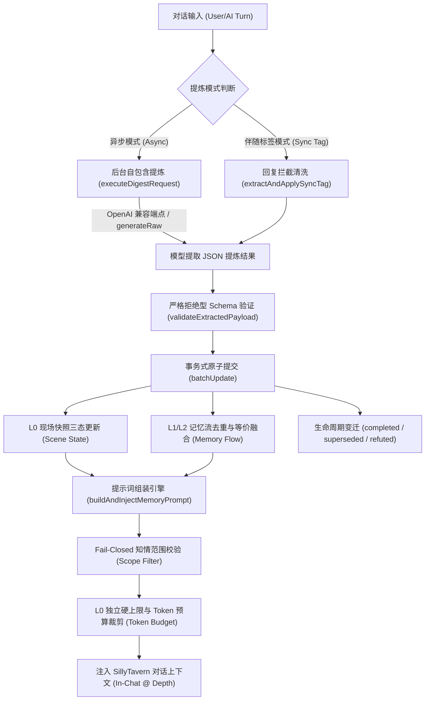

# SillyTavern 持续记忆插件 (ST-Persistent-Memory)

[](https://github.com/dayuseless/ST-Persistent-Memory)
[](https://github.com/SillyTavern/SillyTavern)
[](LICENSE)

> **定位**：SillyTavern Persistent Memory 是一套专为长文本角色扮演 (RP) 设计的持续性情境与记忆扩展系统。通过维护**现场即时快照 (L0 Scene State)**、**事实分级认知流 (L1/L2 Active Memories)** 与**多角色在场权限状态机**，确保 AI 在有限上下文窗口内始终牢记当下发生了什么、角色真正知晓什么，显著增强长程对话的情境连贯性，有效抑制跨轮失忆与身份逻辑穿帮。

---

## 🌟 核心特性与亮点

### 1. 现场快照 (L0 Scene State)
- **拒绝大而全的空洞摘要**：区别于传统“剧情总结”，L0 聚焦当前物理现场：**角色在哪里、处于何时/何种天气、在做什么、心理张力如何、现场遗留什么未决悬念、谁在场**。
- **独立硬预算上限保护**：L0 享受专属启发式 Token 硬上限（默认 ~150 tok），即使剧情再复杂也绝不撑爆上下文。
- **精准清空语义**：散伙离场或动作结束时自动清空，绝不留存旧动作幽灵。

### 2. 事实分级与防脑补纪律 (Fact Hierarchy)
- **事实与推测严格解耦**：
  - `fact`（客观物理事实）：已发生的可验证经历。
  - `statement`（言行约定）：角色亲口说过的话，不推定未来必然兑现。
  - `inference`（主观推断）：对心境、动机、怀疑的当下判断，随情节演化流转。
  - `todo`（即时待办）：未竟之约或即时行动目标。
- **防幻觉纪律**：空白代表角色确实未知，严禁模型为了情节顺畅而脑补未经证实的过去或动机。

### 3. 知情范围隔离与接收者权限路由 (Presence & Recipient Routing)
- **多角色权限分流**：
  - 🌐 `world`（公共世界常识）：全员通用。
  - 👥 `shared`（现场经历共知）：基于当前生成主体 (POV) 严格验证其是否在 `known_by` 知情列表中；若现场存在其他不知情者，自动附加保密约束标记。
  - 👤 `character`（角色私密经历）：基于生成目标主体严格路由，仅允许该角色本人生成时注入，离场或无关角色生成时自动静默休眠，不占额外 Token，严格防止群聊无关角色获悉私密记忆。
- **Fail-Closed 闭环保护**：生成主体无法确定时保守拒绝注入私密/共享记忆；缺失归属或知情者的非法条目直接拒绝入库。

### 4. 双模式提炼架构 (Dual Extraction Modes)
- ⚡ **异步后台独立提炼 (Async Mode)**：
  - 支持**通用 OpenAI 兼容接口**（包含 OpenAI 官方、DeepSeek、Claude 代理中转、通义千问、硅基流动、本地 Ollama / LM Studio / vLLM 等）。
  - 独立专属端点发起单轮自包含提取请求，**彻底隔绝主会话上下文与思维链丢失问题 (彻底解决 DeepSeek `400 Bad Request: reasoning_content must be passed` 报错)**。
  - 具备 **45 秒 AbortController 超时保护**，避免网络挂死锁定提炼通道。
  - **一键同步酒馆主 API**：点击按钮即可自动提取酒馆主界面配置的 Endpoint URL、Key 与模型名称，免去重复配置烦恼。
- 🏷️ **伴随标签模式 (Sync Tag Mode)**：
  - 在主回复末尾附加隐藏状态标签 `<!--PERSISTENT_MEMORY: ... -->`，由前端无感截获入库并从消息正文中剥离。
  - **零额外 API 调用与请求消耗**，适合 API 额度紧张或不支持多并发连接的环境；异常标签自动保留并提供 HUD 错误排查面板。

### 5. 三重 UI 入口与清爽现代交互
- 📱 **屏幕快捷悬浮球**：右下角极简白底脑形气泡，支持触控拖拽、双端独立坐标记忆。
- 🧩 **顶部扩展快捷菜单**：深度融入酒馆顶部工具栏扩展下拉菜单（拼图/魔棒），随时一键唤起。
- ⚙️ **原生扩展设置抽屉 & 侧边 HUD 控制台**：
  - 记忆流管理：支持常驻置顶 (Pinned)、动态触发 (Triggered)、归档 (Archived) 一键切换。
  - 四维类型轮转：事实、约定、推断、待办一键点击更迭。
  - 即时现场快照修改器：随手手填或纠偏现场地点与角色。
  - 状态与生命周期显式流转：已履约 (`completed`)、已迭代 (`superseded`)、已证伪 (`refuted`) 实时徽标展示。

---

## 📥 安装方法

### 方式一：在 SillyTavern 扩展中心一键安装（推荐）

1. 打开 SillyTavern，点击顶部工具栏的 **扩展管理** 图标（拼图/积木块）。
2. 打开 **“安装扩展 (Install Extension)”** 选项卡。
3. 在 Git 仓库 URL 输入框中粘贴以下地址并点击安装：
   ```text
   https://github.com/dayuseless/ST-Persistent-Memory
   ```
4. 页面提示安装成功后，按 **`Ctrl + F5`** 刷新网页即可。

### 方式二：手动离线包安装

1. 从 [Releases 页面](https://github.com/dayuseless/ST-Persistent-Memory/releases) 下载 `ST-Persistent-Memory-v0.1.12.zip`。
2. 解压到 SillyTavern 的扩展目录中：
   ```text
   SillyTavern/public/scripts/extensions/third-party/ST-Persistent-Memory/
   ```
   *(多用户版本可放置于 `SillyTavern/data/default-user/extensions/ST-Persistent-Memory/`)*
3. 重启 SillyTavern 服务端并刷新浏览器即可。

---

## 🚀 快速上手指南

### 步骤 1：开启插件与入口

刷新酒馆后，你会在屏幕右下角看到一个白色的脑形悬浮球。你也可以点击顶部扩展菜单（拼图图标）找到 **“持续记忆”**。
点击即可滑出 HUD 侧边控制台。

### 步骤 2：配置提炼 API（极简推荐：一键同步）

1. 在控制台中切换到 **“设置与 API”** 选项卡（或在右侧酒馆扩展面板的折叠抽屉中）。
2. 勾选 **“启用独立提炼 API (自定义兼容 OpenAI)”**。
3. 点击 **`同步酒馆主 API`** 按钮：
   - 插件会自动读取你已经在酒馆主设置里填好的 Base URL、API Key 与 Model ID。
4. 点击 **`测试 API 连通性`**，看到绿色连通提示即表示配置成功！
5. 点击底部 **`保存并生效全部配置`**。

> 💡 **进阶提示**：你也可以将提炼端点指向成本更低的轻量模型（例如提炼用 `gpt-4o-mini` 或 `deepseek-chat`，而主聊用大模型），实现降本增效。

### 步骤 3：正常聊天，记忆自动运转

- 随着对话推进，插件会按照设定的频率（默认每 3 轮）在后台静默发起提炼，自动沉淀事实并维护现场快照。
- 你可以随时点击控制台顶部的 **“闪电 (⚡)”** 按钮手动触发一次即时提炼。
- 在“记忆流”列表中，你可以随时点击状态徽标将某条记忆设为“常驻置顶”或“归档”，也可以手动删除不准确的条目。

---

## 🏗️ 架构与数据流



---

## 🛠️ 控制台调试指令

在浏览器开发者工具控制台 (F12 Console) 中，提供了全局调试钩子：

```javascript
// 查看当前会话的快照与记忆全量数据
window.__persistentMemory.getState();

// 立即组装并测试提示词注入块
window.__persistentMemory.injectNow();

// 立即强制执行一次后台提炼
window.__persistentMemory.digestNow();
```

---

## 📝 版本历史

### v0.1.13 (归并时序安全、跨会话竞态拦截与生命周期边界自洽)

- **归并执行时序反转安全 (Consolidation Sequencing Fix)**：修复归并入库与旧条目废弃的时序隐患。先将 `supersedes` 关联的旧条目置为 `superseded`，再执行新概括条目入库，彻底杜绝由于文本高相似度（$\ge 0.70$）误触发同库合并导致新记忆被误吞并随同旧条目连带归档失踪的逻辑缺陷。
- **长程归并跨会话隔离拦截 (Cross-Session Async Guard)**：在异步归并请求完成返回后，严格比对 `finishChatId === startChatId`，若检测到用户在模型生成等待期间切换了聊天会话，立即安全丢弃该归并提交，防止归并结果污染新会话或破坏旧会话生命周期。
- **检索休眠记忆隔离防护 (Hibernated Memory Isolation)**：修正归并候选集收集规则，严格限定候选记忆为 `status === triggered`，防止用户主动设置为 `archived`（检索休眠）但事实仍然有效的核心条目被误纳入归并并被意外废弃。
- **终态回收与休眠检索严格解耦 (Terminal Lifecycle Purge Fix)**：`purgeArchivedMemories` 垃圾回收严格依据生命周期终态（`completed` / `superseded` / `refuted`）执行过滤，保护所有 `lifecycle === 'active'` 的条目（即使其处于 `status === 'archived'` 检索休眠状态），确保事实真实性与检索激活状态的严格正交解耦。
- **外部数据导入知情范围归一化 (Import Scope Normalization)**：导入 `character` 私密记忆时强制规整知情者名单为当前单一角色，杜绝从外部备份恢复时出现权限范围模糊或知情者脏数据。
- **测试矩阵扩展至 27 项 (T1-T27 全绿)**：新增归并时序反转与相似隔离 (T26) 及异步切换会话安全拦截 (T27) 的完整自动化测试断言。

### v0.1.12 (记忆周期演进：长程宏观归并、归档抽屉与终态垃圾回收)

- **长程记忆高阶归并 (Memory Consolidation Engine)**：支持将多条阶段性、细节性历史事件一键/自动浓缩为一条宏观概括事实，被涵盖的旧记忆自动流转为 `superseded`（已被迭代）退出日常上下文注入，极大降低长文本 Token 占用。
- **严格归并权限边界安全 (Consolidation ACL Invariants)**：强制基于知情范围与角色分组归并，严禁将私密记忆与公共常识混同，新归并事实强制继承源条目的权限边界，杜绝越权提权。
- **记忆视图三态过滤 (All / Active / Archived)**：记忆列表支持按“活跃”、“归档/终态”、“全部”一键切换查看，不再被长历史拉垮界面。
- **终态记忆垃圾回收 (Purge Terminal Memories)**：在归档视图提供一键彻底清理已履约 (`completed`)、已迭代 (`superseded`)、已证伪 (`refuted`) 终态历史的功能。
- **测试矩阵扩展至 25 项 (T1-T25 全绿)**：新增归并候选分组隔离 (T23)、跨组提权拦截与 Schema 校验 (T24)、终态垃圾回收 (T25) 的自动化测试覆盖。

### v0.1.11 (用户体验升级：卡片行内即时编辑与数据备份迁移)

- **卡片原位即时编辑 (Inline Text & Keywords Editing)**：记忆卡片顶部新增编辑按钮（铅笔图标 ✏️），支持就地快速修改记忆正文与触发词，具备 150 字符安全限制与即时保存/取消能力，改错字更无需删库重加。
- **记忆数据备份与跨会话迁移 (JSON Export & Import)**：在设置面板新增一键导出当前会话的现场快照与全部记忆库为标准 JSON 文件，并支持选择外部备份文件进行智能合并导入（自动跳过重复内容、重塑冲突 ID、校验清洗字段）。
- **测试矩阵扩展至 22 项 (T1-T22 全绿)**：新增针对行内编辑规范化校验 (T21) 与数据导出/去重合并 (T22) 的自动化测试覆盖。

### v0.1.10 (ACL权限边界校验、XSS免疫、容错迁移与20项验证矩阵)

- **P0-1 提炼知情者白名单核验 (ACL Boundary)**：模型提炼产出的 `known_by` 与私密归属 `character` 必须严格属于权威会话参与者名单（包含玩家、当前角色、全部群聊成员及现场角色）；严禁模型受注入影响擅自捏造局外已知者，杜绝越权信息渗透。
- **P0-2 存储型属性注入与 XSS 防御**：在 UI 卡片渲染与状态载入层双重严格落实 `type` 枚举白名单过滤，彻底消除利用畸形属性突破 `class="... pm-type-${curType}"` 引发的浏览器端脚本执行风险。
- **P1-1 历史数据迁移知情权保守化**：针对早期未设定知情范围的旧条目，遵循严格封闭原则归属为当前角色私密（`CHARACTER`），严禁自动升级扩大为两方共享秘密，杜绝历史记忆知情范围失控膨胀。
- **P1-2 损坏记忆数据自愈与容错**：在元数据载入迁移环节引入防御性类型与结构过滤，剔除 `null`、非对象及空白条目，免疫异常元数据导致的迁移中断或插件崩溃。
- **测试矩阵扩展至 20 项 (T1-T20 全绿)**：新增针对非参与者知情白名单核验 (T17)、恶意类型属性注入净化 (T18)、旧数据保守化范围约束 (T19) 与损坏元数据自愈容错 (T20) 的自动化断言。

### v0.1.9 (事务提交、知情权限与预算边界修复)

- **原子提交修复**：批量更新在成功路径直接执行内部持久化，保证聊天元数据与 `state_revision` 恰好提交一次；异常路径仍完整回滚。
- **ACL 收敛**：`known_by` 与 `scope` 均作为权限对象处理。相似记忆不得扩大共享知情者集合，也不得把角色私知转移给另一角色。
- **提炼数据最小化**：提炼请求优先按显式现场角色过滤私密和共享记忆；仅在现场未知时才按近期对话回退。
- **异步可靠性**：修复异常路径的状态引用；原生 `generateRaw` 与 `generateQuietPrompt` 也具备超时后的结果丢弃与锁释放保护。
- **注入边界**：`scene.time` 可独立输出，空角色数组表示有效空场景；总 Token 预算不足时自动改用紧凑同步协议，不再挤占可选记忆预算。
- **可观测性与测试**：同步标签错误可跨重载保留并有 4,000 字符上限；测试矩阵扩展至 16 项，覆盖事务成功提交、ACL 扩张、生产过滤器、低预算和超时。

### v0.1.8 (架构边界与安全加固)
- **P1-01 角色级接收者权限隔离 (POV-based Routing)**：重构知情范围过滤机制，基于当前实际生成对象 (POV) 进行记忆权限路由。私密记忆仅允许路由给该角色生成的提示词；共享记忆严格要求当前生成角色必须在 `known_by` 知情列表中；现场存在不知情角色时自动附加保密约束标记；生成主体无法确定时执行 Fail-Closed 仅注入公共常识。
- **P1-02 真正原子回滚事务**：重构 `batchUpdate`，在执行前创建内存状态完整深拷贝快照，执行过程中发生任何未捕获异常均完整回滚内存状态，杜绝局部脏数据落盘。
- **P1-03 提权注入防线 (Scope Escalation Guard)**：禁止模型通过输出 `world` 擅自扩大私有或共享条目的知情范围；相似已有条目禁止单方面提升权限；限制单条记忆最大长度 (150 字)。
- **P1-04 API Key 脱敏存储**：剥离 `localStorage` 备份中的明文 API Key，回写安全过滤，确保密钥仅在安全环境中受控持有。
- **P2-01 L0 时间维度补齐**：将 `scene.time`（时段/天气）纳入快照判定，修复仅有时间信息时快照被判定为空的缺陷。
- **P2-02 真实 Token 预算全开销扣除**：扩展 CJK 字符估算支持韩文音节与字母 (Hangul)；将伴随协议 (Sync Protocol) 与模板固定开销全量纳入总 Token 预算先期扣减。
- **P2-03 提炼请求超时保护**：异步提炼与连通性测试引入 `AbortController` 45 秒 / 15 秒硬超时保护，网络挂起时自动释放并发任务锁。
- **P2-04 会话切片输入预算上限**：提炼历史消息引入单条 1000 字符安全压缩与 3500 字符总上限，逆序保留最新完整轮次，杜绝机械腰斩与超额 API 费用。
- **P2-05 伴生标签异常留存**：伴生标签解析或验证失败不再静默丢弃，错误原因与原始片段存入状态并在 HUD 控制台呈现。
- **P2-06 旧版本记忆平滑迁移**：无知情范围旧单聊记忆自动对齐为参与者共享并输出统计报告，杜绝历史记忆静默休眠。

### v0.1.7
- **手动录入类型支持**：在 HUD 控制台手动新增条目面板中，新增记忆类型选择器（📌 客观事实 `fact` / 💬 言行约定 `statement` / 🧠 主观推断 `inference` / 📝 即时待办 `todo`），彻底打破原先手动添加只能默认为 `fact` 的限制。
- **卡片类型一键轮转**：记忆卡片顶部类型徽章支持直接点击切换（`fact` ➔ `statement` ➔ `inference` ➔ `todo`），随心订正条目分类。
- **色彩语义强化**：各类记忆拥有专属高对比度配色徽标（事实灰蓝、约定科技蓝、推断高贵紫、待办琥珀金），辨识度倍增。

### v0.1.6
- **核心修复**：排除了注入引擎内部重复声明的致命编译错误；启动生命周期重构为 UI 优先加载，彻底根治插件抽屉与悬浮窗偶发消失的问题。
- **全模型通用兼容**：独立提炼端点升级为通用 OpenAI 兼容格式，全面接入官方 OpenAI、DeepSeek、Claude 代理中转、通义千问、硅基流动、本地 Ollama / LM Studio / vLLM。
- **一键同步**：新增一键从酒馆原生连接设置中自动同步端点 URL、API Key 与模型的便捷功能。
- **三重 UI 入口**：新增顶部工具栏扩展下拉菜单（`#extensionsMenu`）一键直达入口。
- **深色/浅色自适应优化**：UI 界面采用高对比度现代工业风设计，数字读数更清晰。

### v0.1.5
- 引入事务式原子提交机制 (`batchUpdate`)，消除写入竞态。
- 增强防提示词注入隔离区与文学文本不可信边界。
- 修复知情者等价合并与私有角色记忆 Fail-Closed 拦截。

---

## 📄 开源许可证

本项目基于 [MIT License](LICENSE) 开源。欢迎提交 Issue 与 Pull Request！
