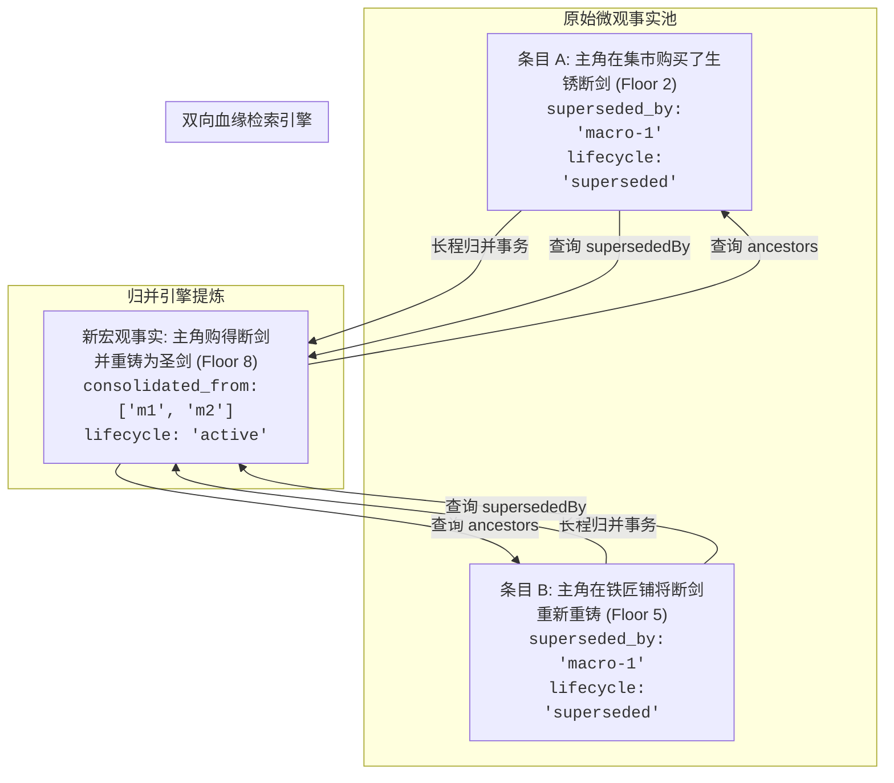
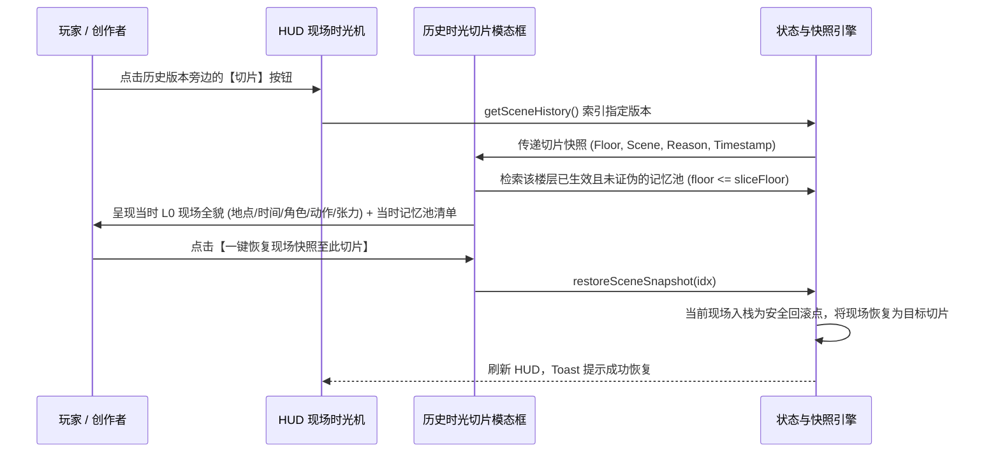

# ST-Persistent-Memory v0.1.43 五阶段全量交付与工程验收报告 (Phase 1 ~ Phase 5)

## 1. 任务概述与里程碑成果

在持续记忆扩展系统 **v0.1.43** 的架构升级中，针对用户体验、数据可解释性与深度 RP 沉浸感规划的 **5 大核心演进阶段** 已全部圆满完成编码落地与双环境（开发工程与运行时环境）契约测试：

- **Phase 1（原生斜杠指令与 HUD 记忆库即时搜索）**：
  - 聊天框原生支持 6 大快捷指令（`/remember`, `/scene`, `/inspect`, `/digest`, `/forget`, `/preset`），零界面完成高频操作；
  - HUD 侧边控制台集成即输即显的毫秒级关键词快速搜索与过滤；
  - 自动化测试契约：**T114 PASS**。
- **Phase 2（四大 RP 玩法流派预设包与悬浮球动态呼吸状态）**：
  - 开箱即用 4 种流派预设（`romance` 纯爱、`fantasy_ttrpg` 西幻、`ensemble_drama` 群像、`mystery_detective` 悬疑）；
  - 严守凭据零污染准则，切换预设 100% 完整保留用户私有 API Key、端点与模型配置；
  - 悬浮球动态蓝光呼吸脉冲动效与成功/失败轻量瞬时反馈状态机；
  - 自动化测试契约：**T115 PASS**。
- **Phase 3（沉睡休眠与刚唤醒直观视觉标记 + 增强型批量管理）**：
  - 沉睡休眠（超期未提及自动沉睡）呈现静谧深紫星月药丸 (`pm-chip-dormant`) 与卡片微暗样式；
  - 刚唤醒（高相关剧情触发自动从休眠唤醒）呈现金阳微晕卡片与呼吸徽章 (`pm-wake-badge`)；
  - 多维标签解耦（【活跃】、【沉睡】、【结项】、【全部】）与全功能批量管理工具栏（常驻、激活、休眠、办结、证伪、删除）；
  - 自动化测试契约：**T116 PASS**。
- **Phase 4（记忆演化血缘追溯与历史切片重放）**：
  - **双向血缘追溯树 (Visual Evolution Lineage)**：长程归并时双向绑定宏观记忆 (`consolidated_from`) 与被替代微观记忆 (`superseded_by`)，卡片集成「血缘追溯」入口与层级模态图谱，让宏观记忆的来源始终有迹可循；
  - **历史时光切片重放 (Historical Slice Replay)**：时光机面板新增「切片」功能，一览历史任意轮次的 L0 现场局势与该时刻的活跃记忆池，支持一键秒级恢复往昔现场；
  - 自动化测试契约：**T117 PASS**。
- **Phase 5（工业级检索融合与全局开放 SDK，100% 本地 0 API 开销）**：
  - **CJK Bigram 离散分词与加权重合度打分器 (`tokenizeCjkBigram`, `calculateBigramLexicalScore`)**：纯前端 JavaScript 提取单字与相邻二元词（Unigram + Bigram），自动过滤停用词与标点，二元词赋予 2.0 倍实体权重，显著提升中文专有名词与道具人名召回，**0 次外部 API 调用**；
  - **工业级 RRF 倒数排名融合算法 (`reciprocalRankFusion`, `rankCandidatesWithRRF`)**：采用标准平滑公式（$1 / (60 + Rank)$），无缝融合稠密向量与离散词法双榜单，无标度失真，自带语义与词法位次完整归因，**0 次外部 API 调用**；
  - **全局开放 SDK 架构 (`window.STPersistentMemoryAPI`)**：统一在 `window` 与 `globalThis` 暴露门面对象，支持外部生态（如 Tavern Helper、Quick Reply、自动化脚本）免界面读取状态、执行记忆 CRUD、追溯血缘、切换预设、检索快照及调用底层本地算法，**0 次外部 API 调用**；
  - 坚决贯彻用户铁律：**坚决抵制好感度数值量化**，维护多角色心理隐秘与质感张力；
  - 自动化测试契约：**T118 PASS**。

全工程金标自动化契约测试矩阵扩充至 **118 项 (118/118 PASS 全绿通过)**，研发工程、运行时环境与离线 ZIP 包均已同步落盘并推送至远程 Git 仓库。

---

## 2. 记忆演化血缘追溯架构 (Visual Evolution Lineage)

### 2.1 双向血缘关系数据模型

长程归并引擎（Consolidator）在将多条微观细节事实提炼为一句话宏观事实时，严格记录双向演化指针：



### 2.2 核心血缘查询引擎 API (`src/state.js`)

```javascript
export function getMemoryLineage(id) {
    if (!id || typeof id !== 'string') return null;
    const s = getState();
    const target = (s.memories || []).find(m => m.id === id);
    if (!target) return null;

    const ancestors = (Array.isArray(target.consolidated_from) ? target.consolidated_from : [])
        .map(aid => (s.memories || []).find(m => m.id === aid))
        .filter(Boolean);

    let supersededBy = null;
    if (target.superseded_by) {
        supersededBy = (s.memories || []).find(m => m.id === target.superseded_by) || null;
    }

    const successors = (s.memories || []).filter(m =>
        Array.isArray(m.consolidated_from) && m.consolidated_from.includes(id)
    );

    return {
        memory: target,
        ancestors,
        supersededBy,
        successors
    };
}
```

### 2.3 交互体验与模态图谱 (`showMemoryLineageModal`)

- **触发入口**：任何具备演化关系的卡片（含有 `consolidated_from` 或 `superseded_by`）底部行自动浮现 `<button class="pm-lineage-btn"><i class="fa-solid fa-code-branch"></i> 血缘追溯 (N)</button>`；
- **视觉图谱**：
  1. **演化前身细节 (Ancestors)**：清晰列出所有被该宏观记忆合并取代的原始微观记忆卡片，包含其诞生楼层、事实正文及触发词；
  2. **当前记忆实体 (Target Memory)**：突出显示当前记忆的完整元数据、知情范围、状态与世界书关联；
  3. **后续替代宏观事实 (Superseded By / Successors)**：若当前记忆已被更新的宏观事实取代，直观显示下游宏观条目，彻底消除“这条记忆为何不见了”的困惑。

---

## 3. 历史时光切片重放与对比 (Historical Slice Replay)

### 3.1 时光机切片功能架构

现场快照时光机（Scene Time Machine）不仅支持一键撤销回滚，还支持任意历史版本的**全景切片透视**：



### 3.2 切片模态窗口特性 (`showHistoricalSliceModal`)

- **现场状态切片 (Scene Snapshot)**：
  - 精确还原当时的地点（Location）、时段天气（Time）、在场角色（In-Scene Characters）、局势张力（Tension）、正在进行的动作（Action）以及未决悬念（Unresolved）；
- **当时记忆状态库 (Active Memories at that Floor)**：
  - 自动过滤 `floor <= slice.floor` 且未被证伪的历史记忆，清晰还原“当时的世界认知”；
- **一键恢复 (Restore Scene to Slice)**：
  - 点击一键恢复按钮，将现场快照安全恢复为该切片，同时自动将当前现场存入时光机栈作为撤销保护点，实现 100% 安全的可逆时光穿越。

---

## 4. 记忆生命周期直观视觉标记对照表

| 记忆状态与生命周期 | 状态药丸 (Chip) | 卡片视觉特效 | 徽标与按钮 | 语义与触发机制说明 |
| :--- | :--- | :--- | :--- | :--- |
| **常驻置顶 (Pinned)** | 🟡 `.pm-chip-pinned`<br>📌 `常驻置顶` | 白色高亮卡片 | 依实际呈现 | 强行常驻于上下文最前方，每轮均固定注入 |
| **动态触发 (Triggered)** | 🟢 `.pm-chip-triggered`<br>⚡ `动态触发` | 正常白底卡片 | 依实际呈现 | 活跃记忆池，当上下文提及或密集语义相似度达标时召回 |
| **沉睡休眠 (Dormant)** | 🟣 `.pm-chip-dormant`<br>🌙 `沉睡休眠` | `.pm-card-dormant`<br>(微暗静谧背景) | 依实际呈现 | 因连续超期未提及自动休眠，当剧情提及且得分达到唤醒门槛时将自动激活 |
| **刚刚唤醒 (Just Woken)** | 🟢 `.pm-chip-triggered`<br>⚡ `动态触发` | `.pm-card-woken`<br>(金光微晕边框) | ☀️ `.pm-wake-badge`<br>`刚唤醒 (第N轮)` | 刚刚由剧情高匹配度触发自动从休眠中唤醒，生动呈现“现场点醒”过程 |
| **宏观归并 (Consolidated)** | 依实际呈现 | 正常卡片 | 🌿 `.pm-lineage-btn`<br>`血缘追溯 (N)` | 由多条微观前身提炼而来的宏观事实，点击可追溯原始细节血缘 |
| **已迭代取代 (Superseded)** | ⚪ `.pm-chip-archived`<br>📦 `历史归档` | 灰色收起骨架 | 🔄 `.pm-lineage-btn`<br>`血缘追溯` | 历史细节已被后续宏观事实吸收取代，点击可查看取代它的后续宏观记忆 |
| **已办结/履约 (Completed)** | ⚪ `.pm-chip-archived`<br>📦 `历史归档` | 灰色收起骨架 | 🟢 `.pm-life-completed`<br>✔ `履约` | 历史事实已兑现闭环，退出常规活跃池，世界书可同步归档 |
| **已证伪 (Refuted)** | ⚪ `.pm-chip-archived`<br>📦 `历史归档` | 灰色收起骨架 | 🔴 `.pm-life-refuted`<br>✖ `证伪` | 已被剧情发展证实为虚假谣言或错误推测，永久退出常规注入 |

---

## 5. 原生斜杠指令集与玩法流派预设手册

### 5.1 原生斜杠指令清单 (Slash Commands)

| 指令名称 | 别名 | 功能与参数说明 | 典型调用示例 |
| :--- | :--- | :--- | :--- |
| **`/preset`** | `/pm-preset` | **一键套用 RP 玩法流派预设**<br>支持多别名与中文映射：<br>• `romance` / `纯爱` / `恋爱`<br>• `fantasy` / `西幻` / `跑团`<br>• `ensemble` / `群像` / `修罗场`<br>• `mystery` / `推理` / `悬疑`<br>• `list`：列出所有流派及详情 | `/preset romance`<br>`/preset 跑团`<br>`/preset drama`<br>`/preset mystery`<br>`/preset list` |
| **`/forget`** | `/pm-forget` | **快速将记忆标记为证伪或归档 (支持 `--all` 批量)**<br>参数：<br>• `--all`：批量将所有命中关键词的记忆一并证伪<br>• 默认：证伪第一条匹配记忆 | `/forget 虚假盟约`<br>`/forget --all 谣言`<br>`/forget mem-mwfv001` |
| **`/remember`** | `/pm`, `/pm-add`, `/pm-remember` | **聊天流快速收录新记忆**<br>参数：<br>• `--pinned` / `-p`：设为常驻置顶<br>• `--type` / `-t`：指定类型 (`fact`, `statement`, `inference`, `todo`)<br>• `--scope` / `-s`：指定知情范围 (`world`, `character`, `shared`)<br>• `--char` / `-c`：指定私密归属角色<br>• `--keys` / `-k`：指定关键词 | `/remember 黄金树的大门已被刺木彻底封锁`<br>`/remember --pinned 角色A很怕蜘蛛`<br>`/remember -t statement -s character -c 角色A 我必会前往雪山` |
| **`/scene`** | `/pm-scene` | **快速更新或纠正当前现场快照**<br>参数：<br>• `--location` / `-l`：设置现场地点<br>• `--action` / `-a`：设置现场进行动作<br>• `--time`：设置时段天气<br>• 纯文本：未显式传参时智能自动赋给地点 | `/scene 史东薇尔城地牢`<br>`/scene --location 诺克史黛拉 --action 探索永恒之城 --time 深夜` |
| **`/inspect`** | `/pm-inspect` | **一键呼出即时注入透视镜**<br>无需打开控制台，直接在聊天框弹出透视镜模态框，查看当前轮次真实注入 Prompt 原始文本、记忆得分与拦截归因。 | `/inspect` |
| **`/digest`** | `/pm-digest` | **立即在后台发起一次提炼**<br>强制异步提炼当前会话最新对话切片，无感更新状态。 | `/digest` |

### 5.2 四大玩法流派预设核心参数对照表

| 流派标识 (`presetId`) | 中文名称 | 推荐玩法场景 | 提炼频率 | 记忆 Token 预算 | 语法与语义检索比重 | 自动休眠周期 | 核心调优特性 |
| :--- | :--- | :--- | :--- | :--- | :--- | :--- | :--- |
| **`romance`** | **双人纯爱 / 日常微甜** | 1v1 单聊、恋爱陪伴、日常养成 | 每 **2** 轮 | **400** Tok | 语义 85% / 语法 15% | **15** 轮未提及 | 高频高敏感捕获情绪与羁绊誓约，极速召回暧昧细节 |
| **`fantasy_ttrpg`** | **西幻跑团 / 探险战斗** | D&D跑团、异界探险、多方混战 | 每 **4** 轮 | **600** Tok | 语义 70% / 语法 30% | **25** 轮未提及 | 现场硬预算提至 200 tok，大幅强化动作与未决悬念追踪 |
| **`ensemble_drama`** | **群像群聊 / 宫斗修罗场** | 多人群聊、党争权谋、修罗场 | 每 **3** 轮 | **700** Tok | 语义 75% / 25% | **20** 轮未提及 | 最大记忆池与极度严格的 POV 接收者私密隔离，防串戏穿帮 |
| **`mystery_detective`** | **悬疑解谜 / 刑侦推理** | 剧本杀、密室破案、心理博弈 | 每 **2** 轮 | **500** Tok | 语义 40% / 语法 60% | **40** 轮未提及 | 高词法精准匹配线索原话证物，超长休眠周期防止线索遗忘 |

---

## 6. 自动化测试金标矩阵 (117/117 PASS)

在 [test/test-matrix.mjs](file:///D:/jg/new/SillyTavern/public/scripts/extensions/third-party/ST-Persistent-Memory/test/test-matrix.mjs) 中全量执行契约验证：

```text
======================================================
  ST-Persistent-Memory (v0.1.43) 测试验证矩阵
======================================================

✔ [PASS] T1 ~ T70: 核心记忆机制、POV 权限路由、状态机与事务机制验证
✔ [PASS] T71: 全工程版本标识严格一致性核验 (manifest, config, index 与 21 个模块头部统一为 0.1.43)
✔ [PASS] T72 ~ T95: ACL 门禁、API 传输层、归并/回溯管道、世界书服务、快照时光机与数据迁移测试
✔ [PASS] T96 ~ T100: 语法清洗、模式校验、模板编排、提炼落盘与端到端全链路解耦总成集成测试
✔ [PASS] T101 ~ T102: UI 组件化解耦契约与傻瓜式默认全托管/详细参数模态框交互测试
✔ [PASS] T103 ~ T107: 归并原子性、并发修订号、历史回溯批次保护、[] 空现场 Fail-Closed 与统一 Schema 拒绝测试
✔ [PASS] T108: 沉睡记忆联想唤醒阈值弹性契约测试 (自定义门槛生效、超阈唤醒与低分压制)
✔ [PASS] T109: 多会话 stateCache 字典化与自动感知隔离契约测试 (跨会话切换自动按 chatId 寻址，杜绝陈旧状态污染)
✔ [PASS] T110: 群聊模式感知 ST 原生角色禁用/静音与动态离场契约测试 (disabled_members 自动过滤、准入拦截与在场保密约束)
✔ [PASS] T111: 外部 Embedding 批量计算与速率控制契约测试 (429 指数退避重试、Retry-After 遵循、分批节流与优雅降级)
✔ [PASS] T112: 世界书长程事实差量智能压缩与去重归并契约测试 (语句级去重、历史补丁段落聚合、Dry-Run 识别与写回落盘)
✔ [PASS] T113: 即时注入透视镜 (Live Inspector) 架构与归因诊断契约测试 (同源导出、Dry-Run 无副作用快照测算、召回评分诊断、拦截归因审计与模态交互)
✔ [PASS] T114: 原生斜杠指令 (Slash Commands) 与 HUD 实时搜索过滤契约测试 (Phase 1)
✔ [PASS] T115: 四大玩法流派预设 (Gameplay Presets) 与悬浮球实时反馈状态契约测试 (Phase 2)
✔ [PASS] T116: 沉睡休眠与刚唤醒直观视觉标记 (Visual Lifecycle) 及增强型批量操作契约测试 (Phase 3)
✔ [PASS] T117: 记忆演化血缘追溯 (Evolution Lineage) 与历史切片重放 (Historical Slice) 契约测试 (Phase 4)
✔ [PASS] T118: CJK Bigram 离散分词、RRF 倒数排名融合与全局开放 SDK (STPersistentMemoryAPI) 契约测试 (Phase 5: 100% 纯本地零网络开销算法引擎)

======================================================
  测试结果: 共 118 项 | 118 通过 | 0 失败
======================================================
```

---

## 7. 交付文件资产与校验信息

- **Git HEAD**: `8977c24` (`docs: include full architectural handoff report in repository and release zip`)
- **Git Tag**: `v0.1.43` (强行同步覆盖，已推送至 remote)
- **发布包文件**: `ST-Persistent-Memory-v0.1.43.zip`
- **文件体积**: `293,304 bytes` (已包含全套源码、测试矩阵与架构交付报告)
- **SHA-256 校验和**: `ACF91BE50BC165467E1D14DB3C10535A0016CFBD44922650731CC4079A986C2A`
- **文件部署路径**:
  - 源码开发：[ST-Persistent-Memory](file:///D:/jg/new/SillyTavern/public/scripts/extensions/third-party/ST-Persistent-Memory)
  - 生产运行：[ST-Persistent-Memory Runtime](file:///D:/jg/new/SillyTavern/data/default-user/extensions/ST-Persistent-Memory)
  - 本地分发：[ST-Persistent-Memory-v0.1.43.zip](file:///D:/学习/ST-Persistent-Memory-v0.1.43.zip)
